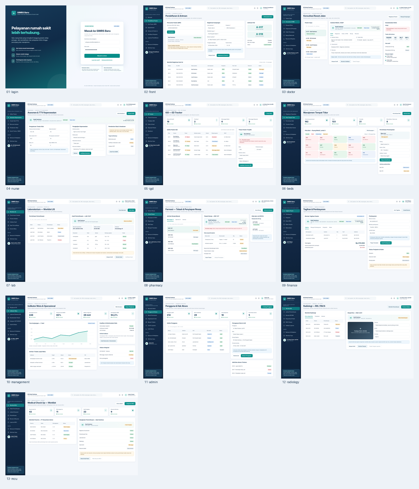

# Referensi UI/UX SIMRS Baru — Mockup November 2026

Kumpulan gambar mockup sebagai **acuan pengembangan** SIMRS Baru. Inspirasi visual berasal dari SIMRS global, SIMRS lokal, dan Dribbble. **Acuan kebutuhan produk tetap** `PRD_SIMRS_Baru_Final_User_Stories_Acceptance_Technical_7PIC_2026-11-06`; bukan revisi PRD.

> **Gambar referensi saja.** Seluruh identitas pasien, angka, transaksi, dan catatan bersifat fiktif. Gambar eksplorasi yang dihasilkan AI dapat memuat istilah/angka yang tidak konsisten. Jangan menerjemahkannya sebagai klaim fitur yang sudah ada atau sebagai spesifikasi teknis final.

## 13 layar operasional per peran

| No | Gambar | Halaman | Target pengguna | Modul / workflow |
|---|---|---|---|---|
| 01 | [01_login.png](./role-screens/01_login.png) | Login | Semua pengguna | CORE-02 |
| 02 | [02_front.png](./role-screens/02_front.png) | Pendaftaran & antrean | Petugas pendaftaran | CORE-08/09/10/11 · WF-01 |
| 03 | [03_doctor.png](./role-screens/03_doctor.png) | Konsultasi rawat jalan | Dokter RJ | RME-01/04/06/08 · WF-02 |
| 04 | [04_nurse.png](./role-screens/04_nurse.png) | Asuhan keperawatan | Perawat | RME-05/07 |
| 05 | [05_igd.png](./role-screens/05_igd.png) | IGD dan triase | Dokter IGD | RME-02 · WF-03 |
| 06 | [06_beds.png](./role-screens/06_beds.png) | Manajemen tempat tidur | Bed Manager | CORE-05 · OPS-10 · WF-04 |
| 07 | [07_lab.png](./role-screens/07_lab.png) | Laboratorium & LIS | ATLM | MED-01 · WF-05 |
| 08 | [08_pharmacy.png](./role-screens/08_pharmacy.png) | Telaah resep & farmasi | Farmasis | MED-04/05 · OPS-01 · WF-07 |
| 09 | [09_finance.png](./role-screens/09_finance.png) | Tagihan & pembayaran | Kasir/Billing | FIN-01/02/03/04 · WF-08 |
| 10 | [10_management.png](./role-screens/10_management.png) | Indikator mutu & operasional | Direksi/Mutu | ENT-08/09/10/11 |
| 11 | [11_admin.png](./role-screens/11_admin.png) | Pengguna & hak akses | Admin sistem | CORE-01/02/04 |
| 12 | [12_radiology.png](./role-screens/12_radiology.png) | Radiologi RIS/PACS | Radiografer/Radiolog | MED-02/03 · WF-06 |
| 13 | [13_mcu.png](./role-screens/13_mcu.png) | Medical Check Up | Petugas MCU | MED-10 |

Berkas `role-screens/` berisi **13 PNG desktop 1600×1000** dan `contact_sheet.png` untuk evaluasi berdampingan (mockup vs implementasi).

## 12 eksplorasi gaya visual

Folder `visual-explorations/` memuat komposisi awal dashboard, layout klinis, modul, dan tampilan ringkasan. Gambar disimpan dalam **WebP** agar ukuran repository lebih kecil.

1. [01-login-exploration.webp](./visual-explorations/01-login-exploration.webp)
2. [02-front-office-exploration.webp](./visual-explorations/02-front-office-exploration.webp)
3. [03-hospital-workspaces-board.webp](./visual-explorations/03-hospital-workspaces-board.webp)
4. [04-clinical-operational-board.webp](./visual-explorations/04-clinical-operational-board.webp)
5. [05-operational-exploration.webp](./visual-explorations/05-operational-exploration.webp)
6. [06-dashboard-exploration.webp](./visual-explorations/06-dashboard-exploration.webp)
7. [07-end-to-end-panels.webp](./visual-explorations/07-end-to-end-panels.webp)
8. [08-hospital-product-board.webp](./visual-explorations/08-hospital-product-board.webp)
9. [09-executive-dashboard.webp](./visual-explorations/09-executive-dashboard.webp)
10. [10-clinical-modules-overview.webp](./visual-explorations/10-clinical-modules-overview.webp)
11. [11-module-journey-board.webp](./visual-explorations/11-module-journey-board.webp)
12. [12-full-simrs-exploration.webp](./visual-explorations/12-full-simrs-exploration.webp)

## Pedoman implementasi

1. **Login** memakai username/password; role/profesi ditentukan dari akun. Pemilihan akun demo adalah fasilitas pengujian saja.
2. **Navigasi berbasis tugas** sesuai role, bukan daftar 68 modul yang ditampilkan kepada seluruh pengguna. Reviewer/QA boleh melihat katalog teknis terpisah.
3. **Konteks pasien** menjaga relasi Patient → Registration → Encounter → UnitVisit dan consent/otorisasi yang relevan.
4. **Form** dipisahkan menurut aktivitas; gunakan worklist → detail → satu form, bukan semua form pada satu halaman. Sediakan kondisi kosong/loading/error/forbidden, validasi, fokus keyboard, mobile, dan audit.
5. **Keselamatan operasional**: draft ≠ review ≠ sign/verify ≠ release. Tidak mengaktifkan dispensing, mutasi stok, pembayaran, klaim resmi, atau pengiriman FHIR tanpa SOP/UAT dan otorisasi terkait.
6. **Design system**: warna navy/teal, keterbacaan tabel, hierarki pasien/kunjungan; token dan komponen resmi SATUSEHAT tetap harus diverifikasi.
7. Saat gambar bertentangan dengan FR/US/AC, aturan klinis, atau kebutuhan unit, **PRD final yang menjadi rujukan keputusan**.

## Tautan implementasi

- [Mockup SIMRS yang aktif di GitHub Pages](https://bofandra.github.io/simrs/)
- [Galeri 13 halaman HTML](https://bofandra.github.io/simrs/design-gallery.html)
- [Dokumentasi Visual Blueprint V8](../../VISUAL_BLUEPRINT_13_SCREEN_V8_2026-11-09.md)

**Catatan penyimpanan:** Aset hanya disimpan dalam folder `design/references/`; tidak dibundel otomatis oleh workflow GitHub Pages yang mengambil `public/ui-preview/`. Cocok untuk review UI/UX, penyusunan backlog dan quality assurance.
