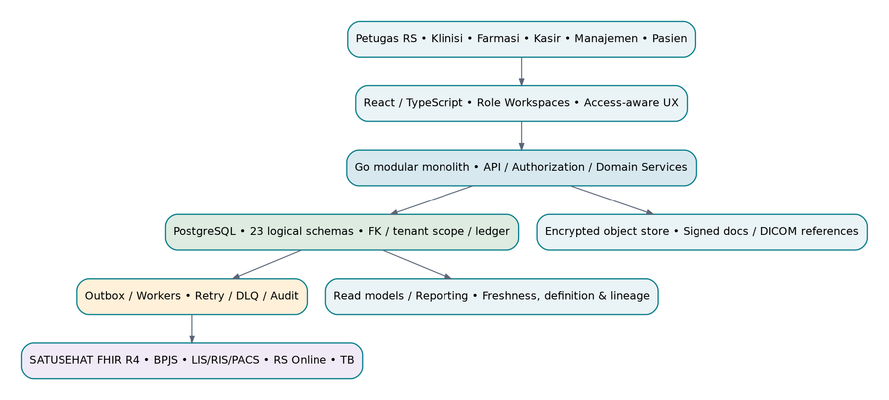

> **Versi sumber:** PRD SIMRS Baru v1.1 — Ekstensi Form Klinis, 10 November 2026.
> **Dokumen sumber:** [PRD lengkap DOCX di Google Drive](https://docs.google.com/document/d/18U00Viq_K4BtUaVgrmD13SRngF_m5wwM/edit).
> **Keterangan:** Konversi lengkap ke Markdown dari dokumen DOCX, dengan 43 tabel dan 2 penempatan diagram yang dipertahankan. Baseline induk 6 November 2026 tetap berlaku; Bab 13 merupakan ekstensi desain, bukan persetujuan rilis klinis.

---

DOKUMEN INDUK / RANCANGAN PRODUK DAN IMPLEMENTASI TEKNIS

SIMRS BARU  
TERINTEGRASI

**PRODUCT REQUIREMENTS DOCUMENT**

User Stories • Acceptance Criteria • Database Design • API & Integrasi • Pelaksanaan 7 PIC

6 November 2026 \| Final design baseline untuk implementasi bertahap

*Diagram: [<u>Diagram_SIMRS_Baru_Final_PRD_7PIC_1_Slide_2026-11-06.pptx</u>](https://docs.google.com/presentation/d/1bFmFFQByyJfkxyj7KrfqF6jdK9YPcx1V/edit?slide=id.p1#slide=id.p1)*

**EDISI TURUNAN v1.1 · 10 NOVEMBER 2026 \| Penajaman form klinis, workflow role-native, dan pemetaan kandidat FHIR R4. Baseline induk v1.0 tanggal 6 November 2026 tetap dipertahankan; perluasan tercantum lengkap pada Bab 13.**

Tujuan dokumen ini adalah memberikan spesifikasi yang dapat diturunkan menjadi backlog, desain ERD, migration, OpenAPI, pengujian otomatis, UAT, dan persetujuan rilis. Fitur klinis dan transaksi keuangan yang berisiko tetap membutuhkan SOP dan bukti uji sebelum diaktifkan.

| **Cakupan**        | **Komitmen desain**                                                                                                 |
|--------------------|---------------------------------------------------------------------------------------------------------------------|
| Cakupan fungsional | 68 modul; 12 workflow utama; FR-001–FR-066; 88 user stories eksplisit; 62 UAT referensi.                            |
| Desain data        | 23 schema PostgreSQL; 211 tabel target; PK/FK, kolom kunci, uniqueness, state, indeks, audit.                       |
| Arsitektur         | React/TypeScript; Go modular monolith; PostgreSQL; encrypted object storage; transactional outbox; FHIR R4 adapter. |
| Organisasi kerja   | 7 PIC teknis sebagai domain owner, 1 koordinator desain lintas domain.                                              |
| Penerapan          | P0–P3 dengan feature flag, approval, keamanan pasien, kontrak integrasi, UAT dan go/no-go.                          |

# Daftar isi

01 Ringkasan dan keputusan desain

02 Pembagian 7 PIC dan batas kepemilikan

03 User stories & acceptance criteria per PIC (68 modul)

04 User stories lintas domain (20 capability)

05 Traceability functional requirements (66 FR)

06 Dua belas workflow end-to-end

07 Arsitektur, batas domain, dan deployment

08 Desain database: model, relasi, 23 schema

09 Kamus data 211 tabel target

10 Kontrak API, event, integrasi dan FHIR

11 Keamanan, privasi, audit, NFR dan SRE

12 MVP, migration, testing, UAT, backlog dan sign-off

Panduan baca: Setiap user story US-\[KODE MODUL\] memiliki tiga acceptance criteria (AC1–AC3). UST-\[FR\] adalah capability lintas domain. Mapping modul→API→tabel→event→UI→FR diatur pada setiap story; katalog data pada Bab 9 menjadi referensi field/constraint. Endpoint adalah kontrak rancangan untuk dibuat dan diverifikasi melalui OpenAPI, bukan klaim bahwa endpoint sudah berjalan.

# 1. Ringkasan dan keputusan desain

SIMRS Baru adalah aplikasi operasional dan klinis RS multi-organisasi yang mempertahankan satu rantai bukti dari identitas pasien dan kunjungan hingga observasi/order, hasil, terapi, pergerakan persediaan, charge, pembayaran, klaim, pelaporan, dan indikator mutu. Data transaksi lokal menjadi sumber kebenaran operasional; keluaran nasional diperoleh dari adapter berversi dengan delivery ledger.

## 1.1 Sasaran produk

- Alur pasien RJ, IGD, RI dan layanan penunjang menggunakan patient_id / registration_id / encounter_id yang konsisten; hubungan kunjungan unit selalu eksplisit.

- Data klinis signed tidak bisa diubah secara destruktif; koreksi dilakukan dengan addendum atau versi baru, tetap menautkan author, waktu, alasan dan provenance.

- Perintah dokter, hasil terverifikasi, dispensing, stok dan charge mempunyai sumber event unik; pembayaran dan klaim tidak mengubah catatan klinis.

- FHIR R4, BPJS, RS Online dan integrasi lainnya diproses melalui adapter dengan ACK dan status eksternal berbeda dari status transaksi lokal.

- Laporan dan dashboard menampilkan definisi indikator, snapshot, keterlambatan data, scope role, dan source lineage.

## 1.2 Keputusan teknis

| **Area**            | **Desain final untuk implementasi**                                                                                             |
|---------------------|---------------------------------------------------------------------------------------------------------------------------------|
| UI                  | React + TypeScript; workspace per peran; validasi di client untuk UX namun otorisasi selalu server-side.                        |
| Backend             | Go modular monolith dengan bounded module, state machine, transaction service dan versi API /api/v1.                            |
| Database            | PostgreSQL; 23 schema logis; constraint DB sebagai garis pertahanan terakhir; setiap transaksi harus memiliki tenant/org scope. |
| Penyimpanan dokumen | Object storage terenkripsi; signed clinical artifacts menggunakan hash, metadata, immutable reference.                          |
| Messaging           | Transactional outbox (at-least-once); worker idempotent; retry backoff, DLQ, reconciliation.                                    |
| Interoperabilitas   | Mapper dan validator FHIR R4; tidak mewajibkan dedicated FHIR server; external ID disimpan terpisah.                            |
| Operasional         | Versioned migrations, CI, OTel tracing, masked log, PITR backup, DR drill, audit dan SOP release gate.                          |

## 1.3 Ruang lingkup dan aturan aktivasi

Seluruh 68 modul berada dalam cakupan produk, tetapi tidak semuanya harus aktif pada rilis awal. Prioritas pada daftar modul mengikuti P0 (fondasi pilot), P1 (alur lanjutan), P2 (ekspansi), P3 (enterprise). Penetapan prioritas tidak menggantikan uji kepatuhan, kontrak pihak ketiga, sign-off RS pilot dan persetujuan domain owner. Fungsi stok/dispensing, hasil klinis, refund, posting klaim, TTE, dan pelaporan resmi tidak boleh aktif tanpa SOP/UAT yang sesuai.

# 2. Pembagian 7 PIC dan batas kepemilikan

| **PIC** | **Tanggung jawab utama**                                           | **Produk teknis wajib**                                                                                 |
|---------|--------------------------------------------------------------------|---------------------------------------------------------------------------------------------------------|
| PIC 1   | Platform, identitas, master data, terminologi, consent             | Skema identity, master, terminology, patient, consent; policy engine dan contract identitas.            |
| PIC 2   | Front office, appointment, antrean, portal administratif           | Skema scheduling dan transaction ownership registrasi di encounter; UI front-office.                    |
| PIC 3   | Pelayanan klinis RJ, IGD, RI, operasi, asuhan dan pathway          | Skema encounter dan clinical (kecuali order/result yang dimiliki PIC 4), operasi klinis dan bed policy. |
| PIC 4   | Order, laboratorium, radiologi, PACS, transfusi dan layanan khusus | Skema orders, laboratory, radiology serta hasil/sesi penunjang.                                         |
| PIC 5   | Farmasi, inventory, pengadaan, gizi, CSSD dan laundry              | Skema pharmacy, inventory, nutrition, procurement serta sebagian operations.                            |
| PIC 6   | Charge, billing, penjamin, BPJS, klaim dan keuangan                | Skema billing, finance, integrasi administratif BPJS bekerja sama dengan PIC 7.                         |
| PIC 7   | Integrasi, interoperabilitas, quality, analytics dan enterprise    | Skema integration, analytics, quality, hr, audit integrasi; observability bersama.                      |

Koordinator teknis (di luar 7 PIC): menjaga konsistensi model Patient–Registration–Encounter–UnitVisit; mengelola ADR lintas domain, kontrak API/event, naming, release dependency, backlog dan keputusan konflik source of truth. Koordinator tidak mengambil alih ownership domain.

## 2.1 Definition of Ready untuk setiap PIC

- Persona, pengguna, prasyarat, exception, izin akses dan workflow sudah dijelaskan.

- User story memiliki AC Given/When/Then serta test case negatif, retry, dan penyalahgunaan akses.

- Nama tabel/field PK-FK, business key, event, HTTP endpoint, state transition dan source-of-truth disepakati.

- Dependensi ke PIC lain dicatat; mock data tak mengandung identitas pasien asli; kontrak integrasi partner terverifikasi.

## 2.2 Definition of Done

- Kode UI, Go API/service, database migration, validation, authorization, audit, outbox dan tests dibuat bila dibutuhkan story.

- OpenAPI, contoh payload dan error, migrasi backwards compatible, rollback, observability, runbook serta tracing diberikan.

- Unit/integration/negative/security/E2E dan UAT evidence hijau, reviewer domain menyetujui; feature flag default OFF untuk fungsi kritis.

# 3. User Stories, Acceptance Criteria dan Mapping Teknis — 7 PIC

Aturan umum untuk semua story: permintaan harus memuat context tenant/organisasi dari token server tervalidasi, request-id dan actor; perubahan kritis mencatat audit; request berulang tidak menghasilkan efek ganda. AC spesifik di bawah merupakan kewajiban tambahan terhadap kontrol umum tersebut.

## PIC 1 — Platform, identitas, master data, terminologi, consent

Membangun fondasi yang dipakai seluruh domain: tenant dan kebijakan hak akses, struktur organisasi, master praktisi, lokasi/layanan/tarif, MPI pasien, terminologi, consent, dan audit akses.

Kepemilikan data: Skema identity, master, terminology, patient, consent; policy engine dan contract identitas.

Kontrak lintas tim: Modul klinis/finansial hanya boleh memanfaatkan master melalui service contract, bukan mengubah record sumber.

Daftar modul PIC: CORE-01, CORE-02, CORE-03, CORE-04, CORE-05, CORE-06, CORE-07, CORE-08, CORE-12.

### US-CORE-01 \| Tenant & Multi-RS \[P0\]

Sebagai admin sistem multi-RS, saya ingin mengelola tenant dan cakupan organisasi agar data tiap RS terisolasi.

**AC1 — Alur positif.** Given admin memiliki mandat tenant; when mendaftarkan organisasi baru; then organisasi terikat pada tenant dan tidak terlihat lintas tenant.

**AC2 — Exception/keamanan.** Given kondisi tidak valid/akses tidak sah; when operasi dijalankan; then query dengan tenant lain menghasilkan 403 tanpa detail data, tanpa efek samping tersembunyi.

**AC3 — Konsistensi.** Given permintaan yang sama dikirim ulang atau concurrent; when diterima; then hasil konsisten menurut business key, tidak ada duplikasi, HTTP 409/422/403 sesuai kasus, dan audit trace disimpan.

**Mapping implementasi:** Modul CORE-01; identity.tenants; endpoint kandidat /api/v1/tenants; event TenantConfigured; layar Admin organisasi; FR-001.

**Bukti yang harus diserahkan:** Test US-CORE-01-AC1/AC2/AC3, migration & index untuk identity.tenants, contoh request/response, authorization matrix, audit log dan screenshot error state.

### US-CORE-02 \| Identity & Access \[P0\]

Sebagai admin akses, saya ingin menetapkan peran dan izin berbasis fungsi agar petugas hanya mengakses aktivitas berwenang.

**AC1 — Alur positif.** Given identitas pengguna aktif; when menetapkan role dan scope unit; then kebijakan akses berlaku di API dan UI.

**AC2 — Exception/keamanan.** Given kondisi tidak valid/akses tidak sah; when operasi dijalankan; then akses lintas organisasi atau tanpa relasi perawatan ditolak 403 serta diaudit, tanpa efek samping tersembunyi.

**AC3 — Konsistensi.** Given permintaan yang sama dikirim ulang atau concurrent; when diterima; then hasil konsisten menurut business key, tidak ada duplikasi, HTTP 409/422/403 sesuai kasus, dan audit trace disimpan.

**Mapping implementasi:** Modul CORE-02; identity.users; endpoint kandidat /api/v1/access/roles; event AccessPolicyChanged; layar Manajemen akses; FR-002.

**Bukti yang harus diserahkan:** Test US-CORE-02-AC1/AC2/AC3, migration & index untuk identity.users, contoh request/response, authorization matrix, audit log dan screenshot error state.

### US-CORE-03 \| Master Organization \[P0\]

Sebagai admin master, saya ingin memelihara data RS, unit, dan identitas organisasi agar seluruh modul memakai referensi konsisten.

**AC1 — Alur positif.** Given organisasi telah terdaftar; when menerbitkan revisi profil organisasi; then kode organisasi unik dan berlaku menurut periode.

**AC2 — Exception/keamanan.** Given kondisi tidak valid/akses tidak sah; when operasi dijalankan; then kode duplikat tidak dapat disimpan, tanpa efek samping tersembunyi.

**AC3 — Konsistensi.** Given permintaan yang sama dikirim ulang atau concurrent; when diterima; then hasil konsisten menurut business key, tidak ada duplikasi, HTTP 409/422/403 sesuai kasus, dan audit trace disimpan.

**Mapping implementasi:** Modul CORE-03; master.organizations; endpoint kandidat /api/v1/organizations; event OrganizationUpdated; layar Master RS; FR-001.

**Bukti yang harus diserahkan:** Test US-CORE-03-AC1/AC2/AC3, migration & index untuk master.organizations, contoh request/response, authorization matrix, audit log dan screenshot error state.

### US-CORE-04 \| Master Practitioner \[P0\]

Sebagai admin SDM medis, saya ingin mengelola praktisi, STR/SIP, dan penugasan layanan agar otorisasi klinis sesuai kewenangan.

**AC1 — Alur positif.** Given praktisi teridentifikasi; when menetapkan practitioner role dan masa berlakunya; then akses tindakan mengikuti role dan effective period.

**AC2 — Exception/keamanan.** Given kondisi tidak valid/akses tidak sah; when operasi dijalankan; then praktisi tanpa kewenangan aktif tidak dapat menandatangani tindakan, tanpa efek samping tersembunyi.

**AC3 — Konsistensi.** Given permintaan yang sama dikirim ulang atau concurrent; when diterima; then hasil konsisten menurut business key, tidak ada duplikasi, HTTP 409/422/403 sesuai kasus, dan audit trace disimpan.

**Mapping implementasi:** Modul CORE-04; master.practitioners; endpoint kandidat /api/v1/practitioners; event PractitionerRoleUpdated; layar Master praktisi; FR lintas domain.

**Bukti yang harus diserahkan:** Test US-CORE-04-AC1/AC2/AC3, migration & index untuk master.practitioners, contoh request/response, authorization matrix, audit log dan screenshot error state.

### US-CORE-05 \| Master Location & Bed \[P0\]

Sebagai pengelola ruang, saya ingin mengatur unit, kamar, tempat tidur, dan klasifikasinya agar admisi memakai kapasitas nyata.

**AC1 — Alur positif.** Given lokasi dan organisasi aktif; when mengubah status operasional bed; then status dan periode efektif tersimpan terpusat.

**AC2 — Exception/keamanan.** Given kondisi tidak valid/akses tidak sah; when operasi dijalankan; then bed di luar organisasi atau nonaktif ditolak untuk alokasi, tanpa efek samping tersembunyi.

**AC3 — Konsistensi.** Given permintaan yang sama dikirim ulang atau concurrent; when diterima; then hasil konsisten menurut business key, tidak ada duplikasi, HTTP 409/422/403 sesuai kasus, dan audit trace disimpan.

**Mapping implementasi:** Modul CORE-05; master.beds; endpoint kandidat /api/v1/beds; event BedMasterUpdated; layar Master lokasi & bed; FR lintas domain.

**Bukti yang harus diserahkan:** Test US-CORE-05-AC1/AC2/AC3, migration & index untuk master.beds, contoh request/response, authorization matrix, audit log dan screenshot error state.

### US-CORE-06 \| Master Layanan & Tarif \[P0\]

Sebagai admin pelayanan, saya ingin mendaftarkan katalog layanan serta tarif efektif agar order dan tagihan memiliki master konsisten.

**AC1 — Alur positif.** Given kode layanan tersedia; when menambah versi layanan dan tarif; then tarif terikat kelas, payer, dan tanggal efektif.

**AC2 — Exception/keamanan.** Given kondisi tidak valid/akses tidak sah; when operasi dijalankan; then tarif tak berlaku tidak dipakai untuk charge baru, tanpa efek samping tersembunyi.

**AC3 — Konsistensi.** Given permintaan yang sama dikirim ulang atau concurrent; when diterima; then hasil konsisten menurut business key, tidak ada duplikasi, HTTP 409/422/403 sesuai kasus, dan audit trace disimpan.

**Mapping implementasi:** Modul CORE-06; master.services; endpoint kandidat /api/v1/catalog/services; event TariffVersionPublished; layar Master layanan & tarif; FR-003, FR-035.

**Bukti yang harus diserahkan:** Test US-CORE-06-AC1/AC2/AC3, migration & index untuk master.services, contoh request/response, authorization matrix, audit log dan screenshot error state.

### US-CORE-07 \| Terminology Service \[P0\]

Sebagai terminologist, saya ingin mengelola kode ICD, LOINC, SNOMED, KFA, dan mapping lokal agar data klinis dan pelaporan dapat dipertukarkan.

**AC1 — Alur positif.** Given referensi terminologi tersedia; when menyetujui mapping dan versinya; then mapping berstatus aktif dengan provenance dan effective date.

**AC2 — Exception/keamanan.** Given kondisi tidak valid/akses tidak sah; when operasi dijalankan; then mapping ambigu tidak dipilih otomatis, tanpa efek samping tersembunyi.

**AC3 — Konsistensi.** Given permintaan yang sama dikirim ulang atau concurrent; when diterima; then hasil konsisten menurut business key, tidak ada duplikasi, HTTP 409/422/403 sesuai kasus, dan audit trace disimpan.

**Mapping implementasi:** Modul CORE-07; terminology.code_mappings; endpoint kandidat /api/v1/terminology/mappings; event TerminologyMappingApproved; layar Terminologi; FR-003, FR-037.

**Bukti yang harus diserahkan:** Test US-CORE-07-AC1/AC2/AC3, migration & index untuk terminology.code_mappings, contoh request/response, authorization matrix, audit log dan screenshot error state.

### US-CORE-08 \| MPI & Rekonsiliasi Pasien \[P0\]

Sebagai petugas pendaftaran, saya ingin mencari atau membuat pasien dengan possible-match review agar identitas ganda tidak bertambah.

**AC1 — Alur positif.** Given identitas pasien diserahkan; when menjalankan pencarian dan registrasi pasien; then hasil kandidat disajikan sebelum create.

**AC2 — Exception/keamanan.** Given kondisi tidak valid/akses tidak sah; when operasi dijalankan; then possible match tidak boleh digabung diam-diam, tanpa efek samping tersembunyi.

**AC3 — Konsistensi.** Given permintaan yang sama dikirim ulang atau concurrent; when diterima; then hasil konsisten menurut business key, tidak ada duplikasi, HTTP 409/422/403 sesuai kasus, dan audit trace disimpan.

**Mapping implementasi:** Modul CORE-08; patient.patients; endpoint kandidat /api/v1/patients; event PatientIdentityReviewed; layar MPI pasien; FR-004.

**Bukti yang harus diserahkan:** Test US-CORE-08-AC1/AC2/AC3, migration & index untuk patient.patients, contoh request/response, authorization matrix, audit log dan screenshot error state.

### US-CORE-12 \| Consent & Disclosure \[P0\]

Sebagai admin privasi, saya ingin mencatat persetujuan, penolakan, pencabutan dan disclosure agar hak akses RME sesuai tujuan.

**AC1 — Alur positif.** Given pasien/wali terverifikasi; when mengubah consent atau proxy grant; then scope dan tanggal berlaku dicek setiap akses.

**AC2 — Exception/keamanan.** Given kondisi tidak valid/akses tidak sah; when operasi dijalankan; then kontak pengantar bukan otomatis wali berizin, tanpa efek samping tersembunyi.

**AC3 — Konsistensi.** Given permintaan yang sama dikirim ulang atau concurrent; when diterima; then hasil konsisten menurut business key, tidak ada duplikasi, HTTP 409/422/403 sesuai kasus, dan audit trace disimpan.

**Mapping implementasi:** Modul CORE-12; consent.consents; endpoint kandidat /api/v1/consents; event ConsentChanged; layar Consent & disclosure; FR-008, FR-039.

**Bukti yang harus diserahkan:** Test US-CORE-12-AC1/AC2/AC3, migration & index untuk consent.consents, contoh request/response, authorization matrix, audit log dan screenshot error state.

## PIC 2 — Front office, appointment, antrean, portal administratif

Menyediakan perjalanan awal pasien: pencarian pasien, booking, check-in, antrean, registrasi, penanggung/pengantar, penerbitan surat administratif, dan tampilan pasien terbatas.

Kepemilikan data: Skema scheduling dan transaction ownership registrasi di encounter; UI front-office.

Kontrak lintas tim: PIC 2 wajib memakai Patient ID serta policy/consent dari PIC 1 dan menyerahkan Encounter ke PIC 3.

Daftar modul PIC: CORE-09, CORE-10, CORE-11, RME-12.

### US-CORE-09 \| Registrasi & Front Office \[P0\]

Sebagai petugas pendaftaran, saya ingin mencatat registrasi dan episode layanan agar setiap kunjungan punya identifier yang konsisten.

**AC1 — Alur positif.** Given pasien teridentifikasi; when check-in rawat jalan atau IGD; then registration dan encounter dibuat atomik.

**AC2 — Exception/keamanan.** Given kondisi tidak valid/akses tidak sah; when operasi dijalankan; then pengulangan check-in tidak menghasilkan episode duplikat, tanpa efek samping tersembunyi.

**AC3 — Konsistensi.** Given permintaan yang sama dikirim ulang atau concurrent; when diterima; then hasil konsisten menurut business key, tidak ada duplikasi, HTTP 409/422/403 sesuai kasus, dan audit trace disimpan.

**Mapping implementasi:** Modul CORE-09; encounter.registrations; endpoint kandidat /api/v1/registrations; event EncounterRegistered; layar Pendaftaran; FR-006.

**Bukti yang harus diserahkan:** Test US-CORE-09-AC1/AC2/AC3, migration & index untuk encounter.registrations, contoh request/response, authorization matrix, audit log dan screenshot error state.

### US-CORE-10 \| Appointment & Scheduling \[P0\]

Sebagai petugas penjadwalan, saya ingin memesan slot dokter tanpa bentrok agar kuota layanan terjaga.

**AC1 — Alur positif.** Given jadwal dan kapasitas tersedia; when membuat atau mengubah appointment; then slot dikunci dalam transaksi dan mengembalikan nomor booking.

**AC2 — Exception/keamanan.** Given kondisi tidak valid/akses tidak sah; when operasi dijalankan; then booking bersamaan pada slot penuh memperoleh 409, tanpa efek samping tersembunyi.

**AC3 — Konsistensi.** Given permintaan yang sama dikirim ulang atau concurrent; when diterima; then hasil konsisten menurut business key, tidak ada duplikasi, HTTP 409/422/403 sesuai kasus, dan audit trace disimpan.

**Mapping implementasi:** Modul CORE-10; scheduling.appointments; endpoint kandidat /api/v1/appointments; event AppointmentBooked; layar Appointment; FR-005.

**Bukti yang harus diserahkan:** Test US-CORE-10-AC1/AC2/AC3, migration & index untuk scheduling.appointments, contoh request/response, authorization matrix, audit log dan screenshot error state.

### US-CORE-11 \| Antrean & Kiosk \[P1\]

Sebagai petugas loket, saya ingin mengelola antrean dan perubahan status kunjungan agar alur tunggu pasien terlacak.

**AC1 — Alur positif.** Given registrasi aktif; when memanggil, menunda atau menyelesaikan antrean; then status terurut dan waktu layanan tercatat.

**AC2 — Exception/keamanan.** Given kondisi tidak valid/akses tidak sah; when operasi dijalankan; then dua nomor aktif yang sama pada loket/layanan ditolak, tanpa efek samping tersembunyi.

**AC3 — Konsistensi.** Given permintaan yang sama dikirim ulang atau concurrent; when diterima; then hasil konsisten menurut business key, tidak ada duplikasi, HTTP 409/422/403 sesuai kasus, dan audit trace disimpan.

**Mapping implementasi:** Modul CORE-11; scheduling.queue_tickets; endpoint kandidat /api/v1/queues/tickets; event QueueTicketCalled; layar Antrean & kiosk; FR-007.

**Bukti yang harus diserahkan:** Test US-CORE-11-AC1/AC2/AC3, migration & index untuk scheduling.queue_tickets, contoh request/response, authorization matrix, audit log dan screenshot error state.

### US-RME-12 \| Portal Pasien \[P2\]

Sebagai pasien atau wali sah, saya ingin melihat appointment dan dokumen yang dilepas agar layanan mandiri tetap menjaga privasi.

**AC1 — Alur positif.** Given proxy grant atau akses pasien berlaku; when membuka portal pasien; then hanya ringkasan dan dokumen approved terlihat.

**AC2 — Exception/keamanan.** Given kondisi tidak valid/akses tidak sah; when operasi dijalankan; then akses setelah revoke langsung ditolak, tanpa efek samping tersembunyi.

**AC3 — Konsistensi.** Given permintaan yang sama dikirim ulang atau concurrent; when diterima; then hasil konsisten menurut business key, tidak ada duplikasi, HTTP 409/422/403 sesuai kasus, dan audit trace disimpan.

**Mapping implementasi:** Modul RME-12; consent.proxy_access_grants; endpoint kandidat /api/v1/portal/documents; event PatientDisclosureRecorded; layar Portal pasien; FR-039.

**Bukti yang harus diserahkan:** Test US-RME-12-AC1/AC2/AC3, migration & index untuk consent.proxy_access_grants, contoh request/response, authorization matrix, audit log dan screenshot error state.

## PIC 3 — Pelayanan klinis RJ, IGD, RI, operasi, asuhan dan pathway

Mengelola episode klinis, triase, rawat inap, bed, CPPT, asesmen, keperawatan, diagnosis, rujukan, prosedur, tanda tangan, rekonsiliasi terapi, obstetri, konsultasi dan pathway.

Kepemilikan data: Skema encounter dan clinical (kecuali order/result yang dimiliki PIC 4), operasi klinis dan bed policy.

Kontrak lintas tim: PIC 3 berwenang atas status klinis, bukan mutasi inventori atau status klaim eksternal.

Daftar modul PIC: RME-01, RME-02, RME-03, RME-04, RME-05, RME-06, RME-07, RME-09, RME-10, RME-11, MED-06, MED-07, OPS-10, ENT-04.

### US-RME-01 \| Rawat Jalan \[P0\]

Sebagai dokter rawat jalan, saya ingin mendokumentasikan asesmen sampai resume agar layanan RJ terhubung dalam satu episode.

**AC1 — Alur positif.** Given encounter RJ aktif; when menyimpan asesmen dan menutup kunjungan; then diagnosis, order, sign dan discharge tercatat per encounter.

**AC2 — Exception/keamanan.** Given kondisi tidak valid/akses tidak sah; when operasi dijalankan; then encounter tak boleh ditutup jika syarat klinis wajib tak terpenuhi tanpa override, tanpa efek samping tersembunyi.

**AC3 — Konsistensi.** Given permintaan yang sama dikirim ulang atau concurrent; when diterima; then hasil konsisten menurut business key, tidak ada duplikasi, HTTP 409/422/403 sesuai kasus, dan audit trace disimpan.

**Mapping implementasi:** Modul RME-01; encounter.encounters; endpoint kandidat /api/v1/clinical/outpatient; event OutpatientEncounterClosed; layar Workspace dokter RJ; FR lintas domain.

**Bukti yang harus diserahkan:** Test US-RME-01-AC1/AC2/AC3, migration & index untuk encounter.encounters, contoh request/response, authorization matrix, audit log dan screenshot error state.

### US-RME-02 \| IGD & Triase \[P0\]

Sebagai dokter IGD, saya ingin melakukan triase dan disposisi pasien agar prioritas gawat darurat terjaga.

**AC1 — Alur positif.** Given pasien IGD tiba; when merekam triase dan memilih disposisi; then acuity, time dan tujuan tercatat.

**AC2 — Exception/keamanan.** Given kondisi tidak valid/akses tidak sah; when operasi dijalankan; then dua disposisi final pada episode sama ditolak, tanpa efek samping tersembunyi.

**AC3 — Konsistensi.** Given permintaan yang sama dikirim ulang atau concurrent; when diterima; then hasil konsisten menurut business key, tidak ada duplikasi, HTTP 409/422/403 sesuai kasus, dan audit trace disimpan.

**Mapping implementasi:** Modul RME-02; clinical.emergency_triages; endpoint kandidat /api/v1/emergency/triages; event EmergencyDispositionConfirmed; layar IGD & triase; FR-010.

**Bukti yang harus diserahkan:** Test US-RME-02-AC1/AC2/AC3, migration & index untuk clinical.emergency_triages, contoh request/response, authorization matrix, audit log dan screenshot error state.

### US-RME-03 \| Rawat Inap & Discharge \[P0\]

Sebagai DPJP rawat inap, saya ingin mengelola admisi, transfer, dan pulang agar aliran bed serta episode aman.

**AC1 — Alur positif.** Given registrasi dan bed layak tersedia; when mengadmisi atau memindahkan pasien; then bed assignment tak tumpang tindih dan discharge menyimpan handover.

**AC2 — Exception/keamanan.** Given kondisi tidak valid/akses tidak sah; when operasi dijalankan; then alokasi bed occupied menghasilkan conflict, tanpa efek samping tersembunyi.

**AC3 — Konsistensi.** Given permintaan yang sama dikirim ulang atau concurrent; when diterima; then hasil konsisten menurut business key, tidak ada duplikasi, HTTP 409/422/403 sesuai kasus, dan audit trace disimpan.

**Mapping implementasi:** Modul RME-03; encounter.admissions; endpoint kandidat /api/v1/admissions; event PatientDischarged; layar Rawat inap; FR-006, FR-011.

**Bukti yang harus diserahkan:** Test US-RME-03-AC1/AC2/AC3, migration & index untuk encounter.admissions, contoh request/response, authorization matrix, audit log dan screenshot error state.

### US-RME-04 \| CPPT / SOAP \[P0\]

Sebagai dokter atau perawat, saya ingin menulis SOAP/CPPT yang dapat ditandatangani agar rekam medis dapat dipertanggungjawabkan.

**AC1 — Alur positif.** Given encounter aktif dan pengguna berwenang; when menandatangani catatan; then hash, author, waktu dan versi terkunci.

**AC2 — Exception/keamanan.** Given kondisi tidak valid/akses tidak sah; when operasi dijalankan; then catatan signed tidak bisa diedit; gunakan addendum, tanpa efek samping tersembunyi.

**AC3 — Konsistensi.** Given permintaan yang sama dikirim ulang atau concurrent; when diterima; then hasil konsisten menurut business key, tidak ada duplikasi, HTTP 409/422/403 sesuai kasus, dan audit trace disimpan.

**Mapping implementasi:** Modul RME-04; clinical.clinical_notes; endpoint kandidat /api/v1/clinical/notes; event ClinicalNoteSigned; layar CPPT/SOAP; FR-009, FR-034, FR-040, FR-042.

**Bukti yang harus diserahkan:** Test US-RME-04-AC1/AC2/AC3, migration & index untuk clinical.clinical_notes, contoh request/response, authorization matrix, audit log dan screenshot error state.

### US-RME-05 \| Asesmen & TTV \[P0\]

Sebagai tenaga klinis, saya ingin mengukur TTV dan asesmen terstruktur agar observasi dapat ditelusuri dan dianalisis.

**AC1 — Alur positif.** Given pasien/encounter benar; when mengisi nilai dan unit; then hasil menyimpan kode, unit, metode, timestamp dan pemeriksa.

**AC2 — Exception/keamanan.** Given kondisi tidak valid/akses tidak sah; when operasi dijalankan; then unit tidak kompatibel tak boleh dipaksa jadi tren, tanpa efek samping tersembunyi.

**AC3 — Konsistensi.** Given permintaan yang sama dikirim ulang atau concurrent; when diterima; then hasil konsisten menurut business key, tidak ada duplikasi, HTTP 409/422/403 sesuai kasus, dan audit trace disimpan.

**Mapping implementasi:** Modul RME-05; clinical.observations; endpoint kandidat /api/v1/clinical/observations; event ObservationVerified; layar Asesmen & TTV; FR-034.

**Bukti yang harus diserahkan:** Test US-RME-05-AC1/AC2/AC3, migration & index untuk clinical.observations, contoh request/response, authorization matrix, audit log dan screenshot error state.

### US-RME-06 \| Diagnosis & Prosedur \[P0\]

Sebagai dokter, saya ingin mencatat diagnosis dan prosedur agar coding klinis dan klaim dapat dikaitkan dengan evidence.

**AC1 — Alur positif.** Given encounter aktif; when menetapkan diagnosis/prosedur; then kode, author, certainty dan encounter tersimpan.

**AC2 — Exception/keamanan.** Given kondisi tidak valid/akses tidak sah; when operasi dijalankan; then perubahan diagnosis signed harus melalui jejak koreksi, tanpa efek samping tersembunyi.

**AC3 — Konsistensi.** Given permintaan yang sama dikirim ulang atau concurrent; when diterima; then hasil konsisten menurut business key, tidak ada duplikasi, HTTP 409/422/403 sesuai kasus, dan audit trace disimpan.

**Mapping implementasi:** Modul RME-06; clinical.diagnoses; endpoint kandidat /api/v1/clinical/diagnoses; event DiagnosisRecorded; layar Diagnosis & prosedur; FR lintas domain.

**Bukti yang harus diserahkan:** Test US-RME-06-AC1/AC2/AC3, migration & index untuk clinical.diagnoses, contoh request/response, authorization matrix, audit log dan screenshot error state.

### US-RME-07 \| Keperawatan \[P0\]

Sebagai perawat, saya ingin menjalankan asesmen, implementasi dan handover keperawatan agar asuhan dapat dilanjutkan shift berikutnya.

**AC1 — Alur positif.** Given penugasan keperawatan aktif; when mencatat intervensi dan evaluasi; then catatan melekat pada encounter dan shift penanggung jawab.

**AC2 — Exception/keamanan.** Given kondisi tidak valid/akses tidak sah; when operasi dijalankan; then staf tanpa relation-to-care tak dapat membaca atau menandatangani, tanpa efek samping tersembunyi.

**AC3 — Konsistensi.** Given permintaan yang sama dikirim ulang atau concurrent; when diterima; then hasil konsisten menurut business key, tidak ada duplikasi, HTTP 409/422/403 sesuai kasus, dan audit trace disimpan.

**Mapping implementasi:** Modul RME-07; clinical.nursing_assessments; endpoint kandidat /api/v1/nursing/assessments; event NursingHandoverSigned; layar Keperawatan; FR-012.

**Bukti yang harus diserahkan:** Test US-RME-07-AC1/AC2/AC3, migration & index untuk clinical.nursing_assessments, contoh request/response, authorization matrix, audit log dan screenshot error state.

### US-RME-09 \| Care Plan & Care Team \[P1\]

Sebagai DPJP, saya ingin mengatur rencana asuhan dan anggota care team agar tindakan dan tanggung jawab terlihat.

**AC1 — Alur positif.** Given encounter aktif; when menugaskan konsulen atau menetapkan care plan; then peran, masa berlaku dan perubahan care plan diaudit.

**AC2 — Exception/keamanan.** Given kondisi tidak valid/akses tidak sah; when operasi dijalankan; then perubahan care team oleh nonpenanggung jawab ditolak, tanpa efek samping tersembunyi.

**AC3 — Konsistensi.** Given permintaan yang sama dikirim ulang atau concurrent; when diterima; then hasil konsisten menurut business key, tidak ada duplikasi, HTTP 409/422/403 sesuai kasus, dan audit trace disimpan.

**Mapping implementasi:** Modul RME-09; clinical.care_plans; endpoint kandidat /api/v1/clinical/care-plans; event CarePlanUpdated; layar Care plan & care team; FR-012.

**Bukti yang harus diserahkan:** Test US-RME-09-AC1/AC2/AC3, migration & index untuk clinical.care_plans, contoh request/response, authorization matrix, audit log dan screenshot error state.

### US-RME-10 \| Rujukan Internal/Eksternal \[P1\]

Sebagai dokter pengirim, saya ingin membuat dan memantau rujukan agar handover klinis memiliki jejak persetujuan.

**AC1 — Alur positif.** Given indikasi dan tujuan rujukan tervalidasi; when mengirim permintaan rujukan; then status lokal dan status pihak tujuan dipisah.

**AC2 — Exception/keamanan.** Given kondisi tidak valid/akses tidak sah; when operasi dijalankan; then timeout tidak boleh tampil sebagai diterima, tanpa efek samping tersembunyi.

**AC3 — Konsistensi.** Given permintaan yang sama dikirim ulang atau concurrent; when diterima; then hasil konsisten menurut business key, tidak ada duplikasi, HTTP 409/422/403 sesuai kasus, dan audit trace disimpan.

**Mapping implementasi:** Modul RME-10; clinical.referrals; endpoint kandidat /api/v1/referrals; event ReferralRequested; layar Rujukan; FR-014, FR-035.

**Bukti yang harus diserahkan:** Test US-RME-10-AC1/AC2/AC3, migration & index untuk clinical.referrals, contoh request/response, authorization matrix, audit log dan screenshot error state.

### US-RME-11 \| Dokumen & Tanda Tangan \[P0\]

Sebagai dokter penandatangan, saya ingin membuat dokumen medis yang sah agar dokumen terverifikasi dan aman dibagikan.

**AC1 — Alur positif.** Given sumber klinis ditandatangani; when menandatangani atau menerbitkan surat; then nomor, versi, hash, signer dan release purpose tercatat.

**AC2 — Exception/keamanan.** Given kondisi tidak valid/akses tidak sah; when operasi dijalankan; then print/release tanpa hak atau dari data belum signed ditolak, tanpa efek samping tersembunyi.

**AC3 — Konsistensi.** Given permintaan yang sama dikirim ulang atau concurrent; when diterima; then hasil konsisten menurut business key, tidak ada duplikasi, HTTP 409/422/403 sesuai kasus, dan audit trace disimpan.

**Mapping implementasi:** Modul RME-11; clinical.documents; endpoint kandidat /api/v1/clinical/documents; event MedicalDocumentSigned; layar Dokumen & TTE; FR-013, FR-042.

**Bukti yang harus diserahkan:** Test US-RME-11-AC1/AC2/AC3, migration & index untuk clinical.documents, contoh request/response, authorization matrix, audit log dan screenshot error state.

### US-MED-06 \| Operasi & Kamar Bedah \[P1\]

Sebagai koordinator kamar operasi, saya ingin menjadwalkan operasi dan checklist keselamatan agar tindakan operasi aman dan terjadwal.

**AC1 — Alur positif.** Given order operasi sudah disetujui; when menetapkan jadwal, tim dan instrumen; then safety checklist serta kesiapan aset tercatat.

**AC2 — Exception/keamanan.** Given kondisi tidak valid/akses tidak sah; when operasi dijalankan; then operasi tak dapat release jika checklist kritis tidak lengkap, tanpa efek samping tersembunyi.

**AC3 — Konsistensi.** Given permintaan yang sama dikirim ulang atau concurrent; when diterima; then hasil konsisten menurut business key, tidak ada duplikasi, HTTP 409/422/403 sesuai kasus, dan audit trace disimpan.

**Mapping implementasi:** Modul MED-06; operations.surgery_cases; endpoint kandidat /api/v1/surgery/cases; event SurgerySafetyChecklistApproved; layar Kamar operasi; FR lintas domain.

**Bukti yang harus diserahkan:** Test US-MED-06-AC1/AC2/AC3, migration & index untuk operations.surgery_cases, contoh request/response, authorization matrix, audit log dan screenshot error state.

### US-MED-07 \| Anestesi & Recovery \[P1\]

Sebagai dokter anestesi, saya ingin mencatat induksi, monitoring, dan recovery agar handover perioperatif aman.

**AC1 — Alur positif.** Given operasi dan pasien sesuai; when memulai anestesi dan menutup PACU; then kejadian dan observasi terikat case serta signer.

**AC2 — Exception/keamanan.** Given kondisi tidak valid/akses tidak sah; when operasi dijalankan; then pasien tak dapat keluar recovery tanpa kriteria discharge/override, tanpa efek samping tersembunyi.

**AC3 — Konsistensi.** Given permintaan yang sama dikirim ulang atau concurrent; when diterima; then hasil konsisten menurut business key, tidak ada duplikasi, HTTP 409/422/403 sesuai kasus, dan audit trace disimpan.

**Mapping implementasi:** Modul MED-07; operations.anesthesia_records; endpoint kandidat /api/v1/anesthesia/records; event RecoveryReleased; layar Anestesi & PACU; FR lintas domain.

**Bukti yang harus diserahkan:** Test US-MED-07-AC1/AC2/AC3, migration & index untuk operations.anesthesia_records, contoh request/response, authorization matrix, audit log dan screenshot error state.

### US-OPS-10 \| Manajemen Bed Operasional \[P0\]

Sebagai bed manager, saya ingin memantau dan mengalokasikan bed agar tidak ada okupansi ganda.

**AC1 — Alur positif.** Given bed aktif dan status terbaru tersedia; when mengalokasikan atau melepas bed; then perubahan occupancy atomik, histori bed movement terjaga.

**AC2 — Exception/keamanan.** Given kondisi tidak valid/akses tidak sah; when operasi dijalankan; then dua admisi ke bed sama pada waktu overlap ditolak, tanpa efek samping tersembunyi.

**AC3 — Konsistensi.** Given permintaan yang sama dikirim ulang atau concurrent; when diterima; then hasil konsisten menurut business key, tidak ada duplikasi, HTTP 409/422/403 sesuai kasus, dan audit trace disimpan.

**Mapping implementasi:** Modul OPS-10; encounter.bed_assignments; endpoint kandidat /api/v1/beds/assignments; event BedAllocated; layar Manajemen bed; FR-011.

**Bukti yang harus diserahkan:** Test US-OPS-10-AC1/AC2/AC3, migration & index untuk encounter.bed_assignments, contoh request/response, authorization matrix, audit log dan screenshot error state.

### US-ENT-04 \| Clinical Pathway \[P1\]

Sebagai DPJP, saya ingin memilih clinical pathway dan merekam deviasi agar evaluasi mutu serta biaya berbasis bukti.

**AC1 — Alur positif.** Given pathway dan indikasi sesuai; when mendaftarkan pasien ke pathway; then setiap step mengacu tindakan atau hasil nyata.

**AC2 — Exception/keamanan.** Given kondisi tidak valid/akses tidak sah; when operasi dijalankan; then sistem tidak otomatis menyatakan step selesai tanpa evidence, tanpa efek samping tersembunyi.

**AC3 — Konsistensi.** Given permintaan yang sama dikirim ulang atau concurrent; when diterima; then hasil konsisten menurut business key, tidak ada duplikasi, HTTP 409/422/403 sesuai kasus, dan audit trace disimpan.

**Mapping implementasi:** Modul ENT-04; clinical.pathway_enrollments; endpoint kandidat /api/v1/clinical/pathways; event PathwayStepCompleted; layar Clinical pathway; FR-015, FR-033.

**Bukti yang harus diserahkan:** Test US-ENT-04-AC1/AC2/AC3, migration & index untuk clinical.pathway_enrollments, contoh request/response, authorization matrix, audit log dan screenshot error state.

## PIC 4 — Order, laboratorium, radiologi, PACS, transfusi dan layanan khusus

Menangani universal order, workflow spesimen, hasil terverifikasi, hasil kritis, mikrobiologi, radiologi, DICOM, transfusi, rehabilitasi, hemodialisis dan MCU.

Kepemilikan data: Skema orders, laboratory, radiology serta hasil/sesi penunjang.

Kontrak lintas tim: Tidak ada hasil final tanpa order/source reconciliation, verifier, dan clinical/tenant scope.

Daftar modul PIC: RME-08, MED-01, MED-02, MED-03, MED-08, MED-09, MED-10, MED-12.

### US-RME-08 \| CPOE & Order \[P0\]

Sebagai dokter pemesan, saya ingin membuat CPOE lintas penunjang agar order selalu memiliki tujuan dan status.

**AC1 — Alur positif.** Given encounter serta katalog layanan valid; when membuat atau membatalkan order; then status order dan item terversi, fulfillment tertaut.

**AC2 — Exception/keamanan.** Given kondisi tidak valid/akses tidak sah; when operasi dijalankan; then perintah tanpa hak atau item duplikat ditolak, tanpa efek samping tersembunyi.

**AC3 — Konsistensi.** Given permintaan yang sama dikirim ulang atau concurrent; when diterima; then hasil konsisten menurut business key, tidak ada duplikasi, HTTP 409/422/403 sesuai kasus, dan audit trace disimpan.

**Mapping implementasi:** Modul RME-08; orders.service_orders; endpoint kandidat /api/v1/orders; event ServiceOrderPlaced; layar CPOE; FR-016.

**Bukti yang harus diserahkan:** Test US-RME-08-AC1/AC2/AC3, migration & index untuk orders.service_orders, contoh request/response, authorization matrix, audit log dan screenshot error state.

### US-MED-01 \| Laboratorium LIS \[P0\]

Sebagai ATLM atau analis laboratorium, saya ingin memproses spesimen hingga hasil diverifikasi agar hasil yang terbaca dokter valid.

**AC1 — Alur positif.** Given order dan identitas spesimen sesuai; when menerima spesimen dan mengesahkan hasil; then report signed terikat order serta verifier.

**AC2 — Exception/keamanan.** Given kondisi tidak valid/akses tidak sah; when operasi dijalankan; then hasil tanpa order/spesimen dikarantina, tidak auto-final, tanpa efek samping tersembunyi.

**AC3 — Konsistensi.** Given permintaan yang sama dikirim ulang atau concurrent; when diterima; then hasil konsisten menurut business key, tidak ada duplikasi, HTTP 409/422/403 sesuai kasus, dan audit trace disimpan.

**Mapping implementasi:** Modul MED-01; laboratory.lab_results; endpoint kandidat /api/v1/laboratory/results; event LaboratoryResultVerified; layar LIS laboratorium; FR-017, FR-034.

**Bukti yang harus diserahkan:** Test US-MED-01-AC1/AC2/AC3, migration & index untuk laboratory.lab_results, contoh request/response, authorization matrix, audit log dan screenshot error state.

### US-MED-02 \| Radiologi RIS \[P1\]

Sebagai radiografer, saya ingin menjalankan pemeriksaan dan membuat ekspertise agar hasil radiologi dapat direview.

**AC1 — Alur positif.** Given order radiologi aktif; when menjadwalkan dan melakukan pemeriksaan; then study UID dan laporan bertanda tangan tersedia.

**AC2 — Exception/keamanan.** Given kondisi tidak valid/akses tidak sah; when operasi dijalankan; then hasil tidak terverifikasi tidak boleh dirilis, tanpa efek samping tersembunyi.

**AC3 — Konsistensi.** Given permintaan yang sama dikirim ulang atau concurrent; when diterima; then hasil konsisten menurut business key, tidak ada duplikasi, HTTP 409/422/403 sesuai kasus, dan audit trace disimpan.

**Mapping implementasi:** Modul MED-02; radiology.rad_orders; endpoint kandidat /api/v1/radiology/reports; event RadiologyReportSigned; layar RIS; FR-018, FR-034.

**Bukti yang harus diserahkan:** Test US-MED-02-AC1/AC2/AC3, migration & index untuk radiology.rad_orders, contoh request/response, authorization matrix, audit log dan screenshot error state.

### US-MED-03 \| PACS / DICOM \[P1\]

Sebagai dokter berizin, saya ingin membuka studi DICOM terkait pasien agar viewer aman dan terhubung pada order.

**AC1 — Alur positif.** Given study terhubung ke encounter; when meminta viewer access; then token akses terbatas waktu dan semua view diaudit.

**AC2 — Exception/keamanan.** Given kondisi tidak valid/akses tidak sah; when operasi dijalankan; then URL studi pasien lain tidak bisa diakses, tanpa efek samping tersembunyi.

**AC3 — Konsistensi.** Given permintaan yang sama dikirim ulang atau concurrent; when diterima; then hasil konsisten menurut business key, tidak ada duplikasi, HTTP 409/422/403 sesuai kasus, dan audit trace disimpan.

**Mapping implementasi:** Modul MED-03; radiology.study_references; endpoint kandidat /api/v1/radiology/studies; event ImagingStudyViewed; layar PACS viewer; FR-018.

**Bukti yang harus diserahkan:** Test US-MED-03-AC1/AC2/AC3, migration & index untuk radiology.study_references, contoh request/response, authorization matrix, audit log dan screenshot error state.

### US-MED-08 \| Hemodialisis \[P2\]

Sebagai perawat hemodialisis, saya ingin mencatat sesi HD dan monitoring agar terapi kronis memiliki rekam terstruktur.

**AC1 — Alur positif.** Given jadwal dan resep terapi aktif; when menyelesaikan sesi HD; then waktu, alat, parameter dan komplikasi tercatat.

**AC2 — Exception/keamanan.** Given kondisi tidak valid/akses tidak sah; when operasi dijalankan; then sesi batal tidak boleh dihitung tindakan selesai, tanpa efek samping tersembunyi.

**AC3 — Konsistensi.** Given permintaan yang sama dikirim ulang atau concurrent; when diterima; then hasil konsisten menurut business key, tidak ada duplikasi, HTTP 409/422/403 sesuai kasus, dan audit trace disimpan.

**Mapping implementasi:** Modul MED-08; operations.dialysis_sessions; endpoint kandidat /api/v1/dialysis/sessions; event DialysisSessionCompleted; layar Hemodialisis; FR-019.

**Bukti yang harus diserahkan:** Test US-MED-08-AC1/AC2/AC3, migration & index untuk operations.dialysis_sessions, contoh request/response, authorization matrix, audit log dan screenshot error state.

### US-MED-09 \| Rehabilitasi Medik \[P2\]

Sebagai terapis rehabilitasi, saya ingin merencanakan, mencatat sesi dan outcome agar kemajuan fungsi pasien dapat dinilai.

**AC1 — Alur positif.** Given rencana rehabilitasi disetujui; when mencatat sesi terapi; then hasil fungsional terhubung baseline dan encounter.

**AC2 — Exception/keamanan.** Given kondisi tidak valid/akses tidak sah; when operasi dijalankan; then sesi tidak hadir tak boleh memicu charge, tanpa efek samping tersembunyi.

**AC3 — Konsistensi.** Given permintaan yang sama dikirim ulang atau concurrent; when diterima; then hasil konsisten menurut business key, tidak ada duplikasi, HTTP 409/422/403 sesuai kasus, dan audit trace disimpan.

**Mapping implementasi:** Modul MED-09; clinical.rehabilitation_sessions; endpoint kandidat /api/v1/rehabilitation/sessions; event RehabSessionCompleted; layar Rehabilitasi; FR-019.

**Bukti yang harus diserahkan:** Test US-MED-09-AC1/AC2/AC3, migration & index untuk clinical.rehabilitation_sessions, contoh request/response, authorization matrix, audit log dan screenshot error state.

### US-MED-10 \| Medical Check Up \[P2\]

Sebagai petugas MCU, saya ingin menjalankan paket pemeriksaan hingga resume agar MCU bisa ditelusuri per komponen order.

**AC1 — Alur positif.** Given paket MCU aktif; when membuat episode MCU; then seluruh order dan hasil terhubung paket serta pasien.

**AC2 — Exception/keamanan.** Given kondisi tidak valid/akses tidak sah; when operasi dijalankan; then resume tidak final jika hasil wajib belum diverifikasi, tanpa efek samping tersembunyi.

**AC3 — Konsistensi.** Given permintaan yang sama dikirim ulang atau concurrent; when diterima; then hasil konsisten menurut business key, tidak ada duplikasi, HTTP 409/422/403 sesuai kasus, dan audit trace disimpan.

**Mapping implementasi:** Modul MED-10; clinical.mcu_packages; endpoint kandidat /api/v1/mcu/packages; event MCUPackageCompleted; layar MCU; FR-019.

**Bukti yang harus diserahkan:** Test US-MED-10-AC1/AC2/AC3, migration & index untuk clinical.mcu_packages, contoh request/response, authorization matrix, audit log dan screenshot error state.

### US-MED-12 \| Bank Darah & Transfusi \[P2\]

Sebagai dokter atau petugas bank darah, saya ingin memesan dan memberikan komponen darah agar transfusi aman dan terlacak.

**AC1 — Alur positif.** Given crossmatch, consent dan unit darah sesuai; when verifikasi identitas di sisi pasien; then unit, pasien, waktu dan reaksi transfusi tercatat.

**AC2 — Exception/keamanan.** Given kondisi tidak valid/akses tidak sah; when operasi dijalankan; then mismatch pasien-unit memblokir pemberian, tanpa efek samping tersembunyi.

**AC3 — Konsistensi.** Given permintaan yang sama dikirim ulang atau concurrent; when diterima; then hasil konsisten menurut business key, tidak ada duplikasi, HTTP 409/422/403 sesuai kasus, dan audit trace disimpan.

**Mapping implementasi:** Modul MED-12; clinical.transfusion_administrations; endpoint kandidat /api/v1/transfusions; event TransfusionAdministered; layar Bank darah & transfusi; FR-019.

**Bukti yang harus diserahkan:** Test US-MED-12-AC1/AC2/AC3, migration & index untuk clinical.transfusion_administrations, contoh request/response, authorization matrix, audit log dan screenshot error state.

## PIC 5 — Farmasi, inventory, pengadaan, gizi, CSSD dan laundry

Membangun resep, review antibiotik, dispensing BCMA/FEFO, lot ledger, stocktake, PO/GRN, diet-kitchen-tray, alat steril, dan linen.

Kepemilikan data: Skema pharmacy, inventory, nutrition, procurement serta sebagian operations.

Kontrak lintas tim: Transaksi fisik kritis harus memiliki SOP, approval, source event, ledger kompensasi, dan UAT sebelum aktif.

Daftar modul PIC: MED-04, MED-05, MED-11, OPS-01, OPS-02, OPS-03, OPS-04, OPS-05.

### US-MED-04 \| Farmasi & E-Resep \[P0\]

Sebagai dokter/farmasis, saya ingin menulis dan memverifikasi resep agar pengobatan memenuhi alergi dan formularium.

**AC1 — Alur positif.** Given diagnosis dan pasien sesuai; when menyetujui resep; then restriksi dan identitas obat ditinjau sebelum dispense.

**AC2 — Exception/keamanan.** Given kondisi tidak valid/akses tidak sah; when operasi dijalankan; then antibiotik restriksi tanpa approval masuk pending, tanpa efek samping tersembunyi.

**AC3 — Konsistensi.** Given permintaan yang sama dikirim ulang atau concurrent; when diterima; then hasil konsisten menurut business key, tidak ada duplikasi, HTTP 409/422/403 sesuai kasus, dan audit trace disimpan.

**Mapping implementasi:** Modul MED-04; pharmacy.prescriptions; endpoint kandidat /api/v1/pharmacy/prescriptions; event PrescriptionVerified; layar Farmasi & e-resep; FR-020, FR-037, FR-038.

**Bukti yang harus diserahkan:** Test US-MED-04-AC1/AC2/AC3, migration & index untuk pharmacy.prescriptions, contoh request/response, authorization matrix, audit log dan screenshot error state.

### US-MED-05 \| Dispensing & BCMA \[P0\]

Sebagai farmasis, saya ingin dispensing obat berbasis lot FEFO agar stok dan penyerahan akurat.

**AC1 — Alur positif.** Given resep signed dan stok tersedia; when scan dan menyerahkan obat; then dispense, lot, stock movement dan charge terkait sekali.

**AC2 — Exception/keamanan.** Given kondisi tidak valid/akses tidak sah; when operasi dijalankan; then lot expired atau stok negatif ditolak, tanpa efek samping tersembunyi.

**AC3 — Konsistensi.** Given permintaan yang sama dikirim ulang atau concurrent; when diterima; then hasil konsisten menurut business key, tidak ada duplikasi, HTTP 409/422/403 sesuai kasus, dan audit trace disimpan.

**Mapping implementasi:** Modul MED-05; pharmacy.dispenses; endpoint kandidat /api/v1/pharmacy/dispenses; event MedicationDispensed; layar Dispensing & BCMA; FR-021, FR-036.

**Bukti yang harus diserahkan:** Test US-MED-05-AC1/AC2/AC3, migration & index untuk pharmacy.dispenses, contoh request/response, authorization matrix, audit log dan screenshot error state.

### US-MED-11 \| Gizi Klinis \[P1\]

Sebagai ahli gizi, saya ingin menetapkan diet sesuai kondisi agar dapur menerima order yang tepat.

**AC1 — Alur positif.** Given asesmen nutrisi valid; when membuat NutritionOrder; then alergi, tekstur, jumlah dan waktu makan tercatat.

**AC2 — Exception/keamanan.** Given kondisi tidak valid/akses tidak sah; when operasi dijalankan; then diet kontraindikasi tidak boleh dirilis, tanpa efek samping tersembunyi.

**AC3 — Konsistensi.** Given permintaan yang sama dikirim ulang atau concurrent; when diterima; then hasil konsisten menurut business key, tidak ada duplikasi, HTTP 409/422/403 sesuai kasus, dan audit trace disimpan.

**Mapping implementasi:** Modul MED-11; nutrition.diet_orders; endpoint kandidat /api/v1/nutrition/diets; event DietOrderApproved; layar Gizi klinis; FR-024.

**Bukti yang harus diserahkan:** Test US-MED-11-AC1/AC2/AC3, migration & index untuk nutrition.diet_orders, contoh request/response, authorization matrix, audit log dan screenshot error state.

### US-OPS-01 \| Gudang & Inventory \[P0\]

Sebagai petugas gudang, saya ingin mencatat perpindahan stok antar lokasi agar saldo berasal dari ledger yang terlacak.

**AC1 — Alur positif.** Given lot dan lokasi valid; when menerima atau mengeluarkan stok; then movement append-only dan balance snapshot diperbarui.

**AC2 — Exception/keamanan.** Given kondisi tidak valid/akses tidak sah; when operasi dijalankan; then mutasi tanpa source/approval tidak menghasilkan stok, tanpa efek samping tersembunyi.

**AC3 — Konsistensi.** Given permintaan yang sama dikirim ulang atau concurrent; when diterima; then hasil konsisten menurut business key, tidak ada duplikasi, HTTP 409/422/403 sesuai kasus, dan audit trace disimpan.

**Mapping implementasi:** Modul OPS-01; inventory.stock_movements; endpoint kandidat /api/v1/inventory/movements; event StockMovementPosted; layar Inventory; FR-022, FR-036.

**Bukti yang harus diserahkan:** Test US-OPS-01-AC1/AC2/AC3, migration & index untuk inventory.stock_movements, contoh request/response, authorization matrix, audit log dan screenshot error state.

### US-OPS-02 \| Purchase & Procurement \[P2\]

Sebagai bagian pengadaan, saya ingin memproses PR, RFQ, PO, dan penerimaan agar belanja mematuhi persetujuan.

**AC1 — Alur positif.** Given vendor dan anggaran valid; when mengajukan dan menyetujui PO; then setiap dokumen punya status serta jejak approval.

**AC2 — Exception/keamanan.** Given kondisi tidak valid/akses tidak sah; when operasi dijalankan; then petugas penyusun tak boleh menyetujui PO sendiri jika melanggar SoD, tanpa efek samping tersembunyi.

**AC3 — Konsistensi.** Given permintaan yang sama dikirim ulang atau concurrent; when diterima; then hasil konsisten menurut business key, tidak ada duplikasi, HTTP 409/422/403 sesuai kasus, dan audit trace disimpan.

**Mapping implementasi:** Modul OPS-02; procurement.purchase_orders; endpoint kandidat /api/v1/procurement/purchase-orders; event PurchaseOrderApproved; layar Pengadaan; FR-022, FR-045.

**Bukti yang harus diserahkan:** Test US-OPS-02-AC1/AC2/AC3, migration & index untuk procurement.purchase_orders, contoh request/response, authorization matrix, audit log dan screenshot error state.

### US-OPS-03 \| CSSD & Sterilisasi \[P1\]

Sebagai petugas CSSD, saya ingin melacak set instrumen sepanjang sterilisasi agar kamar operasi menerima set aman.

**AC1 — Alur positif.** Given set instrumen lengkap; when memproses siklus steril; then batch, alat, indikator dan hasil QC tercatat.

**AC2 — Exception/keamanan.** Given kondisi tidak valid/akses tidak sah; when operasi dijalankan; then set dengan QC gagal tidak dapat release, tanpa efek samping tersembunyi.

**AC3 — Konsistensi.** Given permintaan yang sama dikirim ulang atau concurrent; when diterima; then hasil konsisten menurut business key, tidak ada duplikasi, HTTP 409/422/403 sesuai kasus, dan audit trace disimpan.

**Mapping implementasi:** Modul OPS-03; operations.cssd_cycles; endpoint kandidat /api/v1/cssd/cycles; event SterileSetReleased; layar CSSD; FR-023.

**Bukti yang harus diserahkan:** Test US-OPS-03-AC1/AC2/AC3, migration & index untuk operations.cssd_cycles, contoh request/response, authorization matrix, audit log dan screenshot error state.

### US-OPS-04 \| Laundry & Linen \[P2\]

Sebagai petugas laundry, saya ingin melacak linen kotor, bersih dan selisih agar distribusi linen dapat diaudit.

**AC1 — Alur positif.** Given batch linen diterima; when menyelesaikan cuci dan QC; then jumlah masuk/keluar dan selisih per batch tercatat.

**AC2 — Exception/keamanan.** Given kondisi tidak valid/akses tidak sah; when operasi dijalankan; then selisih tanpa investigasi tidak mengubah stok otomatis, tanpa efek samping tersembunyi.

**AC3 — Konsistensi.** Given permintaan yang sama dikirim ulang atau concurrent; when diterima; then hasil konsisten menurut business key, tidak ada duplikasi, HTTP 409/422/403 sesuai kasus, dan audit trace disimpan.

**Mapping implementasi:** Modul OPS-04; operations.linen_cycles; endpoint kandidat /api/v1/laundry/cycles; event LinenCycleCompleted; layar Laundry; FR-023.

**Bukti yang harus diserahkan:** Test US-OPS-04-AC1/AC2/AC3, migration & index untuk operations.linen_cycles, contoh request/response, authorization matrix, audit log dan screenshot error state.

### US-OPS-05 \| Produksi & Distribusi Gizi \[P1\]

Sebagai kepala dapur, saya ingin membuat batch makanan dan distribusi tray agar pasien menerima diet sesuai order.

**AC1 — Alur positif.** Given diet disetujui dan dapur siap; when memasak, QC dan menyerahkan tray; then tray dihubungkan ke patient-bed-order serta penyerah.

**AC2 — Exception/keamanan.** Given kondisi tidak valid/akses tidak sah; when operasi dijalankan; then alergi/mismatch pasien memblokir tray release, tanpa efek samping tersembunyi.

**AC3 — Konsistensi.** Given permintaan yang sama dikirim ulang atau concurrent; when diterima; then hasil konsisten menurut business key, tidak ada duplikasi, HTTP 409/422/403 sesuai kasus, dan audit trace disimpan.

**Mapping implementasi:** Modul OPS-05; nutrition.kitchen_batches; endpoint kandidat /api/v1/nutrition/trays; event MealTrayDelivered; layar Produksi & distribusi gizi; FR-024.

**Bukti yang harus diserahkan:** Test US-OPS-05-AC1/AC2/AC3, migration & index untuk nutrition.kitchen_batches, contoh request/response, authorization matrix, audit log dan screenshot error state.

## PIC 6 — Charge, billing, penjamin, BPJS, klaim dan keuangan

Mengelola sumber charge, invoice, pembayaran, deposit, coverage, casemix, dossier klaim, rekonsiliasi, GL, AP/AR, budgeting, dan unit cost.

Kepemilikan data: Skema billing, finance, integrasi administratif BPJS bekerja sama dengan PIC 7.

Kontrak lintas tim: Status keuangan tidak dapat memodifikasi rekam medis signed; posting dan refund perlu segregation of duties.

Daftar modul PIC: FIN-01, FIN-02, FIN-03, FIN-04, FIN-05, FIN-06, FIN-07, FIN-08, FIN-09, FIN-10, FIN-11.

### US-FIN-01 \| Charge Capture \[P0\]

Sebagai petugas billing, saya ingin merekam charge dari tindakan sah agar tagihan tidak ganda.

**AC1 — Alur positif.** Given evidence tindakan dan tarif valid; when membuat charge; then unique source per charge_type dan provenance disimpan.

**AC2 — Exception/keamanan.** Given kondisi tidak valid/akses tidak sah; when operasi dijalankan; then retry event yang sama tak menambah charge, tanpa efek samping tersembunyi.

**AC3 — Konsistensi.** Given permintaan yang sama dikirim ulang atau concurrent; when diterima; then hasil konsisten menurut business key, tidak ada duplikasi, HTTP 409/422/403 sesuai kasus, dan audit trace disimpan.

**Mapping implementasi:** Modul FIN-01; billing.charges; endpoint kandidat /api/v1/billing/charges; event ChargeCaptured; layar Charge capture; FR-025.

**Bukti yang harus diserahkan:** Test US-FIN-01-AC1/AC2/AC3, migration & index untuk billing.charges, contoh request/response, authorization matrix, audit log dan screenshot error state.

### US-FIN-02 \| Billing & Invoice \[P0\]

Sebagai kasir, saya ingin menyusun invoice dan koreksi terotorisasi agar saldo tagihan konsisten.

**AC1 — Alur positif.** Given charge sudah tersedia; when menerbitkan invoice; then invoice lines, total, pajak bila relevan dan status seimbang.

**AC2 — Exception/keamanan.** Given kondisi tidak valid/akses tidak sah; when operasi dijalankan; then perubahan invoice settled harus lewat reversal/credit, tanpa efek samping tersembunyi.

**AC3 — Konsistensi.** Given permintaan yang sama dikirim ulang atau concurrent; when diterima; then hasil konsisten menurut business key, tidak ada duplikasi, HTTP 409/422/403 sesuai kasus, dan audit trace disimpan.

**Mapping implementasi:** Modul FIN-02; billing.invoices; endpoint kandidat /api/v1/billing/invoices; event InvoiceIssued; layar Billing; FR-026.

**Bukti yang harus diserahkan:** Test US-FIN-02-AC1/AC2/AC3, migration & index untuk billing.invoices, contoh request/response, authorization matrix, audit log dan screenshot error state.

### US-FIN-03 \| Kasir & Pembayaran \[P0\]

Sebagai kasir, saya ingin menerima pembayaran multiinstrumen agar alokasi uang tidak melebihi tagihan.

**AC1 — Alur positif.** Given invoice aktif; when mengalokasikan pembayaran; then alokasi, bukti settlement dan balance dihitung.

**AC2 — Exception/keamanan.** Given kondisi tidak valid/akses tidak sah; when operasi dijalankan; then duplikat callback atau overpayment diblokir, tanpa efek samping tersembunyi.

**AC3 — Konsistensi.** Given permintaan yang sama dikirim ulang atau concurrent; when diterima; then hasil konsisten menurut business key, tidak ada duplikasi, HTTP 409/422/403 sesuai kasus, dan audit trace disimpan.

**Mapping implementasi:** Modul FIN-03; billing.payments; endpoint kandidat /api/v1/payments; event PaymentAllocated; layar Kasir; FR-026.

**Bukti yang harus diserahkan:** Test US-FIN-03-AC1/AC2/AC3, migration & index untuk billing.payments, contoh request/response, authorization matrix, audit log dan screenshot error state.

### US-FIN-04 \| Coverage & Penjamin \[P0\]

Sebagai verifikator penjamin, saya ingin mencatat coverage dan eligibility agar biaya tidak salah dibebankan.

**AC1 — Alur positif.** Given payer dan kepesertaan disertakan; when mengecek penjamin; then coverage internal dan status eligibility eksternal dibedakan.

**AC2 — Exception/keamanan.** Given kondisi tidak valid/akses tidak sah; when operasi dijalankan; then kegagalan eligibility tidak ditampilkan sebagai approved, tanpa efek samping tersembunyi.

**AC3 — Konsistensi.** Given permintaan yang sama dikirim ulang atau concurrent; when diterima; then hasil konsisten menurut business key, tidak ada duplikasi, HTTP 409/422/403 sesuai kasus, dan audit trace disimpan.

**Mapping implementasi:** Modul FIN-04; billing.coverages; endpoint kandidat /api/v1/coverages; event CoverageEligibilityChecked; layar Coverage & penjamin; FR-027.

**Bukti yang harus diserahkan:** Test US-FIN-04-AC1/AC2/AC3, migration & index untuk billing.coverages, contoh request/response, authorization matrix, audit log dan screenshot error state.

### US-FIN-05 \| Bridging BPJS \[P1\]

Sebagai petugas BPJS, saya ingin membuat SEP dan kontrol melalui adapter agar status administrasi BPJS dapat direkonsiliasi.

**AC1 — Alur positif.** Given izin penggunaan API partner berlaku; when submit permintaan partner; then external ID dan status authoritative tersimpan.

**AC2 — Exception/keamanan.** Given kondisi tidak valid/akses tidak sah; when operasi dijalankan; then timeout/kegagalan partner tetap pending sync bukan success, tanpa efek samping tersembunyi.

**AC3 — Konsistensi.** Given permintaan yang sama dikirim ulang atau concurrent; when diterima; then hasil konsisten menurut business key, tidak ada duplikasi, HTTP 409/422/403 sesuai kasus, dan audit trace disimpan.

**Mapping implementasi:** Modul FIN-05; billing.bpjs_control_plans; endpoint kandidat /api/v1/bpjs/controls; event BPJSStatusReconciled; layar Bridging BPJS; FR-027.

**Bukti yang harus diserahkan:** Test US-FIN-05-AC1/AC2/AC3, migration & index untuk billing.bpjs_control_plans, contoh request/response, authorization matrix, audit log dan screenshot error state.

### US-FIN-06 \| Casemix & INA-CBG \[P1\]

Sebagai coder casemix, saya ingin mengelompokkan episode klaim dengan bukti klinis agar klaim didasarkan pada RME valid.

**AC1 — Alur positif.** Given discharge dan diagnosis signed tersedia; when melakukan coding dan grouping; then versi hasil grouping dan reviewer tercatat.

**AC2 — Exception/keamanan.** Given kondisi tidak valid/akses tidak sah; when operasi dijalankan; then status klaim tidak boleh mengubah diagnosis klinis, tanpa efek samping tersembunyi.

**AC3 — Konsistensi.** Given permintaan yang sama dikirim ulang atau concurrent; when diterima; then hasil konsisten menurut business key, tidak ada duplikasi, HTTP 409/422/403 sesuai kasus, dan audit trace disimpan.

**Mapping implementasi:** Modul FIN-06; billing.case_mix_episodes; endpoint kandidat /api/v1/casemix/episodes; event CaseMixReviewed; layar Casemix; FR-027.

**Bukti yang harus diserahkan:** Test US-FIN-06-AC1/AC2/AC3, migration & index untuk billing.case_mix_episodes, contoh request/response, authorization matrix, audit log dan screenshot error state.

### US-FIN-07 \| Klaim BPJS & Swasta \[P1\]

Sebagai petugas klaim, saya ingin melengkapi dan mengirim klaim sesuai payor agar pengajuan dapat diaudit.

**AC1 — Alur positif.** Given checklist dan dokumen signed memenuhi aturan; when menandai dossier ready dan submit; then status, dokumen, evidence serta ACK tersimpan.

**AC2 — Exception/keamanan.** Given kondisi tidak valid/akses tidak sah; when operasi dijalankan; then klaim tanpa dokumen wajib tetap pending, tanpa efek samping tersembunyi.

**AC3 — Konsistensi.** Given permintaan yang sama dikirim ulang atau concurrent; when diterima; then hasil konsisten menurut business key, tidak ada duplikasi, HTTP 409/422/403 sesuai kasus, dan audit trace disimpan.

**Mapping implementasi:** Modul FIN-07; billing.claims; endpoint kandidat /api/v1/claims; event ClaimSubmitted; layar Klaim; FR-027, FR-040, FR-041.

**Bukti yang harus diserahkan:** Test US-FIN-07-AC1/AC2/AC3, migration & index untuk billing.claims, contoh request/response, authorization matrix, audit log dan screenshot error state.

### US-FIN-08 \| Accounting & General Ledger \[P2\]

Sebagai akuntan, saya ingin membukukan jurnal berimbang agar neraca dan buku besar akurat.

**AC1 — Alur positif.** Given transaksi approved ada; when posting jurnal; then total debit sama dengan kredit.

**AC2 — Exception/keamanan.** Given kondisi tidak valid/akses tidak sah; when operasi dijalankan; then jurnal tak seimbang ditolak, tanpa efek samping tersembunyi.

**AC3 — Konsistensi.** Given permintaan yang sama dikirim ulang atau concurrent; when diterima; then hasil konsisten menurut business key, tidak ada duplikasi, HTTP 409/422/403 sesuai kasus, dan audit trace disimpan.

**Mapping implementasi:** Modul FIN-08; finance.journal_entries; endpoint kandidat /api/v1/finance/journals; event JournalPosted; layar General ledger; FR-028.

**Bukti yang harus diserahkan:** Test US-FIN-08-AC1/AC2/AC3, migration & index untuk finance.journal_entries, contoh request/response, authorization matrix, audit log dan screenshot error state.

### US-FIN-09 \| AP / AR \[P2\]

Sebagai finance AP/AR, saya ingin mengelola utang dan piutang agar jatuh tempo dan rekonsiliasi jelas.

**AC1 — Alur positif.** Given dokumen supplier/payor terverifikasi; when mencatat pembayaran atau penerimaan; then rekam aging dan alokasi tetap sesuai sumber.

**AC2 — Exception/keamanan.** Given kondisi tidak valid/akses tidak sah; when operasi dijalankan; then posting duplikat invoice vendor ditolak, tanpa efek samping tersembunyi.

**AC3 — Konsistensi.** Given permintaan yang sama dikirim ulang atau concurrent; when diterima; then hasil konsisten menurut business key, tidak ada duplikasi, HTTP 409/422/403 sesuai kasus, dan audit trace disimpan.

**Mapping implementasi:** Modul FIN-09; finance.ap_bills; endpoint kandidat /api/v1/finance/receivables; event ReceivableReconciled; layar AP/AR; FR-028, FR-038, FR-041, FR-045.

**Bukti yang harus diserahkan:** Test US-FIN-09-AC1/AC2/AC3, migration & index untuk finance.ap_bills, contoh request/response, authorization matrix, audit log dan screenshot error state.

### US-FIN-10 \| Budgeting \[P3\]

Sebagai budget owner, saya ingin menyusun anggaran per pusat biaya agar kontrol finansial dapat dipantau.

**AC1 — Alur positif.** Given periode fiskal terbuka; when menyetujui budget; then versi budget dan approval immutable.

**AC2 — Exception/keamanan.** Given kondisi tidak valid/akses tidak sah; when operasi dijalankan; then pemohon tidak mengesahkan perubahan sendiri, tanpa efek samping tersembunyi.

**AC3 — Konsistensi.** Given permintaan yang sama dikirim ulang atau concurrent; when diterima; then hasil konsisten menurut business key, tidak ada duplikasi, HTTP 409/422/403 sesuai kasus, dan audit trace disimpan.

**Mapping implementasi:** Modul FIN-10; finance.budgets; endpoint kandidat /api/v1/finance/budgets; event BudgetApproved; layar Budgeting; FR-028.

**Bukti yang harus diserahkan:** Test US-FIN-10-AC1/AC2/AC3, migration & index untuk finance.budgets, contoh request/response, authorization matrix, audit log dan screenshot error state.

### US-FIN-11 \| Unit Costing \[P3\]

Sebagai cost analyst, saya ingin menghitung unit cost berbasis aktivitas agar manajemen dapat menilai efisiensi.

**AC1 — Alur positif.** Given driver biaya dan volume sudah tervalidasi; when menjalankan kalkulasi cost; then rumus, versi driver dan lineage hasil tersimpan.

**AC2 — Exception/keamanan.** Given kondisi tidak valid/akses tidak sah; when operasi dijalankan; then hasil dengan input belum lengkap diberi status provisional, tanpa efek samping tersembunyi.

**AC3 — Konsistensi.** Given permintaan yang sama dikirim ulang atau concurrent; when diterima; then hasil konsisten menurut business key, tidak ada duplikasi, HTTP 409/422/403 sesuai kasus, dan audit trace disimpan.

**Mapping implementasi:** Modul FIN-11; finance.cost_profiles; endpoint kandidat /api/v1/finance/cost-profiles; event UnitCostCalculated; layar Unit costing; FR-033, FR-044.

**Bukti yang harus diserahkan:** Test US-FIN-11-AC1/AC2/AC3, migration & index untuk finance.cost_profiles, contoh request/response, authorization matrix, audit log dan screenshot error state.

## PIC 7 — Integrasi, interoperabilitas, quality, analytics dan enterprise

Mengelola FHIR R4 adapter, outbox/worker/DLQ, RS Online, pelaporan nasional, dashboard, indikator, PPI, patient safety, risiko, HRIS, dan mutu.

Kepemilikan data: Skema integration, analytics, quality, hr, audit integrasi; observability bersama.

Kontrak lintas tim: Integrasi asynchronous, memisahkan state lokal dari ACK pihak luar dan menghindari pengiriman PHI tanpa legitimasi.

Daftar modul PIC: OPS-06, OPS-07, OPS-08, OPS-09, ENT-01, ENT-02, ENT-03, ENT-05, ENT-06, ENT-07, ENT-08, ENT-09, ENT-10, ENT-11.

### US-OPS-06 \| Manajemen Aset \[P2\]

Sebagai pengelola aset, saya ingin mencatat perolehan dan pemakaian aset agar biaya dan utilisasi dapat dihitung.

**AC1 — Alur positif.** Given aset telah diinventarisasi; when mencatat aktivitas penggunaan; then alat, lokasi, encounter dan biaya mesin terhubung.

**AC2 — Exception/keamanan.** Given kondisi tidak valid/akses tidak sah; when operasi dijalankan; then aset nonaktif atau tidak terkalibrasi memunculkan gate, tanpa efek samping tersembunyi.

**AC3 — Konsistensi.** Given permintaan yang sama dikirim ulang atau concurrent; when diterima; then hasil konsisten menurut business key, tidak ada duplikasi, HTTP 409/422/403 sesuai kasus, dan audit trace disimpan.

**Mapping implementasi:** Modul OPS-06; operations.assets; endpoint kandidat /api/v1/assets; event AssetUsageRecorded; layar Manajemen aset; FR-044.

**Bukti yang harus diserahkan:** Test US-OPS-06-AC1/AC2/AC3, migration & index untuk operations.assets, contoh request/response, authorization matrix, audit log dan screenshot error state.

### US-OPS-07 \| Maintenance & Kalibrasi \[P2\]

Sebagai teknisi, saya ingin merencanakan maintenance dan kalibrasi agar alat layak sebelum dipakai.

**AC1 — Alur positif.** Given aset punya tanggal pemeliharaan; when menutup pekerjaan maintenance; then hasil, sertifikat dan next due tersimpan.

**AC2 — Exception/keamanan.** Given kondisi tidak valid/akses tidak sah; when operasi dijalankan; then alat berstatus unsafe tidak dipakai tanpa override tersahkan, tanpa efek samping tersembunyi.

**AC3 — Konsistensi.** Given permintaan yang sama dikirim ulang atau concurrent; when diterima; then hasil konsisten menurut business key, tidak ada duplikasi, HTTP 409/422/403 sesuai kasus, dan audit trace disimpan.

**Mapping implementasi:** Modul OPS-07; operations.maintenance_orders; endpoint kandidat /api/v1/maintenance/orders; event MaintenanceCompleted; layar Maintenance & kalibrasi; FR-044.

**Bukti yang harus diserahkan:** Test US-OPS-07-AC1/AC2/AC3, migration & index untuk operations.maintenance_orders, contoh request/response, authorization matrix, audit log dan screenshot error state.

### US-OPS-08 \| Housekeeping & Fasilitas \[P3\]

Sebagai kepala fasilitas, saya ingin menugaskan housekeeping agar ruangan siap digunakan.

**AC1 — Alur positif.** Given lokasi layanan tersedia; when membuka dan menutup tugas; then petugas, waktu dan bukti inspeksi tersimpan.

**AC2 — Exception/keamanan.** Given kondisi tidak valid/akses tidak sah; when operasi dijalankan; then ruangan belum layak tidak ditandai ready, tanpa efek samping tersembunyi.

**AC3 — Konsistensi.** Given permintaan yang sama dikirim ulang atau concurrent; when diterima; then hasil konsisten menurut business key, tidak ada duplikasi, HTTP 409/422/403 sesuai kasus, dan audit trace disimpan.

**Mapping implementasi:** Modul OPS-08; operations.facility_tasks; endpoint kandidat /api/v1/facilities/tasks; event FacilityReadyConfirmed; layar Housekeeping; FR lintas domain.

**Bukti yang harus diserahkan:** Test US-OPS-08-AC1/AC2/AC3, migration & index untuk operations.facility_tasks, contoh request/response, authorization matrix, audit log dan screenshot error state.

### US-OPS-09 \| Ambulans & Transportasi \[P3\]

Sebagai koordinator ambulans, saya ingin merencanakan perjalanan pasien agar transportasi memiliki jejak operasi.

**AC1 — Alur positif.** Given permintaan transfer disetujui; when menugaskan kendaraan dan kru; then status trip dan handover pasien tercatat.

**AC2 — Exception/keamanan.** Given kondisi tidak valid/akses tidak sah; when operasi dijalankan; then kendaraan unavailable tidak bisa dijadwalkan ganda, tanpa efek samping tersembunyi.

**AC3 — Konsistensi.** Given permintaan yang sama dikirim ulang atau concurrent; when diterima; then hasil konsisten menurut business key, tidak ada duplikasi, HTTP 409/422/403 sesuai kasus, dan audit trace disimpan.

**Mapping implementasi:** Modul OPS-09; operations.ambulance_trips; endpoint kandidat /api/v1/ambulance/trips; event AmbulanceTripCompleted; layar Ambulans; FR lintas domain.

**Bukti yang harus diserahkan:** Test US-OPS-09-AC1/AC2/AC3, migration & index untuk operations.ambulance_trips, contoh request/response, authorization matrix, audit log dan screenshot error state.

### US-ENT-01 \| HRIS & Personnel \[P2\]

Sebagai admin SDM, saya ingin mengelola data kepegawaian dan kompetensi agar penugasan staf konsisten.

**AC1 — Alur positif.** Given identitas pegawai tersedia; when mencatat perubahan jabatan; then riwayat efektif dan approver tercatat.

**AC2 — Exception/keamanan.** Given kondisi tidak valid/akses tidak sah; when operasi dijalankan; then data kepegawaian tidak terbaca oleh role tanpa izin, tanpa efek samping tersembunyi.

**AC3 — Konsistensi.** Given permintaan yang sama dikirim ulang atau concurrent; when diterima; then hasil konsisten menurut business key, tidak ada duplikasi, HTTP 409/422/403 sesuai kasus, dan audit trace disimpan.

**Mapping implementasi:** Modul ENT-01; hr.employees; endpoint kandidat /api/v1/hr/employees; event EmployeePositionChanged; layar HRIS; FR-029, FR-046.

**Bukti yang harus diserahkan:** Test US-ENT-01-AC1/AC2/AC3, migration & index untuk hr.employees, contoh request/response, authorization matrix, audit log dan screenshot error state.

### US-ENT-02 \| Attendance & Payroll \[P3\]

Sebagai pegawai atau payroll admin, saya ingin merekam kehadiran hingga payroll agar penggajian dapat diaudit.

**AC1 — Alur positif.** Given jadwal dan kebijakan kehadiran aktif; when mengunci payroll periode; then komponen gaji dan persetujuan versi tersimpan.

**AC2 — Exception/keamanan.** Given kondisi tidak valid/akses tidak sah; when operasi dijalankan; then payroll yang sudah finalized tidak diedit langsung, tanpa efek samping tersembunyi.

**AC3 — Konsistensi.** Given permintaan yang sama dikirim ulang atau concurrent; when diterima; then hasil konsisten menurut business key, tidak ada duplikasi, HTTP 409/422/403 sesuai kasus, dan audit trace disimpan.

**Mapping implementasi:** Modul ENT-02; hr.payroll_runs; endpoint kandidat /api/v1/hr/payroll; event PayrollFinalized; layar Attendance & payroll; FR-029.

**Bukti yang harus diserahkan:** Test US-ENT-02-AC1/AC2/AC3, migration & index untuk hr.payroll_runs, contoh request/response, authorization matrix, audit log dan screenshot error state.

### US-ENT-03 \| Rekrutmen & Talent \[P3\]

Sebagai rekruter, saya ingin memproses kandidat hingga talent review agar seleksi lebih transparan.

**AC1 — Alur positif.** Given lowongan disetujui; when memindahkan stage kandidat; then jejak review, persetujuan dan batas akses tersimpan.

**AC2 — Exception/keamanan.** Given kondisi tidak valid/akses tidak sah; when operasi dijalankan; then kandidat tidak melihat data pelamar lain, tanpa efek samping tersembunyi.

**AC3 — Konsistensi.** Given permintaan yang sama dikirim ulang atau concurrent; when diterima; then hasil konsisten menurut business key, tidak ada duplikasi, HTTP 409/422/403 sesuai kasus, dan audit trace disimpan.

**Mapping implementasi:** Modul ENT-03; hr.recruitment_applications; endpoint kandidat /api/v1/hr/recruitment; event RecruitmentStageChanged; layar Rekrutmen & talent; FR-029, FR-046.

**Bukti yang harus diserahkan:** Test US-ENT-03-AC1/AC2/AC3, migration & index untuk hr.recruitment_applications, contoh request/response, authorization matrix, audit log dan screenshot error state.

### US-ENT-05 \| HAIs & PPI \[P2\]

Sebagai tim PPI, saya ingin mencatat HAIs dan tindak lanjut agar surveilans infeksi memiliki indikator.

**AC1 — Alur positif.** Given kriteria kasus telah disepakati; when menetapkan episode HAIs; then definisi kasus, waktu, unit dan reviewer disimpan.

**AC2 — Exception/keamanan.** Given kondisi tidak valid/akses tidak sah; when operasi dijalankan; then insiden belum terkonfirmasi tidak dihitung final, tanpa efek samping tersembunyi.

**AC3 — Konsistensi.** Given permintaan yang sama dikirim ulang atau concurrent; when diterima; then hasil konsisten menurut business key, tidak ada duplikasi, HTTP 409/422/403 sesuai kasus, dan audit trace disimpan.

**Mapping implementasi:** Modul ENT-05; quality.hai_episodes; endpoint kandidat /api/v1/quality/hais; event HAICaseReviewed; layar PPI/HAIs; FR-030.

**Bukti yang harus diserahkan:** Test US-ENT-05-AC1/AC2/AC3, migration & index untuk quality.hai_episodes, contoh request/response, authorization matrix, audit log dan screenshot error state.

### US-ENT-06 \| Patient Safety \[P1\]

Sebagai petugas keselamatan pasien, saya ingin melaporkan insiden dengan kerahasiaan agar tindak lanjut dapat dilacak.

**AC1 — Alur positif.** Given petugas memiliki akses pelaporan; when merekam dan melakukan RCA; then status, tingkat dampak, action owner dan waktu tercatat.

**AC2 — Exception/keamanan.** Given kondisi tidak valid/akses tidak sah; when operasi dijalankan; then pelapor berhak dilindungi dari akses tak sah, tanpa efek samping tersembunyi.

**AC3 — Konsistensi.** Given permintaan yang sama dikirim ulang atau concurrent; when diterima; then hasil konsisten menurut business key, tidak ada duplikasi, HTTP 409/422/403 sesuai kasus, dan audit trace disimpan.

**Mapping implementasi:** Modul ENT-06; quality.safety_incidents; endpoint kandidat /api/v1/quality/incidents; event PatientSafetyCaseClosed; layar Keselamatan pasien; FR-030.

**Bukti yang harus diserahkan:** Test US-ENT-06-AC1/AC2/AC3, migration & index untuk quality.safety_incidents, contoh request/response, authorization matrix, audit log dan screenshot error state.

### US-ENT-07 \| Risk Management \[P2\]

Sebagai manajer risiko, saya ingin menilai risiko serta rencana mitigasi agar risiko operasional terpantau.

**AC1 — Alur positif.** Given risk owner ditetapkan; when mengubah likelihood dan impact; then versi scoring dan riwayat keputusan tersimpan.

**AC2 — Exception/keamanan.** Given kondisi tidak valid/akses tidak sah; when operasi dijalankan; then risiko tidak ditandai closed tanpa evidence, tanpa efek samping tersembunyi.

**AC3 — Konsistensi.** Given permintaan yang sama dikirim ulang atau concurrent; when diterima; then hasil konsisten menurut business key, tidak ada duplikasi, HTTP 409/422/403 sesuai kasus, dan audit trace disimpan.

**Mapping implementasi:** Modul ENT-07; quality.risk_registers; endpoint kandidat /api/v1/quality/risks; event RiskMitigationVerified; layar Manajemen risiko; FR-030.

**Bukti yang harus diserahkan:** Test US-ENT-07-AC1/AC2/AC3, migration & index untuk quality.risk_registers, contoh request/response, authorization matrix, audit log dan screenshot error state.

### US-ENT-08 \| Indikator Mutu \[P1\]

Sebagai tim mutu, saya ingin mendefinisikan indikator dan menghitung hasil agar angka mutu bisa direproduksi.

**AC1 — Alur positif.** Given definisi numerator/denominator approved; when menjalankan kalkulasi indikator; then periode, cohort, owner dan lineage ada.

**AC2 — Exception/keamanan.** Given kondisi tidak valid/akses tidak sah; when operasi dijalankan; then hasil dengan data hilang diberi status incomplete, tanpa efek samping tersembunyi.

**AC3 — Konsistensi.** Given permintaan yang sama dikirim ulang atau concurrent; when diterima; then hasil konsisten menurut business key, tidak ada duplikasi, HTTP 409/422/403 sesuai kasus, dan audit trace disimpan.

**Mapping implementasi:** Modul ENT-08; quality.indicator_results; endpoint kandidat /api/v1/quality/indicators; event QualityIndicatorCalculated; layar Indikator mutu; FR-030, FR-043.

**Bukti yang harus diserahkan:** Test US-ENT-08-AC1/AC2/AC3, migration & index untuk quality.indicator_results, contoh request/response, authorization matrix, audit log dan screenshot error state.

### US-ENT-09 \| Dynamic Reporting & RL \[P1\]

Sebagai petugas pelaporan, saya ingin menyusun laporan dinamis dan RL agar pelaporan dapat diverifikasi.

**AC1 — Alur positif.** Given dataset dan definisi indikator disetujui; when menghasilkan laporan periodik; then versi definisi, sumber dan snapshot tercatat.

**AC2 — Exception/keamanan.** Given kondisi tidak valid/akses tidak sah; when operasi dijalankan; then laporan resmi tak boleh submit tanpa approval gate, tanpa efek samping tersembunyi.

**AC3 — Konsistensi.** Given permintaan yang sama dikirim ulang atau concurrent; when diterima; then hasil konsisten menurut business key, tidak ada duplikasi, HTTP 409/422/403 sesuai kasus, dan audit trace disimpan.

**Mapping implementasi:** Modul ENT-09; analytics.report_definitions; endpoint kandidat /api/v1/reports; event ReportApproved; layar Laporan dinamis & RL; FR-031.

**Bukti yang harus diserahkan:** Test US-ENT-09-AC1/AC2/AC3, migration & index untuk analytics.report_definitions, contoh request/response, authorization matrix, audit log dan screenshot error state.

### US-ENT-10 \| Multi-Hospital Analytics \[P3\]

Sebagai direksi RS, saya ingin membandingkan KPI antar unit/RS agar keputusan berbasis data yang sah.

**AC1 — Alur positif.** Given hak akses dashboard terverifikasi; when memilih periode dan filter; then kinerja ditampilkan dengan freshness, definisi dan scope.

**AC2 — Exception/keamanan.** Given kondisi tidak valid/akses tidak sah; when operasi dijalankan; then agregasi antar tenant tak boleh membuka PHI, tanpa efek samping tersembunyi.

**AC3 — Konsistensi.** Given permintaan yang sama dikirim ulang atau concurrent; when diterima; then hasil konsisten menurut business key, tidak ada duplikasi, HTTP 409/422/403 sesuai kasus, dan audit trace disimpan.

**Mapping implementasi:** Modul ENT-10; analytics.read_model_watermarks; endpoint kandidat /api/v1/analytics/dashboards; event DashboardSnapshotPublished; layar Analytics multi-RS; FR-031.

**Bukti yang harus diserahkan:** Test US-ENT-10-AC1/AC2/AC3, migration & index untuk analytics.read_model_watermarks, contoh request/response, authorization matrix, audit log dan screenshot error state.

### US-ENT-11 \| SATUSEHAT & API Integration \[P0\]

Sebagai integrator, saya ingin mengirim data terstandar ke sistem nasional agar transaksi klinis lokal tetap mandiri.

**AC1 — Alur positif.** Given record eligible dan mapping aktif; when menjalankan pengiriman adapter; then outbox, ACK, external ID dan audit attempt tercatat.

**AC2 — Exception/keamanan.** Given kondisi tidak valid/akses tidak sah; when operasi dijalankan; then timeout tidak mengubah state klinis atau memunculkan sukses palsu, tanpa efek samping tersembunyi.

**AC3 — Konsistensi.** Given permintaan yang sama dikirim ulang atau concurrent; when diterima; then hasil konsisten menurut business key, tidak ada duplikasi, HTTP 409/422/403 sesuai kasus, dan audit trace disimpan.

**Mapping implementasi:** Modul ENT-11; integration.outbox_events; endpoint kandidat /api/v1/integrations/jobs; event ExternalDeliveryAcknowledged; layar Integrasi & monitoring; FR-032.

**Bukti yang harus diserahkan:** Test US-ENT-11-AC1/AC2/AC3, migration & index untuk integration.outbox_events, contoh request/response, authorization matrix, audit log dan screenshot error state.

# 4. User Stories Lintas Domain — 20 Capability Klinis dan Operasional

Capability berikut menambah perilaku lengkap lintas modul. Owner utama tetap mengikuti domain penanggung jawab; PIC pendukung wajib menyediakan kontrak dan test lintas layanan. Tiap capability adalah user story tersendiri (UST-\*) dengan tiga acceptance criteria serta mapping data/event.

### UST-FR-047 \| Pelayanan maternal dan bayi baru lahir

Sebagai dokter/bidan, saya ingin menghubungkan persalinan dengan episode bayi tersendiri agar bayi aman teridentifikasi.

**AC1 — Proses.** Given ibu melahirkan; when pencatatan delivery dan register bayi; then dua patient ID dan encounter ID berbeda dengan mother-newborn link.

**AC2 — Penolakan.** Given validasi gagal; when submit/finalisasi; then bayi belum punya NIK tidak meminjam NIK ibu; transaksi lokal sebelumnya tetap konsisten.

**AC3 — Audit dan uji.** Given concurrency/retry atau koreksi; when diproses; then rekaman tetap idempotent/terversi dan lolos UAT-031/032 dengan actor, time, source reference.

**Mapping fitur → teknis:** FR FR-047; owner PIC 3,4; tabel clinical.delivery_records;clinical.newborn_links;clinical.obstetric_episodes; kandidat API /api/v1/obstetrics/deliveries; event BirthRecorded; UAT UAT-031/032.

### UST-FR-048 \| Imunisasi dan vaksinasi

Sebagai tenaga imunisasi, saya ingin mencatat skrining, pemberian, lot, dan tindak lanjut agar pemberian dosis dapat diaudit.

**AC1 — Proses.** Given riwayat dan kontraindikasi diperiksa; when dosis dicatat; then satu immunization_event dan lot valid.

**AC2 — Penolakan.** Given validasi gagal; when submit/finalisasi; then dosis ulang/expired tidak mengubah ledger; transaksi lokal sebelumnya tetap konsisten.

**AC3 — Audit dan uji.** Given concurrency/retry atau koreksi; when diproses; then rekaman tetap idempotent/terversi dan lolos UAT-033/034 dengan actor, time, source reference.

**Mapping fitur → teknis:** FR FR-048; owner PIC 2,3,5; tabel clinical.immunization_events;pharmacy.vaccine_products;inventory.stock_movements; kandidat API /api/v1/immunizations; event ImmunizationAdministered; UAT UAT-033/034.

### UST-FR-049 \| Pediatri dan skrining perkembangan

Sebagai dokter anak, saya ingin mengisi instrumen skrining menurut usia agar skor digunakan sesuai populasi.

**AC1 — Proses.** Given usia anak dan versi instrumen tersedia; when asesmen diisi; then skor dengan referensi dan reviewer tercatat.

**AC2 — Penolakan.** Given validasi gagal; when submit/finalisasi; then umur di luar validasi memicu peringatan; transaksi lokal sebelumnya tetap konsisten.

**AC3 — Audit dan uji.** Given concurrency/retry atau koreksi; when diproses; then rekaman tetap idempotent/terversi dan lolos UAT-035 dengan actor, time, source reference.

**Mapping fitur → teknis:** FR FR-049; owner PIC 3; tabel clinical.pediatric_assessments;clinical.growth_measures;terminology.instrument_versions; kandidat API /api/v1/pediatrics/assessments; event PediatricAssessmentReviewed; UAT UAT-035.

### UST-FR-050 \| PPRA dan stewardship antibiotik

Sebagai farmasis PPRA, saya ingin memvalidasi antibiotik restriksi dan tinjauan berkala agar penggunaan antibiotik sesuai kebijakan klinis.

**AC1 — Proses.** Given aturan restriksi versi efektif tersedia; when resep restriksi diverifikasi; then approval/override beralasan dan review terjadwal.

**AC2 — Penolakan.** Given validasi gagal; when submit/finalisasi; then tanpa approval tetap pending dan tak dispense otomatis; transaksi lokal sebelumnya tetap konsisten.

**AC3 — Audit dan uji.** Given concurrency/retry atau koreksi; when diproses; then rekaman tetap idempotent/terversi dan lolos UAT-036 dengan actor, time, source reference.

**Mapping fitur → teknis:** FR FR-050; owner PIC 3,5; tabel pharmacy.antimicrobial_authorizations;pharmacy.restricted_drug_rules; kandidat API /api/v1/pharmacy/antimicrobial-reviews; event RestrictedAntibioticReviewed; UAT UAT-036.

### UST-FR-051 \| Kultur dan antibiogram

Sebagai ATLM mikrobiologi, saya ingin mengaitkan organisme dan kepekaan ke spesimen agar hasil AST tervalidasi.

**AC1 — Proses.** Given order kultur dan specimen valid; when hasil sensitivitas diinput; then AST bertaut pada organism, method, version.

**AC2 — Penolakan.** Given validasi gagal; when submit/finalisasi; then AST tanpa specimen tidak final; transaksi lokal sebelumnya tetap konsisten.

**AC3 — Audit dan uji.** Given concurrency/retry atau koreksi; when diproses; then rekaman tetap idempotent/terversi dan lolos UAT-037/038 dengan actor, time, source reference.

**Mapping fitur → teknis:** FR FR-051; owner PIC 4; tabel laboratory.microbiology_cultures;laboratory.susceptibility_results; kandidat API /api/v1/laboratory/microbiology; event MicrobiologyResultVerified; UAT UAT-037/038.

### UST-FR-052 \| Rekonsiliasi obat

Sebagai DPJP/farmasis, saya ingin membandingkan obat saat admisi, transfer dan pulang agar discrepancy tidak hilang.

**AC1 — Proses.** Given daftar obat sebelumnya ada; when rekonsiliasi dibuat; then perubahan lanjut/henti/ubah ditandatangani.

**AC2 — Penolakan.** Given validasi gagal; when submit/finalisasi; then mismatch belum selesai tampil warning+override sah; transaksi lokal sebelumnya tetap konsisten.

**AC3 — Audit dan uji.** Given concurrency/retry atau koreksi; when diproses; then rekaman tetap idempotent/terversi dan lolos UAT-039/040 dengan actor, time, source reference.

**Mapping fitur → teknis:** FR FR-052; owner PIC 3,5; tabel clinical.medication_reconciliations;clinical.reconciliation_items; kandidat API /api/v1/medication-reconciliations; event MedicationReconciled; UAT UAT-039/040.

### UST-FR-053 \| Perawatan paliatif

Sebagai dokter paliatif, saya ingin mendokumentasikan goals of care dan rencana gejala agar pasien mendapat tata laksana sensitif.

**AC1 — Proses.** Given izin akses dan keluarga sah diverifikasi; when rencana paliatif dibuat; then catatan signed dengan persetujuan yang sesuai.

**AC2 — Penolakan.** Given validasi gagal; when submit/finalisasi; then catatan edukasi tidak mengubah DNR/order terapi; transaksi lokal sebelumnya tetap konsisten.

**AC3 — Audit dan uji.** Given concurrency/retry atau koreksi; when diproses; then rekaman tetap idempotent/terversi dan lolos UAT-041 dengan actor, time, source reference.

**Mapping fitur → teknis:** FR FR-053; owner PIC 3; tabel clinical.palliative_care_plans;clinical.goals_of_care_discussions; kandidat API /api/v1/palliative/care-plans; event PalliativePlanSigned; UAT UAT-041.

### UST-FR-054 \| Pelaporan kasus TB

Sebagai petugas program TB, saya ingin memastikan case record dan submission program terlacak agar layanan lokal tidak terganggu.

**AC1 — Proses.** Given definisi kasus terversi dan mapping tersedia; when pelaporan disetujui; then ACK/penolakan sistem eksternal tercatat.

**AC2 — Penolakan.** Given validasi gagal; when submit/finalisasi; then timeout tidak menghapus diagnosis/encounter; transaksi lokal sebelumnya tetap konsisten.

**AC3 — Audit dan uji.** Given concurrency/retry atau koreksi; when diproses; then rekaman tetap idempotent/terversi dan lolos UAT-042 dengan actor, time, source reference.

**Mapping fitur → teknis:** FR FR-054; owner PIC 3,7; tabel clinical.program_disease_cases;integration.program_reporting_jobs; kandidat API /api/v1/program-reporting/tb; event TBProgramReportAcknowledged; UAT UAT-042.

### UST-FR-055 \| Skoring klinis terstruktur

Sebagai klinisi, saya ingin memakai instrumen berversi agar hasil asesmen reproduktif.

**AC1 — Proses.** Given instrumen berlaku dan syarat umur sesuai; when form diisi dan final; then nilai, jawaban, versi dan reviewer tersimpan.

**AC2 — Penolakan.** Given validasi gagal; when submit/finalisasi; then item wajib kosong memblokir finalisasi; transaksi lokal sebelumnya tetap konsisten.

**AC3 — Audit dan uji.** Given concurrency/retry atau koreksi; when diproses; then rekaman tetap idempotent/terversi dan lolos UAT-043/044 dengan actor, time, source reference.

**Mapping fitur → teknis:** FR FR-055; owner PIC 1,3; tabel clinical.assessment_instruments;clinical.assessment_answers;clinical.assessment_scores; kandidat API /api/v1/assessments/scores; event ClinicalScoreVerified; UAT UAT-043/044.

### UST-FR-056 \| Transfusi darah end-to-end

Sebagai dokter/perawat, saya ingin memastikan darah sesuai pasien dan consent agar reaksi serta unit terpantau.

**AC1 — Proses.** Given kompatibilitas dan dua identitas dicek; when unit darah diadministrasikan; then unit/volume/monitoring tercatat sekali.

**AC2 — Penolakan.** Given validasi gagal; when submit/finalisasi; then mismatch unit-pasien menolak release; transaksi lokal sebelumnya tetap konsisten.

**AC3 — Audit dan uji.** Given concurrency/retry atau koreksi; when diproses; then rekaman tetap idempotent/terversi dan lolos UAT-045/046 dengan actor, time, source reference.

**Mapping fitur → teknis:** FR FR-056; owner PIC 3,4; tabel clinical.transfusion_orders;clinical.transfusion_administrations;clinical.transfusion_observations; kandidat API /api/v1/transfusions; event TransfusionAdministered; UAT UAT-045/046.

### UST-FR-057 \| Pemeriksaan diagnostik khusus

Sebagai dokter penunjang, saya ingin mencatat hasil EKG/EEG/EMG/FibroScan dari order agar hasil lintas alat terlacak.

**AC1 — Proses.** Given order dan pemeriksa sesuai; when hasil alat diunggah; then file+interpretasi terhubung ke order.

**AC2 — Penolakan.** Given validasi gagal; when submit/finalisasi; then hasil tanpa order masuk exception queue; transaksi lokal sebelumnya tetap konsisten.

**AC3 — Audit dan uji.** Given concurrency/retry atau koreksi; when diproses; then rekaman tetap idempotent/terversi dan lolos UAT-047 dengan actor, time, source reference.

**Mapping fitur → teknis:** FR FR-057; owner PIC 4; tabel orders.specialty_orders;clinical.specialty_results; kandidat API /api/v1/specialty-tests; event SpecialtyResultVerified; UAT UAT-047.

### UST-FR-058 \| Rehabilitasi terukur

Sebagai terapis, saya ingin mencatat sesi sesuai rencana dan outcome agar kemajuan fungsional terpantau.

**AC1 — Proses.** Given rencana rehab disahkan; when sesi selesai; then reassessment dan evidence tindakan ada.

**AC2 — Penolakan.** Given validasi gagal; when submit/finalisasi; then sesi batal tidak menghasilkan charge; transaksi lokal sebelumnya tetap konsisten.

**AC3 — Audit dan uji.** Given concurrency/retry atau koreksi; when diproses; then rekaman tetap idempotent/terversi dan lolos UAT-048 dengan actor, time, source reference.

**Mapping fitur → teknis:** FR FR-058; owner PIC 3,4; tabel clinical.rehabilitation_plans;clinical.rehabilitation_sessions; kandidat API /api/v1/rehabilitation/sessions; event RehabSessionCompleted; UAT UAT-048.

### UST-FR-059 \| Konsultasi antardokter

Sebagai DPJP, saya ingin meminta dan menerima konsul signed agar handover terstruktur.

**AC1 — Proses.** Given konsulen tersedia/berwenang; when konsul diajukan dan dijawab; then status request/response dan signer akurat.

**AC2 — Penolakan.** Given validasi gagal; when submit/finalisasi; then konsul rejected tak diberi label selesai; transaksi lokal sebelumnya tetap konsisten.

**AC3 — Audit dan uji.** Given concurrency/retry atau koreksi; when diproses; then rekaman tetap idempotent/terversi dan lolos UAT-049 dengan actor, time, source reference.

**Mapping fitur → teknis:** FR FR-059; owner PIC 3; tabel clinical.consult_requests;clinical.consult_responses; kandidat API /api/v1/consultations; event ConsultationAnswered; UAT UAT-049.

### UST-FR-060 \| Surat medis administratif

Sebagai petugas/klinisi, saya ingin mengeluarkan surat sesuai template dan otoritas agar dokumen valid dan dapat dicetak.

**AC1 — Proses.** Given encounter dan data eligible telah diverifikasi; when surat dibuat dan ditandatangani; then nomor unik, hash, versi dan print audit dicatat.

**AC2 — Penolakan.** Given validasi gagal; when submit/finalisasi; then surat salah pasien ditolak; signed tidak dihapus; transaksi lokal sebelumnya tetap konsisten.

**AC3 — Audit dan uji.** Given concurrency/retry atau koreksi; when diproses; then rekaman tetap idempotent/terversi dan lolos UAT-050 dengan actor, time, source reference.

**Mapping fitur → teknis:** FR FR-060; owner PIC 2,3; tabel clinical.document_templates;clinical.issued_certificates; kandidat API /api/v1/certificates; event MedicalCertificateIssued; UAT UAT-050.

### UST-FR-061 \| Penanggung jawab, pengantar dan wali

Sebagai petugas registrasi, saya ingin membedakan kontak, wali, dan penanggung biaya agar disclosure mengikuti hak legal.

**AC1 — Proses.** Given hubungan dan tujuan didokumentasikan; when kontak didaftarkan; then jenis relasi, proof, scope dan periode berlaku disimpan.

**AC2 — Penolakan.** Given validasi gagal; when submit/finalisasi; then penanggung biaya tidak otomatis dapat akses RME; transaksi lokal sebelumnya tetap konsisten.

**AC3 — Audit dan uji.** Given concurrency/retry atau koreksi; when diproses; then rekaman tetap idempotent/terversi dan lolos UAT-051 dengan actor, time, source reference.

**Mapping fitur → teknis:** FR FR-061; owner PIC 1,2; tabel patient.patient_contacts;encounter.responsible_parties;consent.proxy_access_grants; kandidat API /api/v1/patients/contacts; event ResponsiblePartyUpdated; UAT UAT-051.

### UST-FR-062 \| Kelengkapan berkas klaim

Sebagai petugas casemix, saya ingin menyiapkan checklist dokumen payor agar claim ready berdasarkan evidence signed.

**AC1 — Proses.** Given pasien discharged dan dokumen tersedia; when dossier diperiksa; then setiap required doc punya source+versi.

**AC2 — Penolakan.** Given validasi gagal; when submit/finalisasi; then dokumen belum lengkap menahan claim-ready saja; transaksi lokal sebelumnya tetap konsisten.

**AC3 — Audit dan uji.** Given concurrency/retry atau koreksi; when diproses; then rekaman tetap idempotent/terversi dan lolos UAT-052 dengan actor, time, source reference.

**Mapping fitur → teknis:** FR FR-062; owner PIC 3,6; tabel billing.claim_dossiers;billing.claim_document_links;billing.claim_document_requirements; kandidat API /api/v1/claims/dossiers; event ClaimDossierReady; UAT UAT-052.

### UST-FR-063 \| Kapasitas RS dan RS Online

Sebagai petugas pelaporan, saya ingin menyusun snapshot kapasitas untuk persetujuan agar status bed lokal tetap otoritatif.

**AC1 — Proses.** Given data bed memiliki watermark; when snapshot disetujui; then submit dan ACK dicatat terpisah.

**AC2 — Penolakan.** Given validasi gagal; when submit/finalisasi; then tolak upstream tidak mengubah okupansi lokal; transaksi lokal sebelumnya tetap konsisten.

**AC3 — Audit dan uji.** Given concurrency/retry atau koreksi; when diproses; then rekaman tetap idempotent/terversi dan lolos UAT-053 dengan actor, time, source reference.

**Mapping fitur → teknis:** FR FR-063; owner PIC 3,7; tabel integration.rs_online_snapshots;integration.delivery_attempts; kandidat API /api/v1/integrations/rs-online; event RSOnlineSnapshotApproved; UAT UAT-053.

### UST-FR-064 \| Kontrol, PRB dan rujukan BPJS

Sebagai petugas BPJS, saya ingin mencatat rencana kontrol dan tindak lanjut agar status pihak partner tidak keliru.

**AC1 — Proses.** Given eligibility valid; when request kontrol dikirim; then external reference dan status sync tersimpan.

**AC2 — Penolakan.** Given validasi gagal; when submit/finalisasi; then batal gagal tidak tampil cancelled; transaksi lokal sebelumnya tetap konsisten.

**AC3 — Audit dan uji.** Given concurrency/retry atau koreksi; when diproses; then rekaman tetap idempotent/terversi dan lolos UAT-054 dengan actor, time, source reference.

**Mapping fitur → teknis:** FR FR-064; owner PIC 3,6,7; tabel billing.bpjs_control_plans;integration.external_identifiers; kandidat API /api/v1/bpjs/control-plans; event BPJSControlPlanUpdated; UAT UAT-054.

### UST-FR-065 \| Deposit, potongan dan pembayaran kompleks

Sebagai kasir senior, saya ingin mengalokasikan deposit dan refund melalui persetujuan agar pembayaran tidak berlebih.

**AC1 — Proses.** Given invoice dan saldo deposit tersedia; when alokasi/refund diminta; then balance dan approval terversi tercatat.

**AC2 — Penolakan.** Given validasi gagal; when submit/finalisasi; then over-allocation dan duplikasi callback ditolak; transaksi lokal sebelumnya tetap konsisten.

**AC3 — Audit dan uji.** Given concurrency/retry atau koreksi; when diproses; then rekaman tetap idempotent/terversi dan lolos UAT-055/056 dengan actor, time, source reference.

**Mapping fitur → teknis:** FR FR-065; owner PIC 6; tabel billing.customer_deposits;billing.payment_allocations;billing.refunds; kandidat API /api/v1/payments/deposits; event DepositAllocated; UAT UAT-055/056.

### UST-FR-066 \| Opname, permintaan dan retur stok

Sebagai pengelola gudang, saya ingin mencatat stocktake, permintaan dan retur agar selisih stok terjelaskan.

**AC1 — Proses.** Given sesi opname dan referensi stok aktif; when penyesuaian stok diusulkan; then approved variance menghasilkan movement kompensasi.

**AC2 — Penolakan.** Given validasi gagal; when submit/finalisasi; then tanpa approval ledger tidak berubah; transaksi lokal sebelumnya tetap konsisten.

**AC3 — Audit dan uji.** Given concurrency/retry atau koreksi; when diproses; then rekaman tetap idempotent/terversi dan lolos UAT-057 dengan actor, time, source reference.

**Mapping fitur → teknis:** FR FR-066; owner PIC 5; tabel inventory.stock_counts;inventory.stock_adjustment_requests;inventory.return_movements; kandidat API /api/v1/inventory/stock-counts; event StockCountApproved; UAT UAT-057.

# 5. Traceability 66 Functional Requirements → Modul dan Acceptance

Setiap FR menjadi payung acceptance. Turunannya adalah user story US-\[modul\]/UST-\[FR\], DB dictionary, endpoint/event serta test yang bisa dijalankan pada pipeline.

| **FR** | **Fitur produk**                           | **Modul/domain**                                                               | **Acceptance inti**                                             |
|--------|--------------------------------------------|--------------------------------------------------------------------------------|-----------------------------------------------------------------|
| FR-001 | Multi-tenant dan organisasi                | CORE-01/03                                                                     | Tenant isolation; denied cross-org data access                  |
| FR-002 | Identity, RBAC dan policy                  | CORE-02                                                                        | Least-privilege, relation-to-care, audited emergency access     |
| FR-003 | Terminologi dan master layanan             | CORE-06/07                                                                     | Versioned code mapping and effective dates                      |
| FR-004 | MPI dan identitas pasien                   | CORE-08                                                                        | No silent merge; possible-match review                          |
| FR-005 | Appointment dan jadwal                     | CORE-10                                                                        | Slot concurrency, cancel/reschedule                             |
| FR-006 | Registrasi dan Encounter                   | CORE-09; RME-03                                                                | Idempotent creation/closure and episode linkage                 |
| FR-007 | Antrean/front office                       | CORE-11                                                                        | Queue state and duplicate check-in guard                        |
| FR-008 | Consent dan disclosure                     | CORE-12                                                                        | Purpose, revoke and disclosure log                              |
| FR-009 | SOAP/CPPT                                  | RME-04                                                                         | Draft→sign→addendum with immutable original                     |
| FR-010 | IGD dan triase                             | RME-02                                                                         | Safety-first triage and disposition traceability                |
| FR-011 | Admission dan bed                          | RME-03; OPS-10                                                                 | No overlapping occupancy                                        |
| FR-012 | Care team, nursing, discharge              | RME-07/09                                                                      | Evidence of handover and discharge                              |
| FR-013 | Tanda tangan dan dokumen                   | RME-11                                                                         | Hash/version signed and locked                                  |
| FR-014 | Rujukan internal/eksternal                 | RME-10                                                                         | Authoritative external status                                   |
| FR-015 | Clinical Pathway                           | ENT-04                                                                         | Versioned step evidence, variance/outcome                       |
| FR-016 | Order lifecycle universal                  | RME-08                                                                         | Valid order state transitions                                   |
| FR-017 | Laboratorium LIS                           | MED-01                                                                         | Specimen linked verified results                                |
| FR-018 | RIS/PACS/DICOM                             | MED-02/03                                                                      | UID mapping and authorized viewer                               |
| FR-019 | Hemodialisis/rehab/MCU/transfusi           | MED-08/09/10/12                                                                | Encounter-linked specialty care                                 |
| FR-020 | E-resep dan farmasi                        | MED-04                                                                         | Clinical safety and pharmacist review                           |
| FR-021 | Dispensing, lot, FEFO, BCMA                | MED-05                                                                         | No expired/negative/duplicate dispensing                        |
| FR-022 | Stock ledger dan procurement               | OPS-01/02                                                                      | Append-only movements and PR/PO/GRN lineage                     |
| FR-023 | CSSD/laundry/bed support                   | OPS-03/04                                                                      | Release and safety gate                                         |
| FR-024 | Gizi klinis dan dapur                      | MED-11; OPS-05                                                                 | Nutrition order, QC and handover                                |
| FR-025 | Charge capture                             | FIN-01                                                                         | Unique source-based charges                                     |
| FR-026 | Invoice dan kasir                          | FIN-02/03                                                                      | Allocation limits and compensating refund                       |
| FR-027 | Coverage, BPJS, casemix, claims            | FIN-04/05/06/07                                                                | Reconciliation and controlled submit                            |
| FR-028 | GL, AP/AR dan budgeting                    | FIN-08/09/10                                                                   | Balanced approved postings                                      |
| FR-029 | HRIS dan payroll                           | ENT-01/02/03                                                                   | Restricted employee data                                        |
| FR-030 | Mutu, keselamatan, PPI, risiko             | ENT-05/06/07/08                                                                | Confidential traceability                                       |
| FR-031 | Pelaporan dinamis, RL, multi-RS            | ENT-09/10                                                                      | Curated/versioned approved outputs                              |
| FR-032 | SATUSEHAT adapter                          | ENT-11                                                                         | Profile-aware FHIR mapping, outbox/retry                        |
| FR-033 | Clinical Pathway & kendali biaya           | ENT-04; FIN-11                                                                 | Evidence-linked cost snapshots                                  |
| FR-034 | Clinical longitudinal dashboard            | RME-04/05; MED-01/02                                                           | Unit-safe time series + scoped read model                       |
| FR-035 | Registri kompetensi rujukan                | CORE-06; RME-10                                                                | Capability version+evidence                                     |
| FR-036 | Stok multi-gudang/depo                     | OPS-01; MED-05                                                                 | On-hand/available/reserved with freshness                       |
| FR-037 | KFA referensi master obat                  | CORE-07; MED-04                                                                | Reviewed local↔KFA mapping                                      |
| FR-038 | Analitik formularium dan utang             | MED-04; FIN-09                                                                 | Governance AP + causality caution                               |
| FR-039 | Portal pasien dan update keluarga          | RME-12; CORE-12                                                                | Proxy grant/release scope                                       |
| FR-040 | Dashboard status klaim dokter              | FIN-07; RME-04                                                                 | Clinical completeness without financial excess                  |
| FR-041 | Rekonsiliasi klaim remittance              | FIN-07/09                                                                      | Matching, mismatch queue and approval                           |
| FR-042 | Audit before-after RME                     | RME-04/11                                                                      | Signed addendum and revision log                                |
| FR-043 | Monitoring akreditasi & izin               | ENT-08                                                                         | Evidence, expiry and assigned owner                             |
| FR-044 | Utilisasi alat, machine cost, BEP          | OPS-06/07; FIN-11                                                              | Procedure-linked usage and scenario model                       |
| FR-045 | Pengadaan penawaran vendor                 | OPS-02; FIN-09                                                                 | Isolated bids, approvals                                        |
| FR-046 | Timekeeper kenaikan jabatan ASN            | ENT-01/03                                                                      | Rules and external integration gate                             |
| FR-047 | Obstetri, persalinan & bayi baru lahir     | clinical.obstetric_episodes, clinical.delivery_records, clinical.newborn_links | Mother/infant own patient+encounter; no identifier reuse        |
| FR-048 | Imunisasi dan vaksinasi                    | clinical.immunization_events, pharmacy.vaccine_products                        | Lot/expiry, one administered event, vaccine history             |
| FR-049 | Pediatri dan skrining perkembangan         | clinical.pediatric_assessments, clinical.growth_measures                       | Age/scale version validation and clinician interpretation       |
| FR-050 | PPRA / antimicrobial stewardship           | pharmacy.antimicrobial_authorizations, pharmacy.restricted_drug_rules          | Approval/justified emergency override, review 48–72 h per SOP   |
| FR-051 | Mikrobiologi, kultur, antibiogram          | laboratory.microbiology_cultures, laboratory.susceptibility_results            | Specimen→organism→AST lineage; correction retains original      |
| FR-052 | Rekonsiliasi obat pada transisi            | clinical.medication_reconciliations, clinical.reconciliation_items             | Discrepancy signed, transfer/discharge acknowledgement          |
| FR-053 | Paliatif dan end-of-life                   | clinical.palliative_care_plans, clinical.goals_of_care_discussions             | Preferences not medical orders; sensitive access                |
| FR-054 | Surveilans dan program TB                  | clinical.program_disease_cases, integration.program_reporting_jobs             | National ACK separate from local clinical state                 |
| FR-055 | Instrumen dan skoring terstruktur          | clinical.assessment_instruments, clinical.assessment_scores                    | Versioned scoring, required items, signed historical integrity  |
| FR-056 | Transfusi darah end-to-end                 | clinical.transfusion_orders, clinical.transfusion_administrations              | Patient+unit bedside match; blood-bank external validity        |
| FR-057 | Diagnostik spesialistik                    | orders.specialty_orders, clinical.specialty_results                            | Order-linked, device file references, signed result             |
| FR-058 | Rehabilitasi terukur                       | clinical.rehabilitation_plans, clinical.rehabilitation_sessions                | Real performed sessions, outcome & charges traceable            |
| FR-059 | Konsultasi antardokter & rawat bersama     | clinical.consult_requests, clinical.consult_responses                          | Asynchronous accept/reject, signed reply, care team scope       |
| FR-060 | Dokumen administratif terstandar           | clinical.document_templates, clinical.issued_certificates                      | Versioned template, unique number, signed release               |
| FR-061 | Penanggung jawab dan pengantar pasien      | patient.patient_contacts, consent.proxy_access_grants                          | Financial guarantor ≠ legal guardian ≠ RME proxy                |
| FR-062 | Kelengkapan dan kompilasi berkas klaim     | billing.claim_dossiers, billing.claim_document_links                           | Signed evidence, payer-specific checklist, no clinical mutation |
| FR-063 | RS Online dan kapasitas RS                 | integration.rs_online_snapshots, integration.delivery_attempts                 | Snapshot approval, ACK, internal occupancy unaffected           |
| FR-064 | BPJS kontrol, PRB, rujukan khusus          | billing.bpjs_control_plans, integration.external_identifiers                   | Partner authoritative status and pending sync                   |
| FR-065 | Pembayaran kompleks, deposit, diskon       | billing.customer_deposits, billing.discounts, billing.refunds                  | Conserved balance, approver segregation, callback dedupe        |
| FR-066 | Inventory: stock opname, permintaan, retur | inventory.stock_counts, inventory.material_requests, inventory.stock_movements | Immutable ledger; adjustment approval and idempotency           |

# 6. Dua Belas Workflow End-to-End dan State Contract

## WF-01 — Pasien → Appointment → Antrean → Encounter

**Prioritas dan owner:** P0; PIC 2

**State/transisi:** appointment:booked → checked_in → completed/cancelled; registration:open → active → closed

**Entity utama:** patient.patients, scheduling.appointments, scheduling.queue_tickets, encounter.registrations, encounter.encounters

**Event domain:** AppointmentBooked, EncounterRegistered

**Negative / exception:** Double check-in, possible match, expired slot, cross-tenant

**Kontrak lintas modul:** Tenant+org context, optimistic version, idempotency key, audit event, reversal/compensation; outbox untuk partner

**Transaction & exception requirement:** Penulis domain harus mendefinisikan allowable transitions, privilege, expected version, idempotency key, business invariant, audit dan event outbox. Kegagalan partner tidak mengubah state lokal yang sudah committed. Semua override wajib alasan dan reviewer bila disyaratkan SOP.

## WF-02 — Rawat Jalan: asesmen → order → resume → close

**Prioritas dan owner:** P0; PIC 3

**State/transisi:** encounter:in_progress → discharged → closed; note:draft → signed → amended

**Entity utama:** clinical.observations, clinical.clinical_notes, orders.service_orders, clinical.documents

**Event domain:** ClinicalNoteSigned, EncounterClosed

**Negative / exception:** Wrong patient signing, unsigned critical result, unresolved order

**Kontrak lintas modul:** Tenant+org context, optimistic version, idempotency key, audit event, reversal/compensation; outbox untuk partner

**Transaction & exception requirement:** Penulis domain harus mendefinisikan allowable transitions, privilege, expected version, idempotency key, business invariant, audit dan event outbox. Kegagalan partner tidak mengubah state lokal yang sudah committed. Semua override wajib alasan dan reviewer bila disyaratkan SOP.

## WF-03 — IGD → Rawat Inap / Rujuk / Pulang

**Prioritas dan owner:** P0; PIC 3

**State/transisi:** triage:received → assessed → disposition; encounter:in_progress → transferred/discharged

**Entity utama:** clinical.emergency_triages, encounter.admissions, clinical.referrals

**Event domain:** EmergencyDispositionRecorded

**Negative / exception:** Emergency bypass controlled, single disposition, transfer identity

**Kontrak lintas modul:** Tenant+org context, optimistic version, idempotency key, audit event, reversal/compensation; outbox untuk partner

**Transaction & exception requirement:** Penulis domain harus mendefinisikan allowable transitions, privilege, expected version, idempotency key, business invariant, audit dan event outbox. Kegagalan partner tidak mengubah state lokal yang sudah committed. Semua override wajib alasan dan reviewer bila disyaratkan SOP.

## WF-04 — Rawat Inap: admission → bed → discharge

**Prioritas dan owner:** P0; PIC 3

**State/transisi:** admission:pending → admitted → transferred → discharged; bed:available → occupied → released

**Entity utama:** encounter.admissions, encounter.bed_assignments, encounter.bed_movements

**Event domain:** BedAssigned, DischargeCompleted

**Negative / exception:** Overlapping bed assignment, med reconciliation/discharge checklist

**Kontrak lintas modul:** Tenant+org context, optimistic version, idempotency key, audit event, reversal/compensation; outbox untuk partner

**Transaction & exception requirement:** Penulis domain harus mendefinisikan allowable transitions, privilege, expected version, idempotency key, business invariant, audit dan event outbox. Kegagalan partner tidak mengubah state lokal yang sudah committed. Semua override wajib alasan dan reviewer bila disyaratkan SOP.

## WF-05 — CPOE → LIS → hasil terverifikasi

**Prioritas dan owner:** P0; PIC 4

**State/transisi:** order:placed → collected → resulted → verified; result:preliminary → final/corrected

**Entity utama:** orders.service_orders, laboratory.specimens, laboratory.lab_results, laboratory.lab_reports

**Event domain:** LabResultVerified

**Negative / exception:** Inbound orphan result quarantined, critical notification, corrected provenance

**Kontrak lintas modul:** Tenant+org context, optimistic version, idempotency key, audit event, reversal/compensation; outbox untuk partner

**Transaction & exception requirement:** Penulis domain harus mendefinisikan allowable transitions, privilege, expected version, idempotency key, business invariant, audit dan event outbox. Kegagalan partner tidak mengubah state lokal yang sudah committed. Semua override wajib alasan dan reviewer bila disyaratkan SOP.

## WF-06 — CPOE → RIS/PACS → ekspertise

**Prioritas dan owner:** P1; PIC 4

**State/transisi:** order:placed → scheduled → performed → reported → verified

**Entity utama:** radiology.rad_orders, radiology.study_references, radiology.rad_reports

**Event domain:** ImagingReportSigned

**Negative / exception:** Study UID mismatch, viewer authorization, device outage

**Kontrak lintas modul:** Tenant+org context, optimistic version, idempotency key, audit event, reversal/compensation; outbox untuk partner

**Transaction & exception requirement:** Penulis domain harus mendefinisikan allowable transitions, privilege, expected version, idempotency key, business invariant, audit dan event outbox. Kegagalan partner tidak mengubah state lokal yang sudah committed. Semua override wajib alasan dan reviewer bila disyaratkan SOP.

## WF-07 — E-Resep → Farmasi → Dispensing → Stock Ledger

**Prioritas dan owner:** P0; PIC 5

**State/transisi:** prescription:draft → signed → reviewed; dispense:prepared → verified → dispensed

**Entity utama:** pharmacy.prescriptions, pharmacy.dispenses, inventory.stock_lots, inventory.stock_movements

**Event domain:** MedicationDispensed

**Negative / exception:** Allergy/restriction, expired lot, duplicate dispense, negative stock

**Kontrak lintas modul:** Tenant+org context, optimistic version, idempotency key, audit event, reversal/compensation; outbox untuk partner

**Transaction & exception requirement:** Penulis domain harus mendefinisikan allowable transitions, privilege, expected version, idempotency key, business invariant, audit dan event outbox. Kegagalan partner tidak mengubah state lokal yang sudah committed. Semua override wajib alasan dan reviewer bila disyaratkan SOP.

## WF-08 — Charge → Invoice → Pembayaran / Penjamin

**Prioritas dan owner:** P0; PIC 6

**State/transisi:** charge:posted → voided; invoice:open → partially_paid → paid; payment:pending → settled/reversed

**Entity utama:** billing.charges, billing.invoices, billing.payments, billing.payment_allocations

**Event domain:** ChargePosted, PaymentAllocated

**Negative / exception:** Duplicate charge source, over-allocation, refund approval

**Kontrak lintas modul:** Tenant+org context, optimistic version, idempotency key, audit event, reversal/compensation; outbox untuk partner

**Transaction & exception requirement:** Penulis domain harus mendefinisikan allowable transitions, privilege, expected version, idempotency key, business invariant, audit dan event outbox. Kegagalan partner tidak mengubah state lokal yang sudah committed. Semua override wajib alasan dan reviewer bila disyaratkan SOP.

## WF-09 — Rujukan internal dan eksternal

**Prioritas dan owner:** P1; PIC 3/7

**State/transisi:** referral:draft → requested → accepted/rejected/cancelled; external status authoritative

**Entity utama:** clinical.referrals, master.service_capabilities, integration.external_identifiers

**Event domain:** ReferralRequested, ReferralStatusReconciled

**Negative / exception:** Consent, eligibility, stale capability, no fabricated acceptance

**Kontrak lintas modul:** Tenant+org context, optimistic version, idempotency key, audit event, reversal/compensation; outbox untuk partner

**Transaction & exception requirement:** Penulis domain harus mendefinisikan allowable transitions, privilege, expected version, idempotency key, business invariant, audit dan event outbox. Kegagalan partner tidak mengubah state lokal yang sudah committed. Semua override wajib alasan dan reviewer bila disyaratkan SOP.

## WF-10 — Operasi → Anestesi → Recovery

**Prioritas dan owner:** P1; PIC 3

**State/transisi:** case:scheduled → prepared → in_surgery → pacu → completed

**Entity utama:** operations.surgery_cases, operations.anesthesia_records, operations.pacu_events

**Event domain:** SurgeryCompleted

**Negative / exception:** WHO/surgical safety checklist, instrument sterile gate

**Kontrak lintas modul:** Tenant+org context, optimistic version, idempotency key, audit event, reversal/compensation; outbox untuk partner

**Transaction & exception requirement:** Penulis domain harus mendefinisikan allowable transitions, privilege, expected version, idempotency key, business invariant, audit dan event outbox. Kegagalan partner tidak mengubah state lokal yang sudah committed. Semua override wajib alasan dan reviewer bila disyaratkan SOP.

## WF-11 — NutritionOrder → Kitchen → Tray Delivery

**Prioritas dan owner:** P1; PIC 5

**State/transisi:** diet:ordered → approved → produced → dispatched → delivered

**Entity utama:** nutrition.diet_orders, nutrition.kitchen_batches, nutrition.meal_trays

**Event domain:** MealTrayDelivered

**Negative / exception:** Allergy/fasting conflict, cancelled/discharged before delivery

**Kontrak lintas modul:** Tenant+org context, optimistic version, idempotency key, audit event, reversal/compensation; outbox untuk partner

**Transaction & exception requirement:** Penulis domain harus mendefinisikan allowable transitions, privilege, expected version, idempotency key, business invariant, audit dan event outbox. Kegagalan partner tidak mengubah state lokal yang sudah committed. Semua override wajib alasan dan reviewer bila disyaratkan SOP.

## WF-12 — Clinical Pathway → Deviasi → Outcome

**Prioritas dan owner:** P1; PIC 3/7

**State/transisi:** pathway:enrolled → active → completed/withdrawn

**Entity utama:** clinical.pathway_enrollments, clinical.pathway_step_executions, clinical.pathway_variances

**Event domain:** PathwayOutcomeReviewed

**Negative / exception:** No automatic enrolment, no unsupported completion/clinical decision

**Kontrak lintas modul:** Tenant+org context, optimistic version, idempotency key, audit event, reversal/compensation; outbox untuk partner

**Transaction & exception requirement:** Penulis domain harus mendefinisikan allowable transitions, privilege, expected version, idempotency key, business invariant, audit dan event outbox. Kegagalan partner tidak mengubah state lokal yang sudah committed. Semua override wajib alasan dan reviewer bila disyaratkan SOP.

# 7. Arsitektur Aplikasi, Deployment, dan Batas Domain

## 7.1 Bounded context dan aliran data

- UI mengirim action → HTTP API memvalidasi OIDC, tenant/org, role, relation-to-care, purpose dan consent → service menerapkan state-machine → transaksi DB committed + outbox atomik → response lokal.

- Worker membaca outbox dengan claim/lease → mapper memvalidasi referensi dan profil → partner adapter mengirim → ACK eksternal, external ID, attempts dan retry dicatat → status delivery dapat dilihat admin.

- Read-model analytics memuat data minimal yang diizinkan, menyimpan watermark & freshness, tidak membuat mutasi balik ke transaksi klinis.

- Object store hanya menyimpan blob terenkripsi seperti dokumen signed/DICOM reference; PostgreSQL menyimpan metadata, hash, signer, retention, policy, dan version. Tidak menyimpan biner medis besar sebagai JSON/FHIR resource.

- Cross-domain writes terjadi lewat service owner dan transaction boundary yang terdokumentasi. Perubahan schema lintas PIC membutuhkan reviewer domain owner dan koordinator.

## 7.2 Struktur kode dan kontrak service

Usulan layout repositori: apps/web untuk React; services/api untuk Go; internal/{identity,master,patient,scheduling,encounter,clinical,orders,laboratory,radiology,pharmacy,inventory,nutrition,procurement,billing,finance,hr,quality,integration,audit,analytics}; migrations/{schema}; contracts/openapi; contracts/events; integration-tests; deploy/helm; infra/iac. Service hanya mengekspos interface/domain event, tidak mengimpor model storage PIC lain.

## 7.3 Matriks dependensi alur kritis

| **Pemicu**                   | **Produsen** | **Konsumen**                    | **Aturan pengiriman**                                                   |
|------------------------------|--------------|---------------------------------|-------------------------------------------------------------------------|
| EncounterRegistered          | PIC 2        | PIC 3, 4, 6                     | Commit registration+encounter; event idempotent, no duplicate charges.  |
| ClinicalNoteSigned           | PIC 3        | PIC 6, 7                        | Immutable signed record; claim eligibility and FHIR mapping by profile. |
| LaboratoryResultVerified     | PIC 4        | PIC 3, 7                        | Release only verified result; critical alert separately acknowledged.   |
| MedicationDispensed          | PIC 5        | PIC 3, 6, 7                     | Lot movement + charge source idempotent; signed prescription required.  |
| PatientDischarged            | PIC 3        | PIC 5, 6, 7                     | Reconciliation/discharge gate; claim dossier builds from signed docs.   |
| PaymentAllocated             | PIC 6        | PIC 6 finance, PIC 7 read model | Settlement verified; allocation cannot exceed invoice balance.          |
| ExternalDeliveryAcknowledged | PIC 7        | Owner module                    | External ID/status reconciled; local record unchanged.                  |

# 8. Desain Database: Konvensi, Relasi, dan Aturan Integritas

PostgreSQL menjadi OLTP authoritative. Seluruh entitas transaksional memiliki kunci UUID internal dan tenant/org scope. Identitas pihak ketiga (IHS, SEP, nomor kunjungan, accession, order eksternal) disimpan pada tabel mapping ber-issuer dan tidak menggantikan primary key.

**Key internal:** id uuid primary key; immutable and separate from MRN/NIK/IHS/NOPEN/SEP/number printed

**Scope transaksi:** org_id uuid not null, references master.organizations(id); tenant_id obtained through org FK; global tables may omit org_id

**Audit columns:** created_at timestamptz NOT NULL DEFAULT now(); created_by uuid; updated_at; version bigint NOT NULL DEFAULT 1

**Time:** All instants stored as timestamptz UTC; display uses IANA timezone configured per hospital

**Code:** Coded fields: system_uri, code, version, display snapshot or FK to concept; historic display retained when needed

**Money and qty:** numeric(18,2) money; numeric(16,3) quantity; ISO 4217 IDR; never float for finance/stock

**PHI:** NIK/contact/address encrypted/tokenized; search uses approved normalized digest; avoid unprotected plaintext index

**Status:** Versioned enum-like domain reference and CHECK constraints; state change logged

**Soft delete:** No deletion signed clinical/ledger data; deactivation for masters; legal retention/hold for records

**FK isolation:** Use (org_id,id) composite alternate keys on scoped parent + composite FK for cross-table tenant guard

**Indexes:** B-tree on tenant/org, encounter_id, patient_id, dates/status; GIST for tstzrange bed exclusion; unique partial indexes for active business keys

**Partitioning:** Evaluate time partitioning for audit/outbox/results only after pilot cardinality and query measurement

## 8.1 Kepemilikan schema

| **Schema**  | **Jumlah tabel** | **Owner** |
|-------------|------------------|-----------|
| identity    | 9                | PIC 1     |
| master      | 12               | PIC 1     |
| terminology | 6                | PIC 1     |
| patient     | 7                | PIC 1     |
| scheduling  | 5                | PIC 2     |
| encounter   | 9                | PIC 2/3   |
| consent     | 5                | PIC 1     |
| clinical    | 39               | PIC 3     |
| orders      | 5                | PIC 4     |
| laboratory  | 8                | PIC 4     |
| radiology   | 4                | PIC 4     |
| pharmacy    | 10               | PIC 5     |
| inventory   | 11               | PIC 5     |
| nutrition   | 5                | PIC 5     |
| operations  | 12               | PIC 3/5/7 |
| procurement | 7                | PIC 5     |
| billing     | 19               | PIC 6     |
| finance     | 7                | PIC 6     |
| hr          | 7                | PIC 7     |
| quality     | 6                | PIC 7     |
| integration | 8                | PIC 7     |
| audit       | 5                | PIC 1/7   |
| analytics   | 5                | PIC 7     |

## 8.2 Hubungan inti dan cardinality

| **Parent**                  | **Child**                                  | **Kardinalitas / invariant**                                                 |
|-----------------------------|--------------------------------------------|------------------------------------------------------------------------------|
| patient.patients            | encounter.registrations                    | 1:N; patient registration scope same org                                     |
| encounter.registrations     | encounter.encounters                       | 1:N allowed by design, exact unit-visit rule ADR                             |
| encounter.encounters        | encounter.unit_visits                      | 1:N; one active unit visit per configured service window                     |
| encounter.encounters        | clinical.notes/orders/charges              | 1:N; all references must agree patient/organization                          |
| encounter.admissions        | encounter.bed_assignments                  | 1:N sequential; same bed cannot overlap across admissions                    |
| orders.service_orders       | laboratory.lab_orders/radiology.rad_orders | 1:N by type; verified result never without order/specimen unless quarantined |
| pharmacy.prescription_items | pharmacy.dispenses                         | 1:N partial dispenses; total \<= prescribed+authorized allowed delta         |
| inventory.stock_lots        | inventory.stock_movements                  | 1:N append-only; stock derived as signed movement sum                        |
| billing.charges             | billing.invoice_lines                      | 1:N with reconciliation; no duplicate charged source                         |
| billing.invoices            | billing.payment_allocations                | 1:N; sum allocation \<= outstanding balance                                  |
| clinical.delivery_records   | clinical.newborn_links                     | 1:N distinct infant IDs and own encounters                                   |
| integration.outbox_events   | integration.delivery_attempts              | 1:N attempts; aggregate version unique                                       |

## 8.3 Constraint fisik yang wajib

- Tenant integrity: FK termasuk org_id ketika tabel sumber dan anak berbagi scope. API tidak mempercayai org_id dari request body bila tidak cocok dengan token.

- Uniqueness: appointment slot occupancy, registration check-in key, patient identifier + issuer, order business key, invoice/charge source, idempotency key, partner ACK, dan lot movement source.

- Concurrency: bed allocation harus memblokir overlapping period; appointment capacity memakai lock/atomic count; pembayaran mengunci invoice/deposit saat alokasi.

- Immutability: signed note, release report, ledger stok, journal posted dan audit event dibuat append-only; koreksi memakai record kompensasi/addendum.

- Indexes: kombinasi org_id + patient_id + created_at dan org_id + encounter_id sesuai query; partial index pada status aktif; index lookup external system/entity/id; mempertimbangkan time partition untuk audit/outbox setelah load test.

- Timezone: timestamptz UTC untuk timestamp, tanggal layanan menurut timezone unit pelayanan; money numeric(18,2), quantities numeric(18,4), signed hashes dan effective periods berversi.

- RLS boleh ditambahkan sebagai defense-in-depth dan dibuktikan dengan migration serta connection-pool test; bukan pengganti pemeriksaan otorisasi API.

# 9. Data Dictionary — 211 Tabel pada 23 Schema

Kamus data berikut merupakan target implementasi; setiap entitas wajib dilengkapi oleh PIC dengan DDL migration, full PK/FK, NOT NULL/UNIQUE/CHECK, data classification, retention, owner query, dan test concurrency. Field yang tercantum adalah field bisnis utama; kolom audit generik mengikuti Bab 8.

## 9.01 identity (9 tabel)

| **Tabel**                | **Kolom inti dan tipe**                                                              | **Relasi / constraint / indeks**               | **Fase** |
|--------------------------|--------------------------------------------------------------------------------------|------------------------------------------------|----------|
| tenants                  | id:uuid,code:varchar(32),name:text,status:varchar(20)                                | UNIQUE(code); root of tenant scopes            | P0       |
| users                    | id:uuid,tenant_id:uuid,username:varchar(120),status:varchar(20)                      | FK→tenants; unique(tenant_id,username)         | P0       |
| roles                    | id:uuid,tenant_id:uuid,code:varchar(64)                                              | FK→tenants; unique role code per tenant        | P0       |
| permissions              | id:uuid,code:varchar(96),resource:text,action:text                                   | Global permission registry; no patient data    | P0       |
| user_roles               | id:uuid,tenant_id:uuid,user_id:uuid,role_id:uuid,org_id:uuid                         | FK users/roles; unique active assignment       | P0       |
| role_permissions         | id:uuid,role_id:uuid,permission_id:uuid                                              | FK roles/permissions; unique pair              | P0       |
| user_sessions            | id:uuid,user_id:uuid,expires_at:timestamptz,revoked_at:timestamptz                   | Opaque token hash; no plaintext secrets        | P0       |
| break_glass_grants       | id:uuid,org_id:uuid,user_id:uuid,patient_id:uuid,purpose:text,expires_at:timestamptz | Time-bound emergency access + mandatory review | P0       |
| organization_memberships | id:uuid,org_id:uuid,user_id:uuid,valid_from:timestamptz,valid_to:timestamptz         | Access determined by org membership            | P0       |

## 9.02 master (12 tabel)

| **Tabel**            | **Kolom inti dan tipe**                                                      | **Relasi / constraint / indeks**                   | **Fase** |
|----------------------|------------------------------------------------------------------------------|----------------------------------------------------|----------|
| organizations        | id:uuid,tenant_id:uuid,ihs_id:varchar(64),name:text                          | FK→tenant; unique current IHS per issuer           | P0       |
| facilities           | id:uuid,org_id:uuid,code:varchar(50),type:varchar(30)                        | FK→organizations; versioned registration           | P0       |
| units                | id:uuid,org_id:uuid,facility_id:uuid,code:varchar(32),type:varchar(40)       | FK→facilities; org+code unique                     | P0       |
| locations            | id:uuid,org_id:uuid,unit_id:uuid,parent_id:uuid,name:text                    | FK→units/locations; prevent hierarchy cycle        | P0       |
| rooms                | id:uuid,org_id:uuid,location_id:uuid,room_code:varchar(30)                   | FK→locations; unique room per org                  | P0       |
| beds                 | id:uuid,org_id:uuid,room_id:uuid,bed_code:varchar(30),status:varchar(25)     | FK→rooms; operational status derived separately    | P0       |
| practitioners        | id:uuid,org_id:uuid,ihs_id:varchar(64),display_name:text                     | FK→organizations; unique verified identifiers      | P0       |
| practitioner_roles   | id:uuid,org_id:uuid,practitioner_id:uuid,role_code:varchar(40),valid_to:date | FK→practitioners; effective dates                  | P0       |
| services             | id:uuid,org_id:uuid,service_code:varchar(48),name:text                       | FK→org; unique active code                         | P0       |
| service_capabilities | id:uuid,org_id:uuid,service_id:uuid,level_code:varchar(20),valid_to:date     | FK→services; evidence and validity mandatory       | P1       |
| tariffs              | id:uuid,org_id:uuid,service_id:uuid,amount:numeric(18,2),valid_from:date     | FK→services; non-overlap active tariff per context | P0       |
| shifts               | id:uuid,org_id:uuid,unit_id:uuid,start_at:timestamptz,end_at:timestamptz     | Valid window; operating calendar                   | P1       |

## 9.03 terminology (6 tabel)

| **Tabel**            | **Kolom inti dan tipe**                                                                      | **Relasi / constraint / indeks**                       | **Fase** |
|----------------------|----------------------------------------------------------------------------------------------|--------------------------------------------------------|----------|
| code_systems         | id:uuid,uri:text,version:varchar(100),status:varchar(20)                                     | Versioned ICD/LOINC/SNOMED/KFA sources                 | P0       |
| concepts             | id:uuid,code_system_id:uuid,code:varchar(100),display:text                                   | FK→code_systems; unique(system,version,code)           | P0       |
| code_mappings        | id:uuid,org_id:uuid,local_code:varchar(80),target_concept_id:uuid,review_status:varchar(20)  | FK→concepts; ambiguity requires review                 | P0       |
| value_sets           | id:uuid,code_system_id:uuid,name:text,version:varchar(64)                                    | FK→code_systems; effective content                     | P0       |
| instrument_versions  | id:uuid,org_id:uuid,instrument_code:varchar(80),version:varchar(40),scoring_definition:jsonb | Unchangeable after signed uses; validated formula      | P1       |
| kfa_product_mappings | id:uuid,org_id:uuid,medication_id:uuid,kfa_code:varchar(80),effective_from:date              | FK→pharmacy.medications; reviewer and effective period | P0       |

## 9.04 patient (7 tabel)

| **Tabel**            | **Kolom inti dan tipe**                                                                    | **Relasi / constraint / indeks**                    | **Fase** |
|----------------------|--------------------------------------------------------------------------------------------|-----------------------------------------------------|----------|
| patients             | id:uuid,org_id:uuid,birth_date:date,sex_code:varchar(20),status:varchar(25)                | No shared NIK canonical PK; possible-match gate     | P0       |
| patient_identifiers  | id:uuid,org_id:uuid,patient_id:uuid,issuer:varchar(80),value_hash:bytea                    | FK→patients; unique(issuer,normalized value) by org | P0       |
| patient_links        | id:uuid,org_id:uuid,from_patient_id:uuid,to_patient_id:uuid,relation_code:varchar(40)      | FK→patients; review history, no destructive merge   | P0       |
| dedup_reviews        | id:uuid,org_id:uuid,candidate_patient_id:uuid,status:varchar(20),reviewer_id:uuid          | Review possible matches with audit                  | P0       |
| patient_contacts     | id:uuid,org_id:uuid,patient_id:uuid,relationship_code:varchar(40),contact_role:varchar(30) | Guardian, payer and emergency contact separated     | P0       |
| patient_addresses    | id:uuid,org_id:uuid,patient_id:uuid,admin_code:varchar(20),address_text:text               | PII encrypted/restricted                            | P0       |
| patient_merge_events | id:uuid,org_id:uuid,source_patient_id:uuid,target_patient_id:uuid,decision:varchar(20)     | Reversible alias/event, not delete                  | P1       |

## 9.05 scheduling (5 tabel)

| **Tabel**           | **Kolom inti dan tipe**                                                                            | **Relasi / constraint / indeks**                   | **Fase** |
|---------------------|----------------------------------------------------------------------------------------------------|----------------------------------------------------|----------|
| appointment_slots   | id:uuid,org_id:uuid,practitioner_role_id:uuid,start_at:timestamptz,end_at:timestamptz,capacity:int | FK→practitioner_roles; lock capacity on book       | P0       |
| appointments        | id:uuid,org_id:uuid,patient_id:uuid,slot_id:uuid,status:varchar(20)                                | FK→patients/slots; client key unique               | P0       |
| queue_tickets       | id:uuid,org_id:uuid,appointment_id:uuid,registration_id:uuid,queue_no:varchar(20)                  | FK→appointments/registrations; date+service unique | P1       |
| queue_events        | id:uuid,org_id:uuid,queue_ticket_id:uuid,event:varchar(30),occurred_at:timestamptz                 | FK→queue_tickets; append-only                      | P1       |
| schedule_exceptions | id:uuid,org_id:uuid,practitioner_role_id:uuid,reason:text,starts_at:timestamptz                    | Leave/overbook explicit; unique constraint         | P1       |

## 9.06 encounter (9 tabel)

| **Tabel**               | **Kolom inti dan tipe**                                                                      | **Relasi / constraint / indeks**                      | **Fase** |
|-------------------------|----------------------------------------------------------------------------------------------|-------------------------------------------------------|----------|
| registrations           | id:uuid,org_id:uuid,patient_id:uuid,registration_no:varchar(64),status:varchar(24)           | FK→patients; unique(org,registration_no)              | P0       |
| encounters              | id:uuid,org_id:uuid,registration_id:uuid,patient_id:uuid,type:varchar(24),status:varchar(24) | FK→registrations/patients; same patient invariant     | P0       |
| unit_visits             | id:uuid,org_id:uuid,encounter_id:uuid,unit_id:uuid,started_at:timestamptz                    | FK→encounters/units; one active visit rule by context | P0       |
| admissions              | id:uuid,org_id:uuid,encounter_id:uuid,admitted_at:timestamptz,discharged_at:timestamptz      | FK→encounters; admitted/discharged validity           | P0       |
| bed_assignments         | id:uuid,org_id:uuid,admission_id:uuid,bed_id:uuid,period:tstzrange                           | FK→admissions/beds; EXCLUDE overlapping occupancy     | P0       |
| bed_movements           | id:uuid,org_id:uuid,admission_id:uuid,from_bed_id:uuid,to_bed_id:uuid                        | FK→beds; transfer immutable and compensated           | P0       |
| responsible_parties     | id:uuid,org_id:uuid,encounter_id:uuid,contact_id:uuid,responsibility:varchar(30)             | FK→patient_contacts; no implicit RME grant            | P0       |
| encounter_status_events | id:uuid,org_id:uuid,encounter_id:uuid,from_state:varchar(25),to_state:varchar(25)            | Append-only state trail                               | P0       |
| discharge_summaries     | id:uuid,org_id:uuid,encounter_id:uuid,document_id:uuid,signed_at:timestamptz                 | Link signed docs, avoid raw duplication               | P0       |

## 9.07 consent (5 tabel)

| **Tabel**           | **Kolom inti dan tipe**                                                                                | **Relasi / constraint / indeks**              | **Fase** |
|---------------------|--------------------------------------------------------------------------------------------------------|-----------------------------------------------|----------|
| consents            | id:uuid,org_id:uuid,patient_id:uuid,purpose_code:varchar(40),status:varchar(20),expires_at:timestamptz | FK→patients; version/revoke enforced          | P0       |
| consent_signatories | id:uuid,org_id:uuid,consent_id:uuid,person_ref:uuid,capacity:varchar(30)                               | FK→consents; legal authority verified         | P0       |
| proxy_access_grants | id:uuid,org_id:uuid,patient_id:uuid,proxy_user_id:uuid,scope:jsonb,revoked_at:timestamptz              | FK→users/patients; no automatic contact grant | P0       |
| disclosure_events   | id:uuid,org_id:uuid,patient_id:uuid,viewer_id:uuid,purpose:varchar(50),resource_ref:text               | Append-only PHI disclosure audit              | P0       |
| procedure_consents  | id:uuid,org_id:uuid,encounter_id:uuid,procedure_code:varchar(80),consent_id:uuid                       | FK→consents; signed scope and version         | P1       |

## 9.08 clinical (39 tabel)

| **Tabel**                   | **Kolom inti dan tipe**                                                                                    | **Relasi / constraint / indeks**                          | **Fase** |
|-----------------------------|------------------------------------------------------------------------------------------------------------|-----------------------------------------------------------|----------|
| clinical_notes              | id:uuid,org_id:uuid,encounter_id:uuid,author_id:uuid,status:varchar(24),signed_hash:varchar(128)           | Signed immutable; addendum only                           | P0       |
| clinical_note_versions      | id:uuid,org_id:uuid,note_id:uuid,version:int,content_ref:text,signed_at:timestamptz                        | FK→notes; unique(note,version); immutable                 | P0       |
| observations                | id:uuid,org_id:uuid,encounter_id:uuid,concept_id:uuid,value_num:numeric(20,6),unit_code:varchar(40)        | UCUM-compatible; signed/revised provenance                | P0       |
| diagnoses                   | id:uuid,org_id:uuid,encounter_id:uuid,code_concept_id:uuid,certainty:varchar(20)                           | FK→encounters/concepts; historical changes audited        | P0       |
| procedures                  | id:uuid,org_id:uuid,encounter_id:uuid,service_id:uuid,performed_at:timestamptz                             | Performed evidence and performer                          | P0       |
| emergency_triages           | id:uuid,org_id:uuid,encounter_id:uuid,acuity_code:varchar(30),assessed_at:timestamptz                      | Triage time+assessor mandatory                            | P0       |
| nursing_assessments         | id:uuid,org_id:uuid,encounter_id:uuid,assessor_id:uuid,content_ref:text                                    | Signed reviewer and patient context                       | P0       |
| care_plans                  | id:uuid,org_id:uuid,encounter_id:uuid,status:varchar(20),author_id:uuid                                    | Versioned plan; link interventions                        | P1       |
| care_team_memberships       | id:uuid,org_id:uuid,encounter_id:uuid,practitioner_role_id:uuid,valid_to:timestamptz                       | Relation-to-care authorization                            | P0       |
| referrals                   | id:uuid,org_id:uuid,encounter_id:uuid,target_org_id:uuid,status:varchar(30),external_status:varchar(30)    | Local vs upstream status separated                        | P1       |
| documents                   | id:uuid,org_id:uuid,encounter_id:uuid,object_uri:text,sha256:varchar(64),status:varchar(24)                | Object ACL, signer, immutable signed content              | P0       |
| obstetric_episodes          | id:uuid,org_id:uuid,maternal_patient_id:uuid,encounter_id:uuid,gravida:int                                 | Maternal separate identity; dates and clinical provenance | P1       |
| delivery_records            | id:uuid,org_id:uuid,obstetric_episode_id:uuid,delivery_at:timestamptz,method_code:varchar(40)              | One birth event business key                              | P1       |
| newborn_links               | id:uuid,org_id:uuid,delivery_record_id:uuid,newborn_patient_id:uuid,newborn_encounter_id:uuid              | No maternal identifier reuse; baby episode distinct       | P1       |
| immunization_events         | id:uuid,org_id:uuid,patient_id:uuid,encounter_id:uuid,lot_id:uuid,administered_at:timestamptz              | Unique actual admin event; valid lot                      | P1       |
| pediatric_assessments       | id:uuid,org_id:uuid,patient_id:uuid,instrument_version_id:uuid,assessed_at:timestamptz                     | Age/version validation                                    | P1       |
| growth_measures             | id:uuid,org_id:uuid,patient_id:uuid,measurement_code:varchar(30),value:numeric(16,4),unit:varchar(20)      | Population/scale referenced                               | P1       |
| assessment_instruments      | id:uuid,org_id:uuid,version_id:uuid,name:text,rule_hash:varchar(64)                                        | FK→terminology.instrument_versions; signed rule immutable | P1       |
| assessment_answers          | id:uuid,org_id:uuid,assessment_id:uuid,item_code:varchar(64),answer:jsonb                                  | Unique required items; validated against version          | P1       |
| assessment_scores           | id:uuid,org_id:uuid,assessment_id:uuid,score:numeric(12,4),reviewer_id:uuid                                | Immutable after signed; reproducible version              | P1       |
| medication_reconciliations  | id:uuid,org_id:uuid,encounter_id:uuid,transition_type:varchar(20),status:varchar(20),signed_at:timestamptz | Required at clinically defined transitions                | P0       |
| reconciliation_items        | id:uuid,org_id:uuid,reconciliation_id:uuid,medication_id:uuid,decision:varchar(20)                         | All discrepancies resolved/escalated                      | P0       |
| palliative_care_plans       | id:uuid,org_id:uuid,encounter_id:uuid,goal_text:text,approved_at:timestamptz                               | Goals not clinical orders                                 | P2       |
| goals_of_care_discussions   | id:uuid,org_id:uuid,palliative_plan_id:uuid,participant_role:varchar(24),document_id:uuid                  | Consent and sensitive access                              | P2       |
| program_disease_cases       | id:uuid,org_id:uuid,patient_id:uuid,program_code:varchar(30),case_status:varchar(30)                       | Program case separate from clinical diagnosis             | P2       |
| transfusion_orders          | id:uuid,org_id:uuid,encounter_id:uuid,component_code:varchar(40),blood_unit_id:varchar(80)                 | External bank verification/eligibility                    | P1       |
| transfusion_administrations | id:uuid,org_id:uuid,transfusion_order_id:uuid,patient_id:uuid,started_at:timestamptz                       | Bedside double identity check                             | P1       |
| transfusion_observations    | id:uuid,org_id:uuid,administration_id:uuid,event_code:varchar(40),observed_at:timestamptz                  | Adverse event provenance                                  | P1       |
| specialty_results           | id:uuid,org_id:uuid,order_id:uuid,device_file_ref:text,result_status:varchar(20)                           | No orphan final; reference object storage                 | P2       |
| rehabilitation_plans        | id:uuid,org_id:uuid,encounter_id:uuid,goal:text,start_date:date                                            | Therapy targets and clinician ownership                   | P2       |
| rehabilitation_sessions     | id:uuid,org_id:uuid,rehab_plan_id:uuid,performed_at:timestamptz,status:varchar(20)                         | Cancelled != performed/charged                            | P2       |
| mcu_packages                | id:uuid,org_id:uuid,encounter_id:uuid,package_code:varchar(50),status:varchar(20)                          | Orders/results linked, not copied                         | P2       |
| consult_requests            | id:uuid,org_id:uuid,encounter_id:uuid,requester_id:uuid,consultant_id:uuid,status:varchar(20)              | Asynchronous response, SLA, permission                    | P1       |
| consult_responses           | id:uuid,org_id:uuid,consult_request_id:uuid,document_id:uuid,signed_at:timestamptz                         | Rejected consultation never answered                      | P1       |
| document_templates          | id:uuid,org_id:uuid,template_code:varchar(40),version:int,body_ref:text                                    | Versioned signed template                                 | P1       |
| issued_certificates         | id:uuid,org_id:uuid,template_id:uuid,encounter_id:uuid,document_no:varchar(60)                             | Unique issued number; revisions only                      | P1       |
| pathway_enrollments         | id:uuid,org_id:uuid,encounter_id:uuid,pathway_version:varchar(50),status:varchar(20)                       | Clinician enrolment only                                  | P1       |
| pathway_step_executions     | id:uuid,org_id:uuid,enrollment_id:uuid,step_code:varchar(40),source_ref:text                               | Evidence-backed performed step                            | P1       |
| pathway_variances           | id:uuid,org_id:uuid,enrollment_id:uuid,reason_code:varchar(40),reviewed_at:timestamptz                     | No automatic clinical decision                            | P1       |

## 9.09 orders (5 tabel)

| **Tabel**        | **Kolom inti dan tipe**                                                                              | **Relasi / constraint / indeks**            | **Fase** |
|------------------|------------------------------------------------------------------------------------------------------|---------------------------------------------|----------|
| service_orders   | id:uuid,org_id:uuid,encounter_id:uuid,order_no:varchar(64),status:varchar(24),order_type:varchar(30) | Unique source id; author and status machine | P0       |
| order_items      | id:uuid,org_id:uuid,order_id:uuid,service_id:uuid,quantity:numeric(12,3)                             | FK→service_orders/services; nonnegative     | P0       |
| fulfillments     | id:uuid,org_id:uuid,order_item_id:uuid,status:varchar(20),source_ref:text                            | No fulfilled without execution proof        | P0       |
| order_events     | id:uuid,org_id:uuid,order_id:uuid,from_status:varchar(24),to_status:varchar(24)                      | Append-only transitions and actor           | P0       |
| specialty_orders | id:uuid,org_id:uuid,service_order_id:uuid,device_type:varchar(50),status:varchar(24)                 | FK universal orders                         | P2       |

## 9.10 laboratory (8 tabel)

| **Tabel**                  | **Kolom inti dan tipe**                                                                         | **Relasi / constraint / indeks**            | **Fase** |
|----------------------------|-------------------------------------------------------------------------------------------------|---------------------------------------------|----------|
| lab_orders                 | id:uuid,org_id:uuid,service_order_id:uuid,accession_no:varchar(80)                              | Unique accession per lab/org                | P0       |
| specimens                  | id:uuid,org_id:uuid,lab_order_id:uuid,barcode:varchar(80),collection_at:timestamptz             | Unique barcode; rejection history           | P0       |
| lab_results                | id:uuid,org_id:uuid,specimen_id:uuid,concept_id:uuid,result_value:text,status:varchar(24)       | Versioned verified result; no orphan final  | P0       |
| lab_reports                | id:uuid,org_id:uuid,lab_order_id:uuid,document_id:uuid,status:varchar(24)                       | Only verified results can be final          | P0       |
| microbiology_cultures      | id:uuid,org_id:uuid,specimen_id:uuid,organism_code:varchar(100),status:varchar(24)              | FK→specimens; correction versions           | P1       |
| susceptibility_results     | id:uuid,org_id:uuid,culture_id:uuid,antibiotic_code:varchar(80),interpretation_code:varchar(20) | FK→culture organism; AST lineage            | P1       |
| unmatched_external_results | id:uuid,org_id:uuid,source_system:varchar(60),payload_ref:text,status:varchar(20)               | Quarantine; manual qualified reconciliation | P0       |
| blood_requests             | id:uuid,org_id:uuid,order_id:uuid,unit_code:varchar(80),status:varchar(20)                      | Blood bank authority verified               | P1       |

## 9.11 radiology (4 tabel)

| **Tabel**           | **Kolom inti dan tipe**                                                                | **Relasi / constraint / indeks**         | **Fase** |
|---------------------|----------------------------------------------------------------------------------------|------------------------------------------|----------|
| rad_orders          | id:uuid,org_id:uuid,service_order_id:uuid,modality_code:varchar(40),status:varchar(20) | FK→service_orders                        | P1       |
| study_references    | id:uuid,org_id:uuid,rad_order_id:uuid,study_instance_uid:varchar(128),pacs_url:text    | UID unique per source; no raw DICOM JSON | P1       |
| rad_reports         | id:uuid,org_id:uuid,rad_order_id:uuid,document_id:uuid,signed_at:timestamptz           | Signed final and revisions               | P1       |
| imaging_view_events | id:uuid,org_id:uuid,study_ref_id:uuid,viewer_id:uuid,viewed_at:timestamptz             | PHI disclosure/access audit              | P1       |

## 9.12 pharmacy (10 tabel)

| **Tabel**                    | **Kolom inti dan tipe**                                                                             | **Relasi / constraint / indeks**           | **Fase** |
|------------------------------|-----------------------------------------------------------------------------------------------------|--------------------------------------------|----------|
| medications                  | id:uuid,org_id:uuid,product_code:varchar(64),name:text,strength:text                                | Local product master; KFA mapping reviewed | P0       |
| vaccine_products             | id:uuid,org_id:uuid,medication_id:uuid,product_code:varchar(50)                                     | FK→medications; cold-chain rule reference  | P1       |
| prescriptions                | id:uuid,org_id:uuid,encounter_id:uuid,order_id:uuid,status:varchar(24),signed_at:timestamptz        | Author/reviewer, no unsigned dispense      | P0       |
| prescription_items           | id:uuid,org_id:uuid,prescription_id:uuid,medication_id:uuid,dose:numeric(16,4),frequency:text       | Dose/route/frequency explicit              | P0       |
| dispenses                    | id:uuid,org_id:uuid,prescription_item_id:uuid,lot_id:uuid,quantity:numeric(16,3),status:varchar(24) | FEFO; signed source and idempotency        | P0       |
| medication_administrations   | id:uuid,org_id:uuid,encounter_id:uuid,dispense_id:uuid,administered_at:timestamptz                  | BCMA patient/med/lot match                 | P1       |
| formularies                  | id:uuid,org_id:uuid,version:varchar(40),effective_from:date                                         | Immutable published versions               | P1       |
| formulary_entries            | id:uuid,org_id:uuid,formulary_id:uuid,medication_id:uuid,status:varchar(20)                         | Unique per version, exception policy       | P1       |
| restricted_drug_rules        | id:uuid,org_id:uuid,medication_id:uuid,rule_version:varchar(40),requires_approval:bool              | SOP-based restriction validation           | P1       |
| antimicrobial_authorizations | id:uuid,org_id:uuid,prescription_item_id:uuid,decision:varchar(20),reviewer_id:uuid                 | Controlled override/reasons/timeout        | P1       |

## 9.13 inventory (11 tabel)

| **Tabel**                 | **Kolom inti dan tipe**                                                                           | **Relasi / constraint / indeks**             | **Fase** |
|---------------------------|---------------------------------------------------------------------------------------------------|----------------------------------------------|----------|
| stock_locations           | id:uuid,org_id:uuid,unit_id:uuid,location_code:varchar(40)                                        | Warehouse/depo not implied by unit           | P0       |
| stock_lots                | id:uuid,org_id:uuid,medication_id:uuid,lot_no:varchar(80),expires_at:date                         | Lot uniqueness with supplier/issuer context  | P0       |
| stock_reservations        | id:uuid,org_id:uuid,lot_id:uuid,location_id:uuid,quantity:numeric(16,3)                           | Available = on-hand minus valid reservations | P0       |
| stock_movements           | id:uuid,org_id:uuid,lot_id:uuid,from_location_id:uuid,to_location_id:uuid,delta_qty:numeric(16,3) | Append-only, unique source+operation key     | P0       |
| stock_balance_snapshots   | id:uuid,org_id:uuid,lot_id:uuid,location_id:uuid,on_hand:numeric(16,3),as_of:timestamptz          | Read model, never authoritative balance      | P0       |
| stock_counts              | id:uuid,org_id:uuid,location_id:uuid,started_at:timestamptz,status:varchar(24)                    | Frozen snapshot/reference and approval       | P1       |
| stock_count_items         | id:uuid,org_id:uuid,stock_count_id:uuid,lot_id:uuid,actual_qty:numeric(16,3)                      | Count evidence; no direct on-hand set        | P1       |
| stock_adjustment_requests | id:uuid,org_id:uuid,stock_count_id:uuid,approved_by:uuid,status:varchar(20)                       | SoD; create ledger on approval only          | P1       |
| material_requests         | id:uuid,org_id:uuid,source_location_id:uuid,destination_location_id:uuid,status:varchar(20)       | Request→pick→receive audit                   | P1       |
| material_request_items    | id:uuid,org_id:uuid,request_id:uuid,medication_id:uuid,requested_qty:numeric(16,3)                | Source idempotency for fulfilment            | P1       |
| return_movements          | id:uuid,org_id:uuid,source_movement_id:uuid,reason_code:varchar(30)                               | Compensating ledger link and approval        | P1       |

## 9.14 nutrition (5 tabel)

| **Tabel**       | **Kolom inti dan tipe**                                                                        | **Relasi / constraint / indeks**      | **Fase** |
|-----------------|------------------------------------------------------------------------------------------------|---------------------------------------|----------|
| diet_orders     | id:uuid,org_id:uuid,encounter_id:uuid,diet_code:varchar(64),allergies:jsonb,status:varchar(20) | Clinical signoff and contraindication | P1       |
| menus           | id:uuid,org_id:uuid,menu_code:varchar(50),effective_date:date                                  | Recipe/version/allergen policy        | P1       |
| kitchen_batches | id:uuid,org_id:uuid,menu_id:uuid,planned_qty:int,status:varchar(20)                            | Production and QC before release      | P1       |
| meal_trays      | id:uuid,org_id:uuid,kitchen_batch_id:uuid,diet_order_id:uuid,status:varchar(20)                | Patient matching/barcode handover     | P1       |
| tray_deliveries | id:uuid,org_id:uuid,tray_id:uuid,delivered_at:timestamptz,receiver_id:uuid                     | No delivery after cancel/discharge    | P1       |

## 9.15 operations (12 tabel)

| **Tabel**            | **Kolom inti dan tipe**                                                                 | **Relasi / constraint / indeks**              | **Fase** |
|----------------------|-----------------------------------------------------------------------------------------|-----------------------------------------------|----------|
| surgery_cases        | id:uuid,org_id:uuid,encounter_id:uuid,room_id:uuid,status:varchar(24)                   | Safety checklist and timing                   | P1       |
| anesthesia_records   | id:uuid,org_id:uuid,surgery_case_id:uuid,anesthetist_id:uuid,signed_at:timestamptz      | Signed monitoring source                      | P1       |
| pacu_events          | id:uuid,org_id:uuid,surgery_case_id:uuid,event_code:varchar(40),occurred_at:timestamptz | Recovery and release criteria                 | P1       |
| cssd_instrument_sets | id:uuid,org_id:uuid,set_code:varchar(60),sterile_until:timestamptz                      | Controlled sterile status                     | P1       |
| cssd_cycles          | id:uuid,org_id:uuid,instrument_set_id:uuid,cycle_no:varchar(50),qc_status:varchar(20)   | No release without QC/SOP                     | P1       |
| linen_cycles         | id:uuid,org_id:uuid,linen_batch_no:varchar(60),status:varchar(20)                       | Laundry tracking & discrepancy investigation  | P2       |
| assets               | id:uuid,org_id:uuid,asset_code:varchar(50),purchase_at:date,status:varchar(24)          | Unique asset identifier                       | P2       |
| asset_usage_events   | id:uuid,org_id:uuid,asset_id:uuid,encounter_id:uuid,started_at:timestamptz              | Utilization / unit-cost lineage               | P2       |
| maintenance_orders   | id:uuid,org_id:uuid,asset_id:uuid,status:varchar(20),due_date:date                      | Preventive/repair, evidence                   | P2       |
| dialysis_sessions    | id:uuid,org_id:uuid,encounter_id:uuid,machine_id:uuid,status:varchar(20)                | Actual treatment logs, constraints            | P2       |
| facility_tasks       | id:uuid,org_id:uuid,unit_id:uuid,task_type:varchar(30),status:varchar(20)               | Housekeeping work order                       | P3       |
| ambulance_trips      | id:uuid,org_id:uuid,encounter_id:uuid,vehicle_id:uuid,status:varchar(20)                | No real-time dispatch claim without readiness | P3       |

## 9.16 procurement (7 tabel)

| **Tabel**            | **Kolom inti dan tipe**                                                               | **Relasi / constraint / indeks**  | **Fase** |
|----------------------|---------------------------------------------------------------------------------------|-----------------------------------|----------|
| vendors              | id:uuid,org_id:uuid,code:varchar(50),name:text                                        | Vendor identity and due diligence | P2       |
| purchase_requests    | id:uuid,org_id:uuid,request_no:varchar(50),status:varchar(20)                         | Approval workflow before PO       | P2       |
| rfqs                 | id:uuid,org_id:uuid,request_id:uuid,due_at:timestamptz,status:varchar(20)             | Versioned terms                   | P3       |
| vendor_bids          | id:uuid,org_id:uuid,rfq_id:uuid,vendor_id:uuid,price:numeric(18,2)                    | Bid isolation; access logs        | P3       |
| purchase_orders      | id:uuid,org_id:uuid,vendor_id:uuid,po_no:varchar(60),status:varchar(20)               | PR/RFQ approval + change control  | P2       |
| purchase_order_lines | id:uuid,org_id:uuid,purchase_order_id:uuid,product_id:uuid,qty:numeric(16,3)          | Line-level tariff and tax         | P2       |
| goods_receipts       | id:uuid,org_id:uuid,purchase_order_id:uuid,received_at:timestamptz,status:varchar(20) | GRN references stock movements    | P2       |

## 9.17 billing (19 tabel)

| **Tabel**                   | **Kolom inti dan tipe**                                                                              | **Relasi / constraint / indeks**                    | **Fase** |
|-----------------------------|------------------------------------------------------------------------------------------------------|-----------------------------------------------------|----------|
| coverages                   | id:uuid,org_id:uuid,patient_id:uuid,payer_id:uuid,policy_no:varchar(80)                              | Coverage validity separate from eligibility         | P0       |
| charges                     | id:uuid,org_id:uuid,encounter_id:uuid,source_type:varchar(40),source_id:uuid,amount:numeric(18,2)    | Unique org+source+charge_type; reversal event       | P0       |
| invoices                    | id:uuid,org_id:uuid,encounter_id:uuid,invoice_no:varchar(60),total:numeric(18,2),status:varchar(20)  | Unique invoice_no; balance from allocations         | P0       |
| invoice_lines               | id:uuid,org_id:uuid,invoice_id:uuid,charge_id:uuid,amount:numeric(18,2)                              | One source charge; compensating credit              | P0       |
| payments                    | id:uuid,org_id:uuid,payment_ref:varchar(80),amount:numeric(18,2),status:varchar(20)                  | Provider verified callback + unique payment ref     | P0       |
| payment_allocations         | id:uuid,org_id:uuid,payment_id:uuid,invoice_id:uuid,amount:numeric(18,2)                             | Conservation and serialized allocation              | P0       |
| customer_deposits           | id:uuid,org_id:uuid,patient_id:uuid,deposit_ref:varchar(80),balance:numeric(18,2)                    | Balance read-model, immutable transactions          | P2       |
| deposit_transactions        | id:uuid,org_id:uuid,deposit_id:uuid,invoice_id:uuid,amount:numeric(18,2)                             | Append-only allocate/return/reverse                 | P2       |
| discounts                   | id:uuid,org_id:uuid,invoice_id:uuid,rule_id:uuid,approved_by:uuid                                    | SoD and rule version                                | P2       |
| refunds                     | id:uuid,org_id:uuid,payment_id:uuid,amount:numeric(18,2),status:varchar(20)                          | Dual approval and reconciliation                    | P2       |
| case_mix_episodes           | id:uuid,org_id:uuid,encounter_id:uuid,coder_id:uuid,status:varchar(20)                               | Signed source evidence only                         | P1       |
| claims                      | id:uuid,org_id:uuid,encounter_id:uuid,payer_id:uuid,external_claim_no:varchar(80),status:varchar(24) | Provider status authoritative; no clinical mutation | P1       |
| claim_status_events         | id:uuid,org_id:uuid,claim_id:uuid,status:varchar(24),source:varchar(30),at:timestamptz               | Append-only audit of partner updates                | P1       |
| claim_dossiers              | id:uuid,org_id:uuid,claim_id:uuid,checklist_version:varchar(50),status:varchar(20)                   | Signed document readiness gate                      | P1       |
| claim_document_requirements | id:uuid,org_id:uuid,payer_id:uuid,document_type:varchar(40),required:bool                            | Effective checklist version                         | P1       |
| claim_document_links        | id:uuid,org_id:uuid,dossier_id:uuid,document_id:uuid,status:varchar(20)                              | Signed hash reference; ACL enforced                 | P1       |
| claim_remittance_batches    | id:uuid,org_id:uuid,file_hash:varchar(64),received_at:timestamptz                                    | Unique file hash provider context                   | P1       |
| claim_remittance_lines      | id:uuid,org_id:uuid,batch_id:uuid,claim_id:uuid,paid_amount:numeric(18,2)                            | Mismatch exception, never auto paid                 | P1       |
| bpjs_control_plans          | id:uuid,org_id:uuid,encounter_id:uuid,external_ref:varchar(80),sync_state:varchar(30)                | Partner authority and retry status                  | P1       |

## 9.18 finance (7 tabel)

| **Tabel**         | **Kolom inti dan tipe**                                                                            | **Relasi / constraint / indeks** | **Fase** |
|-------------------|----------------------------------------------------------------------------------------------------|----------------------------------|----------|
| journal_entries   | id:uuid,org_id:uuid,journal_no:varchar(70),posted_at:timestamptz,status:varchar(20)                | Balanced before posting; SoD     | P2       |
| journal_lines     | id:uuid,org_id:uuid,journal_entry_id:uuid,account_id:uuid,debit:numeric(18,2),credit:numeric(18,2) | Sum(debit)=sum(credit) per entry | P2       |
| chart_of_accounts | id:uuid,org_id:uuid,account_code:varchar(30),type:varchar(20)                                      | Unique effective account code    | P2       |
| ap_bills          | id:uuid,org_id:uuid,vendor_id:uuid,invoice_no:varchar(70),due_date:date                            | Matching PO/GRN/invoice          | P2       |
| receivables       | id:uuid,org_id:uuid,payer_id:uuid,claim_id:uuid,amount:numeric(18,2)                               | Claim/AR reconciliation          | P2       |
| budgets           | id:uuid,org_id:uuid,period:varchar(20),approved_at:timestamptz                                     | Versioned budget approvals       | P3       |
| cost_profiles     | id:uuid,org_id:uuid,service_id:uuid,valid_from:date,allocated_cost:numeric(18,2)                   | Drivers and scenario audit       | P3       |

## 9.19 hr (7 tabel)

| **Tabel**                | **Kolom inti dan tipe**                                                        | **Relasi / constraint / indeks**             | **Fase** |
|--------------------------|--------------------------------------------------------------------------------|----------------------------------------------|----------|
| employees                | id:uuid,org_id:uuid,employee_no:varchar(60),status:varchar(20)                 | Personal data segregated from patient access | P2       |
| employment_events        | id:uuid,org_id:uuid,employee_id:uuid,event_type:varchar(30),effective_at:date  | Append-only contract/career changes          | P2       |
| staff_shifts             | id:uuid,org_id:uuid,employee_id:uuid,starts_at:timestamptz,ends_at:timestamptz | Overtime/attendance policy                   | P2       |
| attendance               | id:uuid,org_id:uuid,employee_id:uuid,checkin_at:timestamptz                    | Signed device and discrepancy                | P3       |
| payroll_runs             | id:uuid,org_id:uuid,period:varchar(20),status:varchar(20)                      | Approver + sensitive payslips                | P3       |
| recruitment_applications | id:uuid,org_id:uuid,position_id:uuid,applicant_ref:uuid,status:varchar(20)     | Applicant data retention/consent             | P3       |
| career_milestones        | id:uuid,org_id:uuid,employee_id:uuid,milestone_type:varchar(30),due_date:date  | External ASN system gate                     | P3       |

## 9.20 quality (6 tabel)

| **Tabel**           | **Kolom inti dan tipe**                                                                | **Relasi / constraint / indeks**        | **Fase** |
|---------------------|----------------------------------------------------------------------------------------|-----------------------------------------|----------|
| safety_incidents    | id:uuid,org_id:uuid,encounter_id:uuid,severity:varchar(20),status:varchar(20)          | Privileged review, protected disclosure | P1       |
| hai_episodes        | id:uuid,org_id:uuid,encounter_id:uuid,hai_code:varchar(50),onset_at:timestamptz        | Evidence and infection-control scope    | P2       |
| risk_registers      | id:uuid,org_id:uuid,risk_code:varchar(50),owner_id:uuid,status:varchar(20)             | Risk versions and mitigation ownership  | P2       |
| indicators          | id:uuid,org_id:uuid,indicator_code:varchar(50),numerator_rule_ref:text                 | Definition/version/cohort encoded       | P1       |
| indicator_results   | id:uuid,org_id:uuid,indicator_id:uuid,period:varchar(20),numerator:int,denominator:int | Lineage, denominator safe and approvals | P1       |
| compliance_evidence | id:uuid,org_id:uuid,standard_code:varchar(50),document_id:uuid,expires_at:date         | Accreditation/permit reminder           | P2       |

## 9.21 integration (8 tabel)

| **Tabel**                | **Kolom inti dan tipe**                                                                                  | **Relasi / constraint / indeks**                               | **Fase** |
|--------------------------|----------------------------------------------------------------------------------------------------------|----------------------------------------------------------------|----------|
| outbox_events            | id:uuid,org_id:uuid,aggregate_type:varchar(40),aggregate_id:uuid,event_type:varchar(80),payload_ref:text | Insert atomically with local commit; unique aggregate sequence | P0       |
| delivery_attempts        | id:uuid,org_id:uuid,outbox_id:uuid,provider:varchar(40),attempt_no:int,http_status:int                   | FK→outbox; append-only attempts                                | P0       |
| external_identifiers     | id:uuid,org_id:uuid,local_type:varchar(40),local_id:uuid,system:varchar(60),external_id:varchar(100)     | Unique system+external id+org                                  | P0       |
| mapping_versions         | id:uuid,org_id:uuid,integration_code:varchar(50),version:varchar(40),mapping_ref:text                    | Profile/version effective, reviewer                            | P0       |
| integration_dead_letters | id:uuid,org_id:uuid,outbox_id:uuid,error_category:varchar(40),status:varchar(20)                         | Controlled manual replay; quarantine PHI                       | P0       |
| program_reporting_jobs   | id:uuid,org_id:uuid,program_code:varchar(40),case_id:uuid,external_state:varchar(30)                     | National ACK independent of clinical record                    | P2       |
| rs_online_snapshots      | id:uuid,org_id:uuid,snapshot_at:timestamptz,approved_by:uuid,status:varchar(20)                          | Versioned occupancy and approval gate                          | P2       |
| integration_webhooks     | id:uuid,org_id:uuid,provider:varchar(50),event_id:varchar(120),payload_hash:varchar(64)                  | Signature verify + dedupe, encrypted payload                   | P1       |

## 9.22 audit (5 tabel)

| **Tabel**               | **Kolom inti dan tipe**                                                                        | **Relasi / constraint / indeks**           | **Fase** |
|-------------------------|------------------------------------------------------------------------------------------------|--------------------------------------------|----------|
| audit_events            | id:uuid,org_id:uuid,actor_id:uuid,action:varchar(80),resource_ref:text,occurred_at:timestamptz | Append-only, no raw PHI in general logs    | P0       |
| access_events           | id:uuid,org_id:uuid,actor_id:uuid,patient_id:uuid,purpose:varchar(40),decision:varchar(20)     | Denied and granted access trail            | P0       |
| clinical_change_events  | id:uuid,org_id:uuid,document_id:uuid,before_version:int,after_version:int,reason:text          | Signed source retained and diff restricted | P0       |
| document_release_events | id:uuid,org_id:uuid,document_id:uuid,recipient_ref:text,release_purpose:text                   | Print/export audit and masking             | P0       |
| security_incidents      | id:uuid,org_id:uuid,correlation_id:varchar(100),severity:varchar(20),status:varchar(20)        | Security response evidence                 | P0       |

## 9.23 analytics (5 tabel)

| **Tabel**             | **Kolom inti dan tipe**                                                                 | **Relasi / constraint / indeks**              | **Fase** |
|-----------------------|-----------------------------------------------------------------------------------------|-----------------------------------------------|----------|
| report_definitions    | id:uuid,org_id:uuid,report_code:varchar(80),definition_version:varchar(50)              | Approved numerator/denominator and permission | P1       |
| report_runs           | id:uuid,org_id:uuid,report_definition_id:uuid,started_at:timestamptz,status:varchar(20) | Asynchronous read-only workload               | P1       |
| read_model_watermarks | id:uuid,org_id:uuid,read_model:varchar(80),last_event_at:timestamptz                    | Expose freshness/lag and degraded state       | P0       |
| clinical_trends_view  | id:uuid,org_id:uuid,patient_id:uuid,generated_at:timestamptz                            | Derived nonauthoritative, unit-safe trend     | P1       |
| claim_cost_snapshots  | id:uuid,org_id:uuid,encounter_id:uuid,as_of:timestamptz,amount:numeric(18,2)            | Lineage and comparator versions               | P1       |

# 10. API, Events, Integration dan FHIR R4

## 10.1 Standar REST/OpenAPI

**Authentication:** OAuth2/OIDC or SSO approved provider; server validates issuer, audience, expiry and privilege.

**Authorization:** Org/tenant scope AND role AND relationship-to-care AND purpose AND consent where applicable.

**Versioning:** /api/v1; major changes through explicit new version, date and migration window.

**Ids / idempotency:** UUID internal; Idempotency-Key on create/critical posting; store request hash, TTL per business risk.

**Optimistic concurrency:** ETag/If-Match or expected_version for updates; 409 on stale version.

**Errors:** application/problem+json with type, title, status, detail_safe, code, correlation_id, field_errors.

**Search & pagination:** Filtered, org-scoped cursor pagination; default/max limits; no PHI in query logs.

**Audit:** Every mutation and protected view emits actor, resource, org, purpose, correlation ID.

**Documents:** Issue short-lived signed URL only after authorization; hash/signature tracked; no public buckets.

**Async:** 202 Accepted with operation_id/status_url; no fake partner success before authoritative ACK.

## 10.2 API Candidate Catalog

| **Method** | **Endpoint**                                  | **Capability**                        | **Modul** | **Preconditions**                                  |
|------------|-----------------------------------------------|---------------------------------------|-----------|----------------------------------------------------|
| POST       | /api/v1/patients                              | MPI create with possible-match review | CORE-08   | Idempotency-Key, deny silent merge                 |
| GET        | /api/v1/patients/{id}                         | Care-scoped patient detail            | CORE-08   | Break-glass audited, no cross-org read             |
| POST       | /api/v1/appointments                          | Reserve slot                          | CORE-10   | Slot capacity locked; unique client key            |
| POST       | /api/v1/registrations                         | Registration/check-in                 | CORE-09   | Idempotent, patient+org validated                  |
| POST       | /api/v1/encounters                            | Create encounter                      | RME-01    | Registration↔patient invariant                     |
| POST       | /api/v1/encounters/{id}/close                 | Close clinical episode                | RME-03    | Required documents, transitions, open-order policy |
| POST       | /api/v1/admissions/{id}/beds                  | Assign or transfer bed                | OPS-10    | EXCLUDE occupancy; 409 conflict                    |
| POST       | /api/v1/clinical-notes/{id}/sign              | Sign CPPT                             | RME-04    | Version precondition, hash, immutable              |
| POST       | /api/v1/clinical-notes/{id}/addenda           | Addendum signed note                  | RME-11    | New version and original preserved                 |
| POST       | /api/v1/orders                                | Create CPOE order                     | RME-08    | No duplicate order per client key                  |
| POST       | /api/v1/lab-results/{id}/verify               | Verify result                         | MED-01    | Specimen+order+verifier mandatory                  |
| GET        | /api/v1/lab-unmatched                         | Quarantine queue                      | MED-01    | Qualified role only                                |
| POST       | /api/v1/prescriptions/{id}/sign               | Clinical prescription sign            | MED-04    | Allergy/restriction and role policy                |
| POST       | /api/v1/dispenses                             | Dispense by lot                       | MED-05    | FEFO, reservation, unique movement                 |
| POST       | /api/v1/medication-reconciliations            | Transition list compare               | RME-03    | Signed discrepancy disposition                     |
| POST       | /api/v1/inventory/stock-counts                | Start stock opname                    | OPS-01    | Snapshot freezes; count authority                  |
| POST       | /api/v1/inventory/adjustments/{id}/approve    | Approve stock adjustment              | OPS-01    | Dual control; movement gated                       |
| POST       | /api/v1/charges                               | Charge event capture                  | FIN-01    | Unique source/type; no duplicate                   |
| POST       | /api/v1/invoices                              | Issue invoice                         | FIN-02    | Amount from valid charges                          |
| POST       | /api/v1/payments                              | Register payment                      | FIN-03    | Verified method and idempotency                    |
| POST       | /api/v1/payments/{id}/allocate                | Allocate invoice balance              | FIN-03    | Serialized allocation, no overdraw                 |
| POST       | /api/v1/claims/{id}/dossier/check             | Validate claim documents              | FIN-07    | Signed documents & versioned checklist             |
| POST       | /api/v1/claims/{id}/submit                    | Submit approved claims                | FIN-07    | Feature flag + SOP + upstream authority            |
| GET        | /api/v1/integrations/outbox                   | Inspect queued deliveries             | ENT-11    | Ops role, PHI-redacted                             |
| POST       | /api/v1/integrations/dead-letters/{id}/replay | Controlled replay                     | ENT-11    | Reason, authorization, dedupe                      |
| GET        | /api/v1/analytics/quality-indicators          | View curated KPI                      | ENT-09    | Definition+source+freshness                        |

## 10.3 Kontrak envelope event

Envelope: event_id UUID, type, version, aggregate_type, aggregate_id, org_id, occurred_at UTC, correlation_id, causation_id, actor_ref, idempotency_key, payload_schema_version, payload_minimized, payload_hash. Insert event ke integration.outbox_events dalam transaksi DB yang sama dengan perubahan aggregate. Worker menjamin at-least-once; consumer menyimpan processed key dan menghindari duplikasi efek.

## 10.4 Integrasi dan status pihak eksternal

| **Adapter**       | **Payload / authority**                                                    | **Konfirmasi sukses**                                      | **Error handling**                                           |
|-------------------|----------------------------------------------------------------------------|------------------------------------------------------------|--------------------------------------------------------------|
| SATUSEHAT FHIR R4 | Versioned FHIR profiles; local resource mapping; upstream ID authoritative | FHIR response status/resource ID + profile validation      | Outbox retry, profile mismatch quarantine, idempotent replay |
| BPJS              | SEP, rujukan, rencana kontrol/PRB; provider authority                      | Acknowledged partner transaction and reference             | Pending sync; compensation/reconciliation, no fake accepted  |
| LIS / Micro       | Order/specimen/results; local final needs verifier                         | Accepted accession, specimen match, signed verified result | Inbound quarantine, manual match, corrected history          |
| RIS/PACS          | Study UID, report and signed image reference                               | Valid study link and signed report                         | Restricted viewer, unavailable device and retry              |
| RS Online         | Approved capacity occupancy snapshot                                       | Provider acknowledgement                                   | Reject/timeout never changes internal bed state              |
| Program TB        | Approved coded case/report with current contract                           | Official ACK/return reference                              | Retry from reporting queue, clinical service unaffected      |
| Payment gateway   | Verified callbacks with provider event identity                            | Verified settlement + single allocation                    | Signature rejection, dedupe callback, no double payment      |

## 10.5 Mapping domain ke FHIR R4

| **Local source**                     | **FHIR R4**                                            | **Gating rule**                                              |
|--------------------------------------|--------------------------------------------------------|--------------------------------------------------------------|
| patient.patients / identifiers       | Patient                                                | MPI IHS mapping; identity verified; no NIK reuse for newborn |
| encounter.encounters                 | Encounter                                              | Episode status and organization validated                    |
| clinical.diagnoses                   | Condition                                              | Clinical attestation, coding terminology                     |
| clinical.observations                | Observation                                            | UCUM, method/unit, authored/verified status                  |
| orders.service_orders                | ServiceRequest                                         | Valid order provenance, activity, and target                 |
| laboratory.lab_results / lab_reports | Observation / DiagnosticReport                         | Verified result, specimen and order linked                   |
| radiology.study_references           | ImagingStudy                                           | DICOM reference, patient and encounter bound                 |
| pharmacy.prescriptions / dispenses   | MedicationRequest / MedicationDispense                 | Signed order, KFA/medication mapping, actual dispense        |
| clinical.care_plans / referrals      | CarePlan / ServiceRequest / Task (per active use case) | Current SATUSEHAT Rujukan contract + consent eligibility     |
| clinical.immunization_events         | Immunization                                           | Actual administration, lot/product and required profile      |

Kontrak setiap adapter harus memiliki profile/version, mapping table, eligibility, terminologi, validation output, ACK/external resource identifier, retry policy, rate-limit, DLQ, error taxonomy, replay, permission, dan bukti uji sandbox. Klaim eksekusi sukses hanya berdasarkan acknowledgement authoritative provider.

## 10.6 Pola response dan error contract

| **HTTP** | **Kategori**            | **Contoh kode bisnis**                   | **Kewajiban klien**                                                           |
|----------|-------------------------|------------------------------------------|-------------------------------------------------------------------------------|
| 200/201  | Berhasil                | PATIENT_CREATED; ORDER_SIGNED            | Response berisi resource_id, version, status, correlation_id.                 |
| 202      | Diterima async          | DELIVERY_QUEUED                          | Tampilkan pending dan tracking id; jangan tampilkan accepted pihak eksternal. |
| 400/422  | Validasi                | INVALID_AGE_RANGE; REQUIRED_ITEM_MISSING | Sajikan field error tanpa menghapus draft.                                    |
| 401/403  | Autentikasi/izin        | AUTH_REQUIRED; SCOPE_DENIED              | Audit akses ditolak; jangan bocorkan keberadaan pasien.                       |
| 404      | Tidak ditemukan         | RESOURCE_NOT_FOUND                       | Pesan generik sesuai policy tenancy.                                          |
| 409      | Konflik status/versi    | BED_OCCUPIED; VERSION_CONFLICT           | Refresh state; tidak otomatis retry mutasi non-idempotent.                    |
| 429/503  | Rate limit/partner down | PARTNER_UNAVAILABLE                      | Backoff + queue; status partner pending; lokal tetap aman.                    |

# 11. Keamanan, Privasi, Audit, NFR, dan Operasional

## 11.1 Security controls

| **Ancaman / risiko**               | **Penegakan**                                                                       | **Evidence**                          |
|------------------------------------|-------------------------------------------------------------------------------------|---------------------------------------|
| IDOR & cross-tenant                | Scoped composite FK/query filters, policy middleware, regression negative tests     | 100% targeted IDOR test denied        |
| Unauthorized RME access            | Care team relationship, purpose-of-use, consent and privileged access rules         | Access event with decision and reason |
| Emergency break-glass              | Timebound grant, purpose, ex-post reviewer and alert; no blanket permanent grant    | UAT and weekly exception review       |
| Wrong identity / newborn           | Issuer-aware identifier, review possible match, birth link distinct patient         | Duplicate & mother-newborn UAT        |
| Signed record tampering            | Immutable object version, sha256 hash, signer and addendum model                    | Hash comparison on read/print         |
| PHI leaks to logs                  | Allowlist logging, redact headers/body/identifier, restricted debugging             | PHI log scanner and audit access      |
| Misuse of high-impact transactions | Segregation of duty, maker-checker, approvals, feature flags                        | No release/posting without evidence   |
| Partner payload/data exposure      | Separate secrets/credentials per environment, KMS, egress controls, signed webhooks | Secrets scanning and contract tests   |
| Backup/database breach             | At-rest encryption, limited restore access, retention/legal hold                    | DR test and IAM audit                 |

## 11.2 Akses per peran

| **Role**           | **Catatan klinis**         | **Dispense**                  | **Submit klaim**      | **Stock adjustment**            | **Break-glass**                 |
|--------------------|----------------------------|-------------------------------|-----------------------|---------------------------------|---------------------------------|
| Dokter care team   | Read/author/sign own scope | No                            | No                    | No                              | Under reason/time policy        |
| Perawat care team  | Read/author nursing scope  | No                            | No                    | No                              | Under controlled policy         |
| Farmasi            | Medication view only       | Verify/dispense if authorized | No                    | No                              | Need specific clinical approval |
| ATLM               | Lab order/specimen/results | No                            | No                    | No                              | No general RME                  |
| Casemix/finance    | Evidence summary only      | No                            | Draft/approve per SoD | No                              | No                              |
| Inventory approver | No                         | No                            | No                    | Approve distinct from requester | No                              |
| Administrator TI   | No default patient access  | No                            | No                    | No                              | No universal clinical bypass    |

## 11.3 Nonfunctional acceptance (25 NFR)

| **NFR** | **Area**                     | **Target terukur**                                                         | **Cara verifikasi**                                      |
|---------|------------------------------|----------------------------------------------------------------------------|----------------------------------------------------------|
| NFR-01  | Availability                 | ≥99,5% selama jam pelayanan pilot; maintenance terencana disetujui         | Monthly SLO dashboard, uptime probe and incident record  |
| NFR-02  | Performance                  | p95 basic read ≤500 ms; local basic write ≤1,5 s (exclude partner)         | Repeatable load test using agreed pilot workload         |
| NFR-03  | Concurrency                  | 0 double bed assignment/appointment/dispense/payment duplicates            | 100-way race tests, DB exclusion/unique index assertions |
| NFR-04  | Resilience                   | Outbox processing resumes after 24 h partner outage without data loss      | Chaos outage + replay test                               |
| NFR-05  | Recovery                     | Pilot design target RPO ≤15 min; RTO ≤4 jam (to be approved)               | Quarterly restore drill, checksum reconciliation         |
| NFR-06  | Security                     | TLS, encryption at rest, MFA for privileged roles, authorization reviews   | Pentest, TLS/config checks, security CI                  |
| NFR-07  | Observability                | 100% critical API requests have correlation ID and masked metadata         | Sample traces + log PHI scanning                         |
| NFR-08  | Audit                        | 100% sign/release/approval/critical write has actor, reason, time, version | Automated audit coverage queries                         |
| NFR-09  | Data quality                 | 0 orphan verified result, same-tenant FK, daily exception review           | Constraint tests and DQ dashboard                        |
| NFR-10  | Interoperability             | FHIR R4 mapping conforms to currently approved SATUSEHAT profile           | Profile validator, contract test, ACK/replay evidence    |
| NFR-11  | Accessibility                | Target WCAG 2.2 AA for priority registration and clinical paths            | Accessibility audit and keyboard/screen-reader tests     |
| NFR-12  | Localization                 | Bahasa Indonesia, IDR, UTC persisted & local time displayed                | TZ/rounding regression tests                             |
| NFR-13  | Maintainability              | Contract versioning, ADR, 2-stage migration compatibility                  | Migration rehearsal, API breaking-change gate            |
| NFR-14  | Portability                  | Containerized services and IaC, restoreable artifacts                      | Reproducible staging build and DR restore                |
| NFR-15  | Scalability                  | Indexed cursor pagination and independent worker capacity                  | Explain plans, load/read replication tests               |
| NFR-16  | Business continuity          | Approved downtime SOP and post-recovery reconciliation                     | Tabletop drill and reconciliation signoff                |
| NFR-17  | Read-model freshness         | Display timestamp/staleness state for stock/claims/beds                    | Simulated lag and stale indicator tests                  |
| NFR-18  | Explainability               | Every KPI/claim/cost metric shows data source and rule version             | KPI lineage and review sample                            |
| NFR-19  | Data retention               | Retention/hold/disposal policy by data classification                      | Policy register and disposal audit, no premature delete  |
| NFR-20  | Integration governance       | Owner, schema version, timeout, deprecation and sandbox gate               | Contract registry and integration checklist              |
| NFR-21  | Maternal and neonatal safety | Different patient/encounter IDs; verified birth link                       | UAT no-NIK baby, retry and cross-patient test            |
| NFR-22  | Medication transition safety | Open discrepancies visible and signed/escalated                            | Transfer/discharge UAT                                   |
| NFR-23  | Lab provenance               | Specimen/organism/AST and corrected history                                | Microbiology and unmatched-result UAT                    |
| NFR-24  | Claim packet integrity       | Signed evidence, payer checklist and scoped access                         | Claim readiness negative UAT                             |
| NFR-25  | Program reporting safety     | No national reporting error alters internal clinical commit                | Upstream outage and ACK mismatch UAT                     |

## 11.4 Deployment dan observability

- Environments minimal dev, integration, staging, prod terpisah data/secret; data staging sintetis atau de-identified. Build image immutable dengan SBOM dan scan dependency.

- Pipeline: lint/typecheck, unit, DB migration dry-run, API contract, integration, security SAST/DAST, build signed artifact, staging E2E dan owner approval; rolling/canary dengan rollback.

- Observability: OpenTelemetry trace+request_id+correlation_id+event_id; metriks p95, error rate, outbox lag, DLQ, unmatched results, stock negative attempt, claim-ready backlog, consent denied dan audited break-glass.

- Backup: full/continuous WAL, encryption, key management, restore rehearsal dan validasi hash dokumen; downtime SOP + mekanisme reconciliation saat kembali online.

- Security review: IDOR dan tenant isolation by negative tests, MFA privileged account, access recertification, audit log retention, legal hold, alert incident dan token revocation.

# 12. Implementasi, Testing, dan Kriteria Persetujuan

## 12.1 Paket MVP (P0)

| **Slice** | **Target hasil**                                              | **Gate sebelum hidup**                               |
|-----------|---------------------------------------------------------------|------------------------------------------------------|
| P0-A      | Identity, tenant, patient, MPI, org & terminology, consent    | IDOR/possible-match/role UAT; data dictionary signed |
| P0-B      | Scheduling, registration, encounter, admission, bed           | Concurrency tests and downtime SOP                   |
| P0-C      | CPPT, vitals, diagnoses, notes, med reconciliation, discharge | Clinical signoff/exception handling                  |
| P0-D      | CPOE, LIS verified results, pharmacy & stock ledger           | Lab/stock/dispense SOP+UAT before critical writes    |
| P0-E      | Charge, invoice, payment, FHIR outbox, basic report           | Payment idempotency/partner sandbox checks           |
| P0-F      | Pen-test, DR, monitoring, training, cutover plan              | Go/No-Go cross-functional signed                     |

## 12.2 Paket delivery tiap PIC

### PIC 1 — checklist delivery

Owner: Platform, identitas, master data, terminologi, consent.

- A. Daftar requirement US/UST & test evidence (happy/negative/security/race/retry) dan screenshot workflow per role.

- B. Migration versioned untuk tabel domain, ERD final, PK/FK/index/check, sample fixture dan migration rollback/rehearsal.

- C. OpenAPI + schema validator + contoh payload + state machine + approval/override + contract tests.

- D. Audit, masked logs, metrics, runbook kegagalan, data lineage dan kebijakan retention.

- E. PR review lintas domain + CI hijau + UAT domain + deployment feature flag + bukti go/no-go.

### PIC 2 — checklist delivery

Owner: Front office, appointment, antrean, portal administratif.

- A. Daftar requirement US/UST & test evidence (happy/negative/security/race/retry) dan screenshot workflow per role.

- B. Migration versioned untuk tabel domain, ERD final, PK/FK/index/check, sample fixture dan migration rollback/rehearsal.

- C. OpenAPI + schema validator + contoh payload + state machine + approval/override + contract tests.

- D. Audit, masked logs, metrics, runbook kegagalan, data lineage dan kebijakan retention.

- E. PR review lintas domain + CI hijau + UAT domain + deployment feature flag + bukti go/no-go.

### PIC 3 — checklist delivery

Owner: Pelayanan klinis RJ, IGD, RI, operasi, asuhan dan pathway.

- A. Daftar requirement US/UST & test evidence (happy/negative/security/race/retry) dan screenshot workflow per role.

- B. Migration versioned untuk tabel domain, ERD final, PK/FK/index/check, sample fixture dan migration rollback/rehearsal.

- C. OpenAPI + schema validator + contoh payload + state machine + approval/override + contract tests.

- D. Audit, masked logs, metrics, runbook kegagalan, data lineage dan kebijakan retention.

- E. PR review lintas domain + CI hijau + UAT domain + deployment feature flag + bukti go/no-go.

### PIC 4 — checklist delivery

Owner: Order, laboratorium, radiologi, PACS, transfusi dan layanan khusus.

- A. Daftar requirement US/UST & test evidence (happy/negative/security/race/retry) dan screenshot workflow per role.

- B. Migration versioned untuk tabel domain, ERD final, PK/FK/index/check, sample fixture dan migration rollback/rehearsal.

- C. OpenAPI + schema validator + contoh payload + state machine + approval/override + contract tests.

- D. Audit, masked logs, metrics, runbook kegagalan, data lineage dan kebijakan retention.

- E. PR review lintas domain + CI hijau + UAT domain + deployment feature flag + bukti go/no-go.

### PIC 5 — checklist delivery

Owner: Farmasi, inventory, pengadaan, gizi, CSSD dan laundry.

- A. Daftar requirement US/UST & test evidence (happy/negative/security/race/retry) dan screenshot workflow per role.

- B. Migration versioned untuk tabel domain, ERD final, PK/FK/index/check, sample fixture dan migration rollback/rehearsal.

- C. OpenAPI + schema validator + contoh payload + state machine + approval/override + contract tests.

- D. Audit, masked logs, metrics, runbook kegagalan, data lineage dan kebijakan retention.

- E. PR review lintas domain + CI hijau + UAT domain + deployment feature flag + bukti go/no-go.

### PIC 6 — checklist delivery

Owner: Charge, billing, penjamin, BPJS, klaim dan keuangan.

- A. Daftar requirement US/UST & test evidence (happy/negative/security/race/retry) dan screenshot workflow per role.

- B. Migration versioned untuk tabel domain, ERD final, PK/FK/index/check, sample fixture dan migration rollback/rehearsal.

- C. OpenAPI + schema validator + contoh payload + state machine + approval/override + contract tests.

- D. Audit, masked logs, metrics, runbook kegagalan, data lineage dan kebijakan retention.

- E. PR review lintas domain + CI hijau + UAT domain + deployment feature flag + bukti go/no-go.

### PIC 7 — checklist delivery

Owner: Integrasi, interoperabilitas, quality, analytics dan enterprise.

- A. Daftar requirement US/UST & test evidence (happy/negative/security/race/retry) dan screenshot workflow per role.

- B. Migration versioned untuk tabel domain, ERD final, PK/FK/index/check, sample fixture dan migration rollback/rehearsal.

- C. OpenAPI + schema validator + contoh payload + state machine + approval/override + contract tests.

- D. Audit, masked logs, metrics, runbook kegagalan, data lineage dan kebijakan retention.

- E. PR review lintas domain + CI hijau + UAT domain + deployment feature flag + bukti go/no-go.

## 12.3 UAT master suite (62 skenario)

| **UAT** | **Skenario**                                       | **Expected acceptance**                               |
|---------|----------------------------------------------------|-------------------------------------------------------|
| UAT-001 | Duplicate appointment and check-in                 | One visit/registration per client key                 |
| UAT-002 | Two users book last slot                           | Only one allocation; other receives 409               |
| UAT-003 | Possible-match patient                             | Review queue, no silent merge                         |
| UAT-004 | Access other organization patient                  | 403, access audit                                     |
| UAT-005 | Encounter closed with unsigned record              | Blocked or SOP-documented exception                   |
| UAT-006 | Wrong-patient signed note                          | Sign denied, security incident trace                  |
| UAT-007 | Signed note correction                             | Original hash preserved; new addendum                 |
| UAT-008 | Concurrent same-bed assignment                     | One succeeds, no overlap                              |
| UAT-009 | Discharge without required checklist               | Warning/authorized exception per SOP                  |
| UAT-010 | LIS result without specimen                        | Quarantine, never final                               |
| UAT-011 | Critical lab result notification                   | Verified result, ack and escalation                   |
| UAT-012 | Duplicate electronic prescription                  | Only one signed prescription per request key          |
| UAT-013 | Dispense expired lot                               | Denied, no movement or charge                         |
| UAT-014 | Duplicate/negative stock dispense                  | Denied; consistent ledger                             |
| UAT-015 | Clinical referral external timeout                 | Local pending sync, no false accepted                 |
| UAT-016 | Unauthorized imaging study view                    | Deny and disclosure audit                             |
| UAT-017 | Drug restriction conflict                          | Review/approval, override reason if SOP               |
| UAT-018 | Nutrition allergy conflict                         | Tray release denied                                   |
| UAT-019 | Charge replay                                      | No duplicate charge                                   |
| UAT-020 | Payment over-allocation                            | Denied; balances unchanged                            |
| UAT-021 | Claim submit without eligibility                   | Pending, no false upstream success                    |
| UAT-022 | Patient portal proxy revoked                       | Immediate deny on next access                         |
| UAT-023 | Break glass without purpose/expiry                 | Denied and logged                                     |
| UAT-024 | FHIR transport timeout                             | Local encounter intact, retryable event               |
| UAT-025 | FHIR event replay                                  | Same business resource, no duplicate                  |
| UAT-026 | Remittance mismatch                                | Exception review, not auto paid                       |
| UAT-027 | Unreviewed KFA ambiguous mapping                   | Do not auto-map                                       |
| UAT-028 | Inventory count without approval                   | No stock adjustment                                   |
| UAT-029 | Canceled order after signed result                 | Addendum/compensation, no destructive delete          |
| UAT-030 | Restored backup & reconciled outbox                | RPO/RTO evidence and no duplicate outbound            |
| UAT-031 | Newborn without NIK                                | Distinct baby patient and encounter, linked to mother |
| UAT-032 | Duplicate birth event retry                        | Single birth event and newborn link                   |
| UAT-033 | Expired vaccine                                    | No administration, movement or charge                 |
| UAT-034 | Repeated vaccine posting                           | One actual immunization event                         |
| UAT-035 | Age-invalid pediatric instrument                   | Explicit warning and clinician decision               |
| UAT-036 | Restricted antibiotic without approval             | Pending review / audited override per SOP             |
| UAT-037 | AST result without culture/specimen                | Cannot release final                                  |
| UAT-038 | Corrected microbiology result                      | Original/updated versions and signer preserved        |
| UAT-039 | Transfer with medication discrepancy               | Receiving care team sees and resolves                 |
| UAT-040 | Discharge with medication mismatch                 | Warning/escalation with audited handover              |
| UAT-041 | Palliative education note attempted therapy change | No medication/treatment side effects                  |
| UAT-042 | TB reporting timeout                               | Clinical record persists; report retryable            |
| UAT-043 | Assessment required item blank                     | Draft retained, cannot finalize                       |
| UAT-044 | Change instrument after signed score               | Historical signed rule and value unchanged            |
| UAT-045 | Patient/blood unit mismatch                        | Bedside administration denied                         |
| UAT-046 | Transfusion reaction                               | Adverse event linked to patient/admin/unit            |
| UAT-047 | Specialty result without valid order               | Exception queue, no final report                      |
| UAT-048 | Canceled rehab session                             | No performed action or charge                         |
| UAT-049 | Rejected consultation                              | Visible rejected, never marked answered               |
| UAT-050 | Reprint issued certificate                         | Same version/number unless correction                 |
| UAT-051 | Patient escort opens RME                           | Denied without proxy grant                            |
| UAT-052 | Incomplete claim dossier                           | Pending readiness, encounter unchanged                |
| UAT-053 | RS Online upstream rejects report                  | Internal bed status unchanged, controlled replay      |
| UAT-054 | BPJS control cancellation fails                    | Pending sync visible, no false success                |
| UAT-055 | Deposit allocation exceeds balance                 | Denied with conservative balance                      |
| UAT-056 | Duplicate EDC/payment callback                     | One allocation and payment                            |
| UAT-057 | Stocktake adjustment without approval              | Denied, no ledger write                               |
| UAT-058 | Cancel visit after signed result                   | Non-destructive addendum + compensation               |
| UAT-059 | Unmatched LIS result from integration              | Quarantine and manual review only                     |
| UAT-060 | Consent revoked before document release            | Release denied; evidence preserved                    |
| UAT-061 | Discharge without med reconciliation               | Warning/authorized override + audit                   |
| UAT-062 | Cross-org maternal/claim/contact attempt           | Denied and security audit                             |

## 12.4 Matriks persetujuan akhir

| **Pihak**           | **Objek persetujuan**                                       | **Minimum evidence**                                                        |
|---------------------|-------------------------------------------------------------|-----------------------------------------------------------------------------|
| PIC 1 + Koordinator | Tenant, identitas, MPI, consent, istilah, relasi kunci      | IDOR, merge review, consent revoke, signed audit, FK/unique migration.      |
| PIC 2               | Appointment, registrasi, antrean                            | Race booking, duplicate check-in, role UI, referral identity.               |
| PIC 3               | Catatan signed, asuhan, admission/bed, discharge, surgery   | Bed concurrency, immutable notes, med-recon, clinical sign-offs.            |
| PIC 4               | CPOE, LIS, RIS/PACS, hasil dan transfusi                    | Critical result, unmatched quarantine, sample mapping, blood identity gate. |
| PIC 5               | Dispensing, ledger stok, gizi, CSSD, laundry                | FEFO/expired, no stock negative, adjustment approved, allergen gating.      |
| PIC 6               | Charge, invoice, payment, claims, GL                        | Source charge uniqueness, payment reconciliation, payer dossier, SoD.       |
| PIC 7               | FHIR adapter, nasional, indikator, monitoring, security ops | ACK/DLQ/replay, masked telemetry, data freshness, partner sandbox.          |
| Pemilik RS pilot    | Keputusan go/no-go layanan dan keselamatan                  | SOP, UAT signed, pentest, downtime/restore drill, pelatihan pengguna.       |

## 12.5 Ketentuan sign-off

Dokumen ini menjadi baseline final desain produk dan teknis untuk pembagian pengembangan. Persetujuan dokumen bukan otorisasi langsung untuk melakukan posting klaim resmi, pengiriman laporan nasional, release hasil klinis, mutasi stok aktual, atau prosedur risiko tinggi. Masing-masing alur harus diaktifkan melalui SOP spesifik RS, kontrak integrasi efektif, bukti UAT positif-negatif, hardening keamanan, dan keputusan go/no-go tertulis.

Nama Koordinator: \_\_\_\_\_\_\_\_\_\_\_\_\_\_\_\_\_\_\_\_\_ Tanggal: \_\_\_\_\_\_\_\_\_\_\_

PIC 1: \_\_\_\_\_\_\_\_\_\_\_\_\_\_\_\_\_\_\_\_\_ PIC 2: \_\_\_\_\_\_\_\_\_\_\_\_\_\_\_\_\_\_\_\_\_ PIC 3: \_\_\_\_\_\_\_\_\_\_\_\_\_\_\_\_\_\_\_\_\_

PIC 4: \_\_\_\_\_\_\_\_\_\_\_\_\_\_\_\_\_\_\_\_\_ PIC 5: \_\_\_\_\_\_\_\_\_\_\_\_\_\_\_\_\_\_\_\_\_ PIC 6: \_\_\_\_\_\_\_\_\_\_\_\_\_\_\_\_\_\_\_\_\_

PIC 7: \_\_\_\_\_\_\_\_\_\_\_\_\_\_\_\_\_\_\_\_\_ Owner RS Pilot: \_\_\_\_\_\_\_\_\_\_\_\_\_\_\_\_\_\_\_\_\_

# 13. Ekstensi Form Klinis & Riwayat Longitudinal — v1.1 (10 Nov 2026)

Status: keputusan penyempurnaan PRD untuk implementasi bertahap; tidak menggantikan persyaratan pada Bab 1–12. Sumber tambahan: Matriks_Field_Form_SIMRS_SATUSEHAT_FHIR_R4.xlsx.PDF (5 halaman), khususnya daftar field halaman 1–3, peruntukan modul halaman 4, dan daftar resource kandidat halaman 5. Nama resource di dokumen benchmark adalah kandidat, belum profil integrasi final.

## 13.1 Keputusan scope, UX dan data

• Struktur tetap 68 modul dan tujuh PIC. Setiap penambahan berupa subform/workflow di dalam modul yang ada, bukan menu global baru. Penamaan dan penugasan modul baru hanya jika ada keputusan produk terpisah.

• Alur layar role → worklist → patient/encounter → satu aktivitas → satu kelompok isian aktif; subform ditampilkan sebagai tab, wizard, atau panel kontekstual, bukan seluruh form dalam dashboard.

• Semua data klinis harus menautkan tenant_id, organization_id, patient_id, encounter_id, author/practitioner_id, recorded_at, version dan provenance sesuai kontrak baseline; editor draft dan autentikasi/review terpisah.

• Riwayat Klinis Pasien bersifat read-only, disusun dari catatan yang telah ada (dengan provenance, versi, status, encounter) dan tidak menyalin/menginput ulang data. Filter sesuai hak akses dan relasi pelayanan.

• Prototype pada GitHub Pages memakai identitas/encounter sintetis serta draft lokal untuk evaluasi UI. Tombol sign, discharge aktual, transfer bed, dispensing, posting billing/claim, dan pengiriman SATUSEHAT tidak aktif sampai backend, SOP, UAT, audit, dan izin sesuai baseline.

• Mapping FHIR dikerjakan di adapter setelah validasi profil resmi SATUSEHAT per use case; jangan menyamakan satu form dengan satu resource FHIR. Proses integrasi punya outbox/ACK/retry tersendiri.

## 13.2 Inventaris subform, coverage dan PIC

| **ID** | **Subform/layar**                                    | **Modul induk**           | **Owner**       | **Prioritas** | **Kandidat FHIR**                                                 |
|--------|------------------------------------------------------|---------------------------|-----------------|---------------|-------------------------------------------------------------------|
| CF-01  | Triase IGD terstruktur (ABCDE)                       | RME-02                    | PIC 3           | P0            | Encounter; Observation; QuestionnaireResponse                     |
| CF-02  | Asesmen keperawatan cepat / awal / lanjutan / ulang  | RME-07; RME-05            | PIC 3           | P0            | Observation; QuestionnaireResponse; Condition; ClinicalImpression |
| CF-03  | NCP dan implementasi asuhan                          | RME-07; RME-09            | PIC 3           | P0            | CarePlan; Goal; Condition; Procedure                              |
| CF-04  | Alergi / diagnosis khusus / pengkajian risiko        | RME-05; RME-06            | PIC 3           | P0            | AllergyIntolerance; Condition; RiskAssessment                     |
| CF-05  | Restrain, monitoring dan penghentian                 | RME-02; RME-03            | PIC 3           | P0 usulan     | Procedure; Observation; Consent                                   |
| CF-06  | PRMRJ / skor risiko RJ (instrumen belum terdefinisi) | RME-05; RME-01            | PIC 3           | P1 bersyarat  | QuestionnaireResponse; Observation; RiskAssessment                |
| CF-07  | Transfer ICU / keluar-masuk ICU                      | RME-03; OPS-10            | PIC 3 & PIC 2   | P1            | Encounter; Observation; Procedure                                 |
| CF-08  | Edukasi dan pemberian informasi pasien               | RME-01; RME-07; CORE-12   | PIC 3 & PIC 1   | P0 usulan     | Procedure; QuestionnaireResponse; Consent                         |
| CF-09  | Penunjang luar, hasil dan dokumen eksternal          | RME-10; RME-08            | PIC 3 & PIC 4   | P1            | ServiceRequest; DiagnosticReport; Observation; DocumentReference  |
| CF-10  | Rencana pemberian obat / medication schedule         | MED-04; MED-05; RME-03    | PIC 5 & PIC 3   | P1            | MedicationRequest; MedicationStatement; MedicationAdministration  |
| CF-11  | Care plan terintegrasi dan instruksi antarprofesi    | RME-09; RME-04            | PIC 3           | P1            | CarePlan; Goal; Condition; ServiceRequest                         |
| CF-12  | Histori pemakaian BMHP per tindakan                  | RME-06; OPS-01            | PIC 3 & PIC 5   | P1            | Procedure; SupplyRequest; Medication (kandidat)                   |
| CF-13  | Partograf / monitoring persalinan                    | RME-03 (subflow obstetri) | PIC 3           | P1 bersyarat  | Observation; QuestionnaireResponse; CarePlan; Procedure           |
| CF-14  | Riwayat klinis longitudinal, read-only               | RME-01–11; MED-01–07      | PIC 3 & PIC 4/5 | P1            | Query gabungan resource dan catatan SIMRS                         |

Catatan: prioritas P0/P1 pada bab ini adalah usulan penajaman implementasi dan membutuhkan persetujuan PIC/RS pilot; label “bersyarat” berarti definisi atau SOP/aktor harus diputuskan sebelum development produk. Kebutuhan CF-01–CF-14 tidak otomatis menambah 14 modul ataupun mengubah prioritas yang telah dipatok pada Bab 3.

## 13.3 Kamus field wajib/utama per subform

### CF-01 — Triase IGD terstruktur (ABCDE)

Field utama: tanggal/waktu triase; petugas triase; cara datang; sumber rujukan; keluhan utama; kategori triase; tingkat kegawatan; airway; breathing; circulation; disability/GCS; exposure; TD; nadi; RR; suhu; SpO2; nyeri/skala; alergi; risiko jatuh; keputusan triase; tujuan/area pelayanan; catatan; autentikasi.

UI: tampilkan ringkasan pasien & encounter read-only; bagi form menjadi kelompok/tahap sesuai tugas. Data yang sudah tersedia dari encounter, master pasien, atau pemeriksaan terdahulu ditampilkan sebagai referensi, bukan meminta input ulang.

### CF-02 — Asesmen keperawatan cepat / awal / lanjutan / ulang

Field utama: jenis asesmen \[cepat/awal/lanjutan/ulang\]; tanggal/waktu; perawat; keluhan/riwayat penyakit/riwayat obat; sumber anamnesis; kesadaran; tanda vital; skala nyeri; ABC (jika cepat); alergi; risiko jatuh/dekubitus; status fungsional; nutrisi; eliminasi; psikososial; status kulit/pemeriksaan fisik; masalah keperawatan; intervensi awal; evaluasi perubahan dan revisi rencana; catatan.

UI: tampilkan ringkasan pasien & encounter read-only; bagi form menjadi kelompok/tahap sesuai tugas. Data yang sudah tersedia dari encounter, master pasien, atau pemeriksaan terdahulu ditampilkan sebagai referensi, bukan meminta input ulang.

### CF-03 — NCP dan implementasi asuhan

Field utama: waktu; perawat; diagnosis/masalah keperawatan; data subjektif/objektif; etiologi/tanda/gejala; tujuan; indikator hasil; intervensi; frekuensi; target waktu; pelaksana; parameter; status terlaksana; alasan tak terlaksana; respons pasien; evaluasi; revisi; catatan.

UI: tampilkan ringkasan pasien & encounter read-only; bagi form menjadi kelompok/tahap sesuai tugas. Data yang sudah tersedia dari encounter, master pasien, atau pemeriksaan terdahulu ditampilkan sebagai referensi, bukan meminta input ulang.

### CF-04 — Alergi / diagnosis khusus / pengkajian risiko

Field utama: jenis \[alergi/diagnosis khusus/risiko\]; waktu; pencatat; alergen atau diagnosis; kode terminologi; manifestasi/reaksi; tingkat keparahan; status klinis; verifikasi; onset; tanggal terakhir; sumber informasi; skor/nilai faktor risiko jika tersedia; kategori risiko; tindak lanjut; catatan.

UI: tampilkan ringkasan pasien & encounter read-only; bagi form menjadi kelompok/tahap sesuai tugas. Data yang sudah tersedia dari encounter, master pasien, atau pemeriksaan terdahulu ditampilkan sebagai referensi, bukan meminta input ulang.

### CF-05 — Restrain, monitoring dan penghentian

Field utama: waktu mulai/selesai; indikasi; jenis restrain; lokasi; instruksi dokter; petugas pemasang; asesmen sebelum; alternatif yang dicoba; persetujuan/justifikasi; pemantauan berkala; kulit/sirkulasi; evaluasi; waktu pelepasan; alasan pelepasan; catatan.

UI: tampilkan ringkasan pasien & encounter read-only; bagi form menjadi kelompok/tahap sesuai tugas. Data yang sudah tersedia dari encounter, master pasien, atau pemeriksaan terdahulu ditampilkan sebagai referensi, bukan meminta input ulang.

### CF-06 — PRMRJ / skor risiko RJ (instrumen belum terdefinisi)

Field utama: tanggal; petugas; kode/versi instrumen PRMRJ (TBD); faktor risiko; nilai tiap faktor (TBD); skor total (TBD); kategori (TBD); kebutuhan pelayanan; tindak lanjut; evaluasi; catatan.

UI: tampilkan ringkasan pasien & encounter read-only; bagi form menjadi kelompok/tahap sesuai tugas. Data yang sudah tersedia dari encounter, master pasien, atau pemeriksaan terdahulu ditampilkan sebagai referensi, bukan meminta input ulang.

### CF-07 — Transfer ICU / keluar-masuk ICU

Field utama: tanggal/waktu masuk dan keluar ICU; unit asal/tujuan; indikasi; diagnosis; kondisi saat masuk; tanda vital; DPJP; alasan keluar; kondisi saat keluar; status transfer; catatan.

UI: tampilkan ringkasan pasien & encounter read-only; bagi form menjadi kelompok/tahap sesuai tugas. Data yang sudah tersedia dari encounter, master pasien, atau pemeriksaan terdahulu ditampilkan sebagai referensi, bukan meminta input ulang.

### CF-08 — Edukasi dan pemberian informasi pasien

Field utama: waktu; pemberi; penerima; hubungan dengan pasien; topik/isi; materi; metode; bahasa/kebutuhan khusus; respons; evaluasi pemahaman dan teach-back; pertanyaan; keputusan/persetujuan/penolakan; saksi; tindak lanjut; catatan.

UI: tampilkan ringkasan pasien & encounter read-only; bagi form menjadi kelompok/tahap sesuai tugas. Data yang sudah tersedia dari encounter, master pasien, atau pemeriksaan terdahulu ditampilkan sebagai referensi, bukan meminta input ulang.

### CF-09 — Penunjang luar, hasil dan dokumen eksternal

Field utama: waktu permintaan; dokter; provider/fasilitas luar; indikasi; jenis pemeriksaan; kode; tanggal pelaksanaan; hasil; satuan; rujukan; interpretasi; lampiran; status; verifikasi sumber; catatan.

UI: tampilkan ringkasan pasien & encounter read-only; bagi form menjadi kelompok/tahap sesuai tugas. Data yang sudah tersedia dari encounter, master pasien, atau pemeriksaan terdahulu ditampilkan sebagai referensi, bukan meminta input ulang.

### CF-10 — Rencana pemberian obat / medication schedule

Field utama: waktu; dokter; obat/kode; bentuk dan kekuatan; dosis; rute; frekuensi; durasi; jumlah; mulai/akhir; indikasi; instruksi; jadwal administrasi; alergi/alert; status; catatan.

UI: tampilkan ringkasan pasien & encounter read-only; bagi form menjadi kelompok/tahap sesuai tugas. Data yang sudah tersedia dari encounter, master pasien, atau pemeriksaan terdahulu ditampilkan sebagai referensi, bukan meminta input ulang.

### CF-11 — Care plan terintegrasi dan instruksi antarprofesi

Field utama: waktu; profesi; masalah/diagnosis; tujuan/target; intervensi tiap profesi; PIC; jadwal; indikator; hasil konferensi; status dan revisi; instruksi dokter/perawat; instruksi terlaksana; respons; catatan.

UI: tampilkan ringkasan pasien & encounter read-only; bagi form menjadi kelompok/tahap sesuai tugas. Data yang sudah tersedia dari encounter, master pasien, atau pemeriksaan terdahulu ditampilkan sebagai referensi, bukan meminta input ulang.

### CF-12 — Histori pemakaian BMHP per tindakan

Field utama: waktu; pasien/encounter; item BMHP/kode; batch/lot; jumlah; satuan; unit; petugas; indikasi/prosedur; status; catatan; referensi inventory movement jika kelak direkonsiliasi.

UI: tampilkan ringkasan pasien & encounter read-only; bagi form menjadi kelompok/tahap sesuai tugas. Data yang sudah tersedia dari encounter, master pasien, atau pemeriksaan terdahulu ditampilkan sebagai referensi, bukan meminta input ulang.

### CF-13 — Partograf / monitoring persalinan

Field utama: waktu; gravida/para; usia kehamilan; fase persalinan; DJJ; kontraksi; pembukaan; penurunan kepala; ketuban/warna cairan; TD; nadi; suhu; urine; obat/cairan; tindakan; kondisi ibu/janin; petugas; catatan.

UI: tampilkan ringkasan pasien & encounter read-only; bagi form menjadi kelompok/tahap sesuai tugas. Data yang sudah tersedia dari encounter, master pasien, atau pemeriksaan terdahulu ditampilkan sebagai referensi, bukan meminta input ulang.

### CF-14 — Riwayat klinis longitudinal, read-only

Field utama: filter tanggal/encounter/layanan/jenis dokumen; status draft/signed/revised; sumber; author; waktu pencatatan; versi/addendum; tautan hasil lab/radiologi; catatan obat dan BMHP; view-only; audit access.

UI: tampilkan ringkasan pasien & encounter read-only; bagi form menjadi kelompok/tahap sesuai tugas. Data yang sudah tersedia dari encounter, master pasien, atau pemeriksaan terdahulu ditampilkan sebagai referensi, bukan meminta input ulang.

## 13.4 User story tambahan & acceptance criteria operasional

### USX-CLN-01 — Triase terstruktur

Mapping: RME-02 / FR-010

AC1 (positif). Given pasien IGD dan encounter terpilih; when petugas mengisi ABCDE, acuity dan TTV; then draft hanya terikat pada encounter benar dan ditampilkan untuk pemeriksaan ulang.

AC2 (negatif/otorisasi). Given nilai vital tidak valid atau pasien tertukar; when validasi dilakukan; then review ditolak dan field/error ditunjukkan.

AC3 (riwayat/konsistensi). Given tugas ganda atau triase ulang; when menyimpan; then rekaman revisi baru tidak menimpa triase sebelumnya.

### USX-CLN-02 — Rangkaian asesmen keperawatan dan NCP

Mapping: RME-05/RME-07/RME-09 / FR-012

AC1 (positif). Given shift/encounter aktif; when perawat memilih cepat, awal, lanjutan atau ulang; then form terkait dan NCP dapat dinavigasi kontekstual.

AC2 (negatif/otorisasi). Given risiko, masalah atau intervensi belum dinilai; when review; then sistem menandai kelengkapan menurut tipe form tanpa mengisi keputusan klinis otomatis.

AC3 (riwayat/konsistensi). Given reassessment; when catatan berubah; then versi historis dan keterkaitan respons terhadap intervensi dapat ditelusuri.

### USX-CLN-03 — Restrain dan ICU transfer

Mapping: RME-02/RME-03 / FR-010–011

AC1 (positif). Given indikasi sah; when restrain dicatat; then pemantauan dan pelepasan disimpan dengan urutan waktu.

AC2 (negatif/otorisasi). Given alasan/alternatif/otorisasi tidak valid; when review; then tindakan ditolak dan audit tercatat.

AC3 (riwayat/konsistensi). Given transfer ICU; when unit berubah; then status layanan, handover, lokasi dan riwayat tetap konsisten tanpa mutasi bed otomatis pada mockup.

### USX-CLN-04 — Edukasi, informasi, penunjang luar

Mapping: RME-01/RME-07/RME-10/CORE-12 / FR terkait modul

AC1 (positif). Given instruksi layanan; when edukasi dicatat; then penerima, metode, pemahaman dan tindak lanjut terdokumentasi.

AC2 (negatif/otorisasi). Given lampiran eksternal tidak jelas sumbernya; when dicatat; then hasil diberi provenance dan belum otomatis dianggap terverifikasi.

AC3 (riwayat/konsistensi). Given izin pasien/keluarga; when informasi dibagikan; then lingkup disclosure, decision dan audit sesuai kebijakan consent.

### USX-CLN-05 — Penggunaan BMHP dan medication plan

Mapping: RME-06/MED-04/MED-05/OPS-01 / FR terkait modul

AC1 (positif). Given prosedur/terapi aktif; when jadwal obat atau pemakaian BMHP diisi; then terhubung ke encounter dan order/tindakan sumber.

AC2 (negatif/otorisasi). Given stok, order, alergi atau identitas belum sesuai; when akan melakukan transaksi; then mockup tetap tidak memproses mutasi stok atau dispensing.

AC3 (riwayat/konsistensi). Given perubahan instruksi; when menyimpan; then status dan histori penggunaan tetap dapat dibandingkan.

### USX-CLN-06 — Riwayat longitudinal dan persalinan

Mapping: RME-01–11 / FR terkait modul

AC1 (positif). Given tenaga klinis berwenang; when membuka riwayat; then catatan per jenis dan kunjungan ditampilkan dengan sumber, status, waktu, author dan versi.

AC2 (negatif/otorisasi). Given hak akses tidak sesuai; when membuka data; then server produksi menolak 403 serta mengaudit (mockup hanya simulasi).

AC3 (riwayat/konsistensi). Given layanan persalinan dan instrumen tersedia; when partograf diisi; then data longitudinal ibu/janin tetap berdasarkan encounter; plotting klinis perlu validasi SOP sebelum rilis.

## 13.5 Penguatan desain database dan API (kontrak usulan)

Bukan migration yang telah dieksekusi. Gunakan existing domain schema pada Bab 8–10 dan detailkan objek di bawah sebagai tabel atau subentitas sesuai review PIC dan normalisasi data. Hindari membuat tabel duplikat untuk satu aktivitas klinis yang sama.

| **Domain kandidat**                       | **Relasi utama**                                 | **Atribut minimal / event (rancangan)**                                                            |
|-------------------------------------------|--------------------------------------------------|----------------------------------------------------------------------------------------------------|
| clinical.triage_assessments               | encounter_id → encounter; author_id              | triage_type, acuity_code, abcde_json, risk_json, observed_at, status; TriageAssessmentRecorded     |
| clinical.nursing_assessments / care_plans | encounter_id; parent_assessment_id; nurse_id     | assessment_type, problems, interventions, goals, eval_at, version, status; NursingPlanUpdated      |
| clinical.patient_education                | encounter_id; performer_id; receiver_ref         | topic, method, language, teach_back, outcome, witness, consent_ref; PatientEducationDocumented     |
| clinical.restrain_events                  | encounter_id; author_id; related_order_id        | reason, alternatives, started_at, monitoring_json, stopped_at; RestrainEventRecorded               |
| clinical.external_results                 | encounter_id; order_id; origin_org_ref           | service_type, performed_at, result_json, attachment_ref, source_verified; ExternalResultDocumented |
| clinical.icu_transfers                    | encounter_id; from_location_id; to_location_id   | admit_at, discharge_at, rationale, condition, handover_id; ICUTransferDocumented                   |
| clinical.medication_schedules             | encounter_id; prescription_id                    | schedule_json, start/end, allergy_review_state; MedicationPlanRecorded                             |
| clinical.procedure_supplies               | encounter_id; procedure_id; item_id              | lot, quantity, unit, author_id, inventory_reference (nullable); ProcedureSupplyDocumented          |
| clinical.obstetric_partographs            | encounter_id; mother_patient_id; practitioner_id | measurements_json, fetal_status, phase, version; PartographRecorded                                |
| clinical.longitudinal_view                | patient_id + scoped encounters                   | Read-only query/view; tidak duplikat data, tidak menghasilkan event klinis baru                    |

Endpoint kandidat (memerlukan OpenAPI & authorization review): GET/POST /api/v1/encounters/{encounterId}/triage-assessments; /nursing-assessments; /care-plans; /restrain-events; /education-records; /external-results; /medication-plans; /procedure-supplies; /partograph; GET /api/v1/patients/{patientId}/clinical-history?type=&from=&to=. Semua POST harus idempotent menurut source key dan menolak perubahan signed tanpa addendum.

## 13.6 Kandidat FHIR R4 & batas validasi

FHIR map mengikuti resource kandidat pada matriks benchmarking, misalnya Observation untuk vital/partograf, QuestionnaireResponse untuk asesmen/skrining, CarePlan/Goal untuk NCP, AllergyIntolerance untuk alergi, Procedure untuk intervensi/restrain, DocumentReference untuk lampiran eksternal, MedicationRequest/MedicationAdministration untuk peresepan/pemberian obat, serta Encounter untuk lokasi/status transfer. Tidak semua resource kandidat otomatis termasuk profil yang diterima SATUSEHAT. Daftar halaman 5 dari dokumen benchmark bukan daftar komprehensif: halaman sebelumnya juga menyebut Consent, ImagingStudy, MedicationStatement, Medication, dan SupplyRequest.

Tindak lanjut PIC 7: validasi profil & terminology pada playbook/use case SATUSEHAT sebelum mengeksekusi mapping; simpan link original record → FHIR resource id, status pemrosesan, ACK/error, retry, dan versi mapping. Perubahan payload tidak boleh mengubah status pelayanan lokal.

## 13.7 Alur layar dan hubungan 12 workflow baseline

| **Skenario**              | **Titik masuk**                  | **Alur subform / histori**                                                                       |
|---------------------------|----------------------------------|--------------------------------------------------------------------------------------------------|
| WF-03 IGD                 | Dokter IGD → worklist triase     | Triase → ABCDE dan asesmen cepat → restraint bila relevan → keputusan disposisi → histori triase |
| WF-02 Rawat Jalan         | Perawat/dokter → worklist pasien | Asesmen/PRMRJ bila tervalidasi → diagnosa → edukasi → riwayat                                    |
| WF-04 Rawat Inap          | DPJP/perawat → encounter aktif   | Asesmen awal → NCP → intervensi/observasi → med plan → handover/discharge → histori              |
| WF-05 Penunjang           | Order aktif → hasil              | Penunjang internal maupun eksternal, dengan verifikasi sumber dan dokumen                        |
| WF-06/07 Obat             | Resep aktif → MAR/dispensing     | Order terapi → rencana dosis → verifikasi pemberian → histori obat                               |
| WF obstetri (di dalam RI) | Encounter perawatan ibu          | Partograf berbasis waktu, tampilan ringkas; grafik dan alarm klinis hanya setelah SOP/UAT        |

Nomor WF pada tabel ini adalah label lintas modul yang perlu dicocokkan kembali dengan judul workflow resmi Bab 6 dalam refinement PIC; tidak menambah workflow master baru sebelum disetujui.

## 13.8 UAT dan kriteria penerimaan tambahan

• UAT-CF-01: Form triase/asesmen IGD menampilkan satu bagian aktif; seluruh field dapat diisi, divalidasi dan disimpan sebagai draft tanpa kehilangan context pasien.

• UAT-CF-02: Perawat dapat memilih jenis asesmen berbeda pada encounter yang sama; evaluasi ulang tidak menghapus asesmen awal; NCP memiliki masalah, tujuan, intervensi, hasil, evaluasi.

• UAT-CF-03: Rekam restrain memiliki alasan, alternatif, monitoring, dan stop time; tanpa persetujuan/justifikasi yang dibutuhkan review gagal. Tidak ada pelaksanaan fisik dalam mockup.

• UAT-CF-04: Pencatatan edukasi membedakan pemberian informasi, teach-back dan persetujuan; keputusan pasien tidak dibuat otomatis.

• UAT-CF-05: Hasil penunjang luar memuat fasilitas asal dan dokumen; sebelum sumber terverifikasi tidak ditampilkan sebagai hasil verifikasi RS.

• UAT-CF-06: Riwayat longitudinal menampilkan sumber/encounter/author/status/versi; riwayat tidak bisa diedit secara langsung; akses lintas tenant/role ditolak di produksi.

• UAT-CF-07: Partograf dan PRMRJ tertahan di feature flag sampai instrumen, SOP, terminologi, penerima tindakan dan pemetaan data disepakati.

• UAT-CF-08: Output FHIR tidak mengirim data sebelum validasi profil SATUSEHAT dan authorization; status ACK eksternal terpisah dari status record SIMRS.

## 13.9 Open decisions dan sign-off

• D-01 — Apa kepanjangan, faktor dan cut-off PRMRJ yang dipakai institusi sumber? Sampai dipastikan, tampilkan template umum dan tandai konfigurasi/skor TBD.

• D-02 — Apakah subflow Partograf aktif untuk RS pilot; aktor Bidan/Sp.OG, profil akses, SOP, dan clinical alert harus disepakati?

• D-03 — Penetapan role klinis IGD, rawat inap, ruang bersalin, ICU; pemisahan hak tulis, review, tanda tangan, dan read-only.

• D-04 — Validasi definisi dan terminologi klinis lokal/nasional untuk kategori triase, restraint, NCP, edukasi, alergi dan risiko.

• D-05 — Normalisasi tabel dan kontrak event di atas terhadap skema yang sudah ditetapkan pada Bab 8–9; jangan menganggap usulan sebagai DDL final.

Konfirmasi: PIC 3 \_\_\_\_\_\_\_\_ PIC 1 \_\_\_\_\_\_\_\_ PIC 4 \_\_\_\_\_\_\_\_ PIC 5 \_\_\_\_\_\_\_\_ PIC 7 \_\_\_\_\_\_\_\_ Owner RS Pilot \_\_\_\_\_\_\_\_ Tanggal \_\_\_\_\_\_\_\_

Acuan tetap: PRD_SIMRS_Baru_Final_User_Stories_Acceptance_Technical_7PIC_2026-11-06. Ekstensi 13 adalah kesepakatan penyempurnaan desain, bukan approval rilis klinis.
